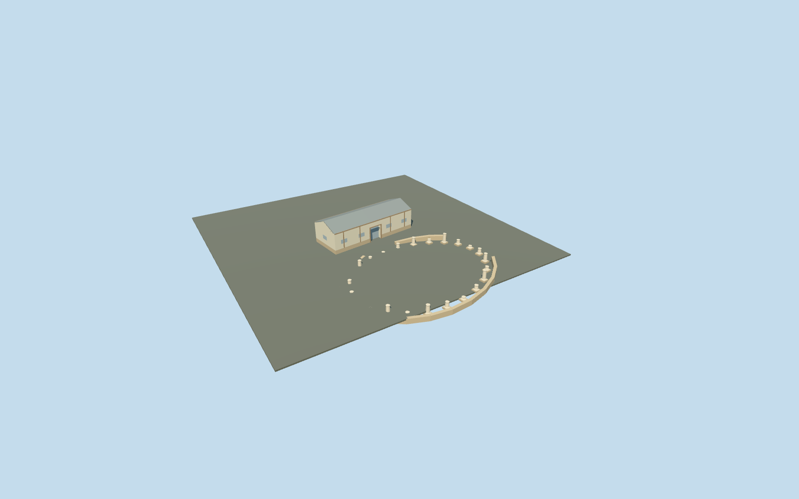

# Xystus portico rooms and oval court remains, Villa Romana del Casale

Xystus north conservation rooms and related oval court remains only. Mapped north rectangle provides exact roof scale; ordinary aerial proportions guide a reconstructed open oval boundary, selected low stone wall remains and24 short column/base remains. The north shelter has pale infill/stone base, grey metal gabled roof, timber support trim and a real south door recess/soffit/threshold. No roof or floor fills the outdoor court: original terrain remains between individual occupied low walls and pads. Main villa/baths, Triclinium, gate piers and two latrines remain independent. No copied mosaics, furnished rooms or invented intact ancient colonnade.

## Evidence and reconstruction

Published dimensions and reconstructed details are separated in spec.json. Primary references:

- [Reference](https://www.villaromanadelcasale.it/)
- [Reference](https://www.sslanzilotti.com/armerina-villa-del-casale)

Xystus north conservation rooms and related oval court remains only. Mapped north rectangle provides exact roof scale; ordinary aerial proportions guide a reconstructed open oval boundary, selected low stone wall remains and24 short column/base remains. The north shelter has pale infill/stone base, grey metal gabled roof, timber support trim and a real south door recess/soffit/threshold. No roof or floor fills the outdoor court: original terrain remains between individual occupied low walls and pads. Main villa/baths, Triclinium, gate piers and two latrines remain independent. No copied mosaics, furnished rooms or invented intact ancient colonnade.

## Model and axes

3,818 triangles; 8,046 vertices; 6 material groups; 339,396 bytes. Native bounds: -11.152, -1.097, -3.865 to 11.150, 4.517, 24.680. Source hash: `sha256:b1ca297622a86e8661af98032b216c5b99c2b1f5c5fe9a8c55fe0c81f476164b`.

{"x":"east","y":"up","z":"south"}

The geographic proposal uses exact-QID OpenStreetMap evidence. Map-derived orientation and estimated architectural details require real-site visual review; preview eligibility is distinct from geographic/fidelity approval. Map attribution: © OpenStreetMap contributors, ODbL-1.0.

## Reproduce

Run `node packages/worldgen/scripts/generate-additional-landmarks.mjs --ids=casale_xystus` (or add `--check`). The generator preserves manually edited masters by checking their baseline hashes. Import through the standard authored-model workflow with optimization disabled; then capture all QA cameras, including shared-surface views.

## Pending work

- Xystus north conservation rooms and related oval court remains only. Mapped north rectangle provides exact roof scale; ordinary aerial proportions guide a reconstructed open oval boundary, selected low stone wall remains and24 short column/base remains. The north shelter has pale infill/stone base, grey metal gabled roof, timber support trim and a real south door recess/soffit/threshold. No roof or floor fills the outdoor court: original terrain remains between individual occupied low walls and pads. Main villa/baths, Triclinium, gate piers and two latrines remain independent. No copied mosaics, furnished rooms or invented intact ancient colonnade.
- Shared site Q505617 and unique building way304818581/native35184676907413 identify the north Xystus conservation rooms. The mapped15.1m by5.7m rectangle sets scale and signed axes: internal +X east/slightly north, +Z south/slightly east toward the open oval court. Native +X east/+Y up/+Z south geometry is baked with heading0. Only this mapped rectangle is replaced. The unroofed oval remains and short column inventory are photo-led approximations within the surrounding open site, not claimed mapped building polygons.
- Photo-led medium-fi conservation exterior, with no qualified mapped heights. Working covered-room floor 544.940m absolute follows the south threshold sample+0.2m; eaves3.6m and ridge4.7m above floor are reconstructed. Approximate oval center internal[-1.5,15], radii11.5/9.4m;24 selected column stubs vary0.42–1.52m and surviving low wall tops follow the original standard ground+0.62m. Counts, surviving wall/gap extents, roof form, room inventories, door position and exact historic floor/paving/accessibility remain unverified. The outdoor court stays open with no copied mosaics or restored full-height colonnade.
- Qualified approximate native exterior fit on original Protomaps20261020/Mapzen 201x201/6m ground. South outside-building provider[0,28] supplies 545.1228036157049m datum. Covered north-room boundary grades -0.885..0.193m, working floor -0.183m and closed foundation -1.035m retain original heights. Minor downhill base exposure/uphill burial remain; the recessed south threshold stays exposed. Each low wall and short column pad follows bilinear samples of the retained grid, with no ground flattening. Forty-one occupied masks retain original terrain in the open oval and its approaches. All42 resident /43 wider independent buildings, roads and empty water layer remain. The approximate oval/column inventory does not overwrite any other mapped building. Exact archaeological layout, doorway/floor/paving levels, surviving wall heights and accessibility remain unverified. No bespoke terrain or survey research.

This bundle follows the medium-fi standard. Medium-fi appearance and geographic fit are reviewed separately. Hash-bound visual acceptance is recorded separately after capture inspection.
