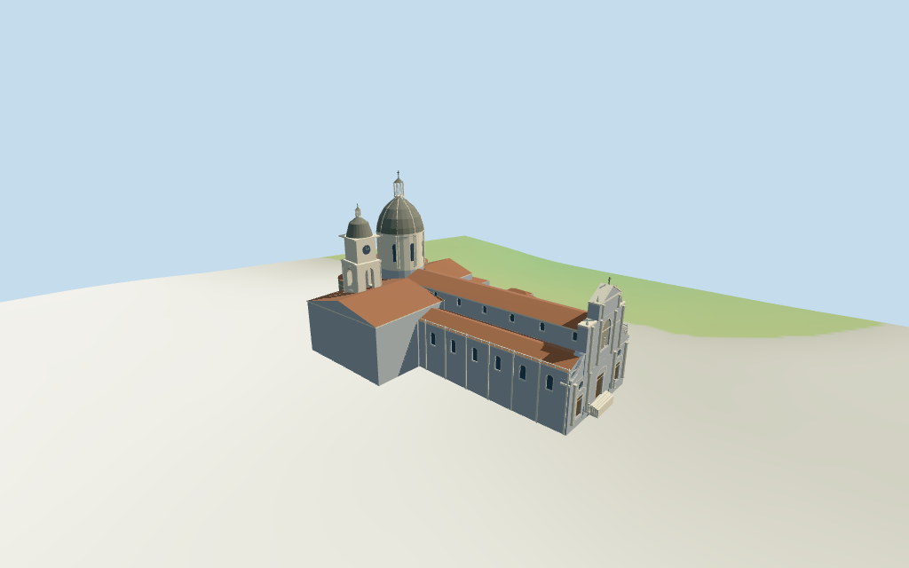

# Catania Cathedral

Individual Catania Cathedral medium-fi exterior: broad blue-grey/pale baroque west facade with three portals,oculi,paired columns,upper niche and pediment/cross;long nave with red roofs and pale bay rhythm;large ribbed drum/dome/lantern,north open belfry/clock/cap tower,three massive medieval lava-stone apses and immediate mapped southern ranges. Shared materials,four browser LODs. Every height and detailed sub-plan is estimated. Exact sculpture/inscriptions,full interior,engineering and neighboring Badia/civic buildings excluded or simplified.

## Evidence and reconstruction

Published dimensions and reconstructed details are separated in spec.json. Primary references:

- [Reference](https://commons.wikimedia.org/wiki/File:Vista_aerea_cupole_catania.jpg)
- [Reference](https://commons.wikimedia.org/wiki/File:Cathedral_Catania_facade.jpg)
- [Reference](https://commons.wikimedia.org/wiki/File:Cattedrale_di_Sant%27Agata_2024a.jpg)
- [Reference](https://commons.wikimedia.org/wiki/File:Catania_-_Cattedrale_-_2018-07-25.jpg)
- [Reference](https://commons.wikimedia.org/wiki/File:Badia_di_Sant%27Agata_(Catania)_06_02_2026_67.jpg)
- [Reference](https://commons.wikimedia.org/wiki/File:Catania_-_Cattedrale_di_Sant%27Agata_absidi.jpg)

Six existing shared256-square lime plaster,continuous limestone,basalt ashlar,ceramic roof tile,painted metal and plain wood graphs serve seven groups including local blue-grey glass. Linear tints,metric UVs and flat architectural normals.No embedded images,unique facade photographs,baked lighting or micro-carving.

## Model and axes

14,403 triangles; 43,209 vertices; 7 material groups; 1,732,572 bytes. Native bounds: -53.477, -2.636, -37.252 to 51.543, 58.000, 35.434. Source hash: `sha256:33a8a2fedb6866ba01ca03160f5f13bb5ff2911b2f5f817494b209510603ac7e`.

{"x":"generally east toward three apses","y":"up","z":"generally south toward attached ranges"}

Standard viewer DEM datum 19.712368m;selected raw perimeter -2.28..2.13m. Floor0.5m,adaptive footings crossY=0 and extend below retained samples. No terrain cutout or flattening. Exact piazza/parvis,steps,door/base joins,absolute altitude and walking remain unverified.

## Reproduce

Run `node packages/worldgen/scripts/generate-additional-landmarks.mjs --ids=N0401` (or add `--check`). The generator preserves manually edited masters by checking their baseline hashes. Import through the standard authored-model workflow with optimization disabled; then capture all QA cameras, including shared-surface views.

## Pending work

- Retained exact way/58102740 and Q1499188 match current whole35184430191572 and its same-ID Catania Cathedral POI. Preserve nine current whole/roof/attached-range controls and all raw coordinates/properties,plus earlier whole/tags. Anchor and heading0.154164150898rad unchanged. +X generally east toward three apses,-X west square-facing baroque facade,-Z north bell tower/transept,+Z south attached ranges. The actual nave follows its oblique mapped roof within this retained native frame;no horizontal rescale. Separate Badia di Sant'Agata,neighboring bishop/civic ranges and piazza remain host content.
- No current mapped height,level or roof-height tags and no independent dimension facts. Every height is a picture estimate above floor0.5m: nave21.5m eaves/24m ridge,aisles15.8/18m,north transept19/23m,south transept18/22m,choir20/23m;three lava-stone apses23/20.5/20.5m walls with shallow caps24/21.5/21.5m. Main drum24..37m,dome48.5m,lantern55m and cross57.5m. North bell tower body20.5m,belfry31.5m,clock stage39.5m,small cap45.3m,lantern48.4m and cross49.5m. West facade tiers12.5/26/30.5m,pediment34m/cross36m. Attached southern ranges12..17m. Detailed component plans,openings,pediments,statuary abstractions,railings and steps are estimates,not measured architectural plans.
- Standard viewer DEM datum 19.712368m;selected raw perimeter -2.28..2.13m. Floor0.5m,adaptive footings crossY=0 and extend below retained samples. No terrain cutout or flattening. Exact piazza/parvis,steps,door/base joins,absolute altitude and walking remain unverified.
- Medium-fi exterior from six inspected pictures and standard viewer map/DEM.All heights and detailed component profiles estimated;no survey dimensions.Fine portal sculpture,figures,inscriptions,exact dome ornament,full interiors/bells,engineering,hidden roof joins,current finish and precise host-ground contact excluded,simplified or unverified.Neighboring Badia/bishop/civic buildings remain separate.Synthetic Italian palazzo neighbors are style fixtures.Physical phone/laptop timing pending.
- Skyline retains three-tier front with oculi,main dome/lantern,north small-cap tower and three curved apses.District adds shared surfaces,front columns/portals,recessed windows,drum ribs and open belfry.Street adds side bay rhythm,parapets and blind apse arches.Close-up/master add sparse figure/clock/column-capital abstractions.

This bundle follows the medium-fi standard. Medium-fi appearance and geographic fit are reviewed separately. Hash-bound visual acceptance is recorded separately after capture inspection.

## Additional geographic data

©OpenStreetMap contributors;Protomaps;Mapzen/USGS terrain tiles.
