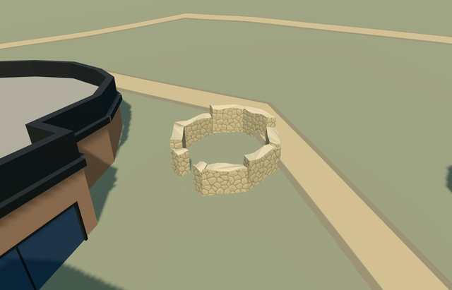

# N0765_EASTLATRINE — eastern latrine masonry draft

Reviewed 2026-10-23. **Incomplete draft. Casale remains 4/6 complete. Automatic placement remains draft.**

## Built and inspected

Detached eastern latrine surviving octagonal masonry only, on its own exact mapped footprint beside the basilica. Low broad rubble walls, irregular broken caps, a reconstructed west-facing entrance gap toward the main villa and a genuinely open center retain original ground. No speculative intact ancient roof, invented conservation canopy, mosaic copy, furnishings, benches or underground plumbing. Main villa, Triclinium, Xystus, entrance and polygonal latrine remain independent. Authored masonry draft, not a completed unique landmark. Existing aerial partly obscures this eastern latrine and does not resolve current roof/conservation-canopy or preservation state. Wall heights, west entrance and hidden faces remain approximations. Do not approve the current roofless interpretation as complete until an ordinary exterior picture supports or corrects it. No bespoke terrain/survey research requested. Full medium-fi distance/time/mode matrix remains pending until exterior scope is settled.

## Materials and LODs

Three material roles share two existing 256px graphs, stone_drywall and stone_limestone_raw. Canonical metric UVs, linear tint, skyline graph means, three textured draws/one skyline. No embedded images/private atlas/new graph; separate vertex streams and equal CPU/GPU accounting. Five authored models (four complete, this one draft) load with nine total graphs, each read once.

| Level | Triangles | Bytes | Draws |
| --- | ---: | ---: | ---: |
| skyline | 216 | 22628 | 1 |
| district | 472 | 53912 | 3 |
| street | 897 | 101260 | 3 |
| closeup | 1943 | 216956 | 3 |

Initial skyline + district geometry: 76540 bytes. Six GLBs: zero Khronos errors/warnings, 138 mesh/contact probes. Selected generation/import/placement, strict budget/style check, scene/sim30 and two-recipe lint pass. Sim30 sha256:79c79b6257800b36a3e162ffa01d9920f6a9b46ba81a859327f07209786e462d. These do not prove the photographed exterior is complete.

## Native placement evidence

Shared park Q505617 identifies the site; independent way304818578/native35184676907410 identifies this eastern latrine. Its eight mapped vertices set meter scale and offsets. Internal +X points east/slightly south away from the villa and +Z follows the western side south/slightly west. Native east/up/south axes are baked with heading 0. Only this one footprint is replaced; the southern polygonal latrine and every other building remain independent. Original Protomaps20261020/Mapzen 201x201 / 6m grid retained. Eastern outside-building provider [4,0] supplies 554.9566939433241m datum. Boundary grades -1.174..-0.130m relative. Nine closed wall segments extend 0.15m below their own boundary minima. Ground masks occupy only masonry; center and west gap retain native ground. Native visual acceptance remains pending. No bespoke terrain or flattening. Native current views show supported wall bases and open center/west gap. All 42 resident / 43 wider independent buildings, original terrain, road inputs and empty water layer remain unchanged. A close native view shows an original path-rendering sliver across the inner wall; exact archaeological pavement/accessibility remain unverified.

One intersecting detailed PMTiles15 case owns only native35184676907410. No intersecting level13/14 building in this extract. Four LODs, failed loading and unload retain original map inputs. Failed loading retains all43 buildings. Five-model combined test retains35 other resident buildings. All runs dispose model geometry and restore ground/water.

## References

- https://www.villaromanadelcasale.it/ — Site operator; individual photographer not specified; Photo date unspecified; No reuse license established; viewed only, no pixels copied. Viewed only; no copied pixels.

- https://www.sslanzilotti.com/armerina-villa-del-casale — Unknown; page labels this aerial an internet photo; Unspecified; No reuse license established; viewed only, no copied pixels. Viewed only; no copied pixels.

- https://www.openstreetmap.org/way/304818578 — eight-vertex footprint; ©OpenStreetMap contributors, ODbL-1.0.

## Completion checklist

- [x] Rebuildable master/import, four authored LODs and existing shared textures.
- [x] Current geometry/material/native images inspected and source/runtime/input hashes verified.
- [x] Only one mapped footprint replaced in explicit tests; open center/approach and independent buildings retained.
- [ ] Resolve actual roof/conservation-canopy and surviving exterior from an ordinary clear picture; correct source geometry as needed.
- [ ] Review native path sliver and record final qualified exterior fit.
- [ ] Finish medium-fi distance/time/mode views after exterior scope is settled.
- [ ] Approve final current model; do not count this draft complete.
