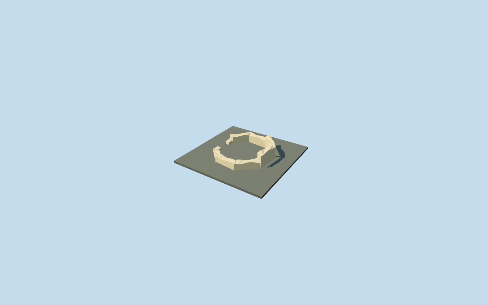

# Eastern latrine masonry remains, Villa Romana del Casale

Detached eastern latrine surviving octagonal masonry only, on its own exact mapped footprint beside the basilica. Low broad rubble walls, irregular broken caps, a reconstructed west-facing entrance gap toward the main villa and a genuinely open center retain original ground. No speculative intact ancient roof, invented conservation canopy, mosaic copy, furnishings, benches or underground plumbing. Main villa, Triclinium, Xystus, entrance and polygonal latrine remain independent.

## Evidence and reconstruction

Published dimensions and reconstructed details are separated in spec.json. Primary references:

- [Reference](https://www.villaromanadelcasale.it/)
- [Reference](https://www.sslanzilotti.com/armerina-villa-del-casale)

Detached eastern latrine surviving octagonal masonry only, on its own exact mapped footprint beside the basilica. Low broad rubble walls, irregular broken caps, a reconstructed west-facing entrance gap toward the main villa and a genuinely open center retain original ground. No speculative intact ancient roof, invented conservation canopy, mosaic copy, furnishings, benches or underground plumbing. Main villa, Triclinium, Xystus, entrance and polygonal latrine remain independent.

## Model and axes

1,943 triangles; 5,829 vertices; 3 material groups; 235,692 bytes. Native bounds: -2.731, -1.324, -2.731 to 2.729, 1.230, 2.729. Source hash: `sha256:006c97eb877e4425c6e88a0fa8ea4b54f958a63f57830007e5711dbc598f3001`.

{"x":"east","y":"up","z":"south"}

The geographic proposal uses exact-QID OpenStreetMap evidence. Map-derived orientation and estimated architectural details require real-site visual review; preview eligibility is distinct from geographic/fidelity approval. Map attribution: © OpenStreetMap contributors, ODbL-1.0.

## Reproduce

Run `node packages/worldgen/scripts/generate-additional-landmarks.mjs --ids=N0765_EASTLATRINE` (or add `--check`). The generator preserves manually edited masters by checking their baseline hashes. Import through the standard authored-model workflow with optimization disabled; then capture all QA cameras, including shared-surface views.

## Pending work

- Detached eastern latrine surviving octagonal masonry only, on its own exact mapped footprint beside the basilica. Low broad rubble walls, irregular broken caps, a reconstructed west-facing entrance gap toward the main villa and a genuinely open center retain original ground. No speculative intact ancient roof, invented conservation canopy, mosaic copy, furnishings, benches or underground plumbing. Main villa, Triclinium, Xystus, entrance and polygonal latrine remain independent.
- Shared park Q505617 identifies the site; independent way304818578/native35184676907410 identifies this eastern latrine. Its eight mapped vertices set meter scale and offsets. Internal +X points east/slightly south away from the villa and +Z follows the western side south/slightly west. Native east/up/south axes are baked with heading 0. Only this one footprint is replaced; the southern polygonal latrine and every other building remain independent.
- Medium-fi surviving masonry interpretation from existing ordinary aerial context and exact map outline. The tiny eastern polygon is partly obscured in the aerial; wall heights, hidden faces, west entrance position/width and fracture pattern are unmeasured approximations. Working wall tops vary 1.08–1.46m above local standard ground; inner face is a 0.79 radial inset. No qualified map height. Roof or conservation-canopy state is not resolved by this picture, so no roof is reconstructed. Exact archaeological paving, thresholds, preservation state and accessibility remain unverified.
- Original Protomaps20261020/Mapzen 201x201 / 6m grid retained. Eastern outside-building provider [4,0] supplies 554.9566939433241m datum. Boundary grades -1.174..-0.130m relative. Nine closed wall segments extend 0.15m below their own boundary minima. Ground masks occupy only masonry; center and west gap retain native ground. Native visual acceptance remains pending. No bespoke terrain or flattening.

This bundle follows the medium-fi standard. Medium-fi appearance and geographic fit are reviewed separately. Hash-bound visual acceptance is recorded separately after capture inspection.
