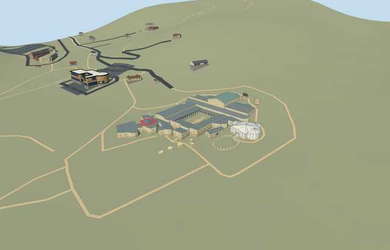

# N0765_ENTRY — Casale monumental entrance remains

Reviewed2026-10-23. **Completed medium-fi four-pier entrance; qualified approximate native fit. Collection N0765 is4/6 complete.**

## Built and inspected

Four integral surviving ancient entrance piers on their four mapped footprints: low broad tapered rubble bodies, fractured caps and a taller narrow surviving remnant connected into the eastern pier. Three real open passages retain lawn and paths. Ordinary official entrance picture and retained aerial context plus standard PMTiles/Mapzen guide one continuous author/inspect pass. No invented intact arches, lintels, roof or paved platform. Main villa/baths, Triclinium and Xystus load together with the entrance; the two latrines remain unapproved procedural context.

## Shared materials and LODs

Three material roles share two existing256px graphs: stone_drywall for rubble, stone_limestone_raw for broken tops and foundation tint variants. Canonical metric UVs, sRGB-to-linear tint and baked graph means for skyline; three textured draws/one skyline. No embedded image, private atlas or new graph. Separate vertex streams and equal CPU/GPU geometry bytes. The four-model site uses nine existing shared graphs, each read once. Flat portable/shared/synthetic planes intersect some grade-specific bases or expose mask patches; unchanged native terrain supplies ground-fit evidence.

| Level | Triangles | Bytes | Draws |
| --- | ---: | ---: | ---: |
| skyline | 188 | 19076 | 1 |
| district | 620 | 68136 | 3 |
| street | 1316 | 145044 | 3 |
| closeup | 2769 | 306336 | 3 |

Four authored LODs 188 / 620 / 1316 / 2769 triangles; initial skyline+district geometry 87212 bytes, closeup 306336 bytes. Six GLBs zero Khronos errors/warnings;90 actual mesh/contact probes; four intersecting detailed PMTiles15 cases/four distinct owned records. No intersecting level13/14 building in this extract. Inspected49 current portable/shared/medium-fi/native frames including a four-model overview. Individual LOD/failure/unload preserves39 resident /40 wider independent buildings, original201x201/6m terrain, roads, empty water layer and all three open passages/approaches. Failure retains all43 originals including four owned piers. Combined loading preserves36 other resident buildings and nine shared graphs read once; all runs restore ground/water and dispose model geometry.

## Geographic fit

Shared site Q505617 identifies this ancient entrance within park way304804695. Four integral piers are independently mapped as ways304818582,304818577,304818576 and304818580/native35184676907414,35184676907409,35184676907408 and35184676907412. Anchor uses the inner eastern pier way304818576; the other three retain their exact offsets. Internal +X follows the outer-pier row east/slightly south and +Z points south/slightly west across the approach. Native east/up/south axes are baked with heading0. Only the four pier records are replaced; all three passages and every other mapped building remain. Qualified approximate native exterior fit on original Protomaps20261020/Mapzen 201x201/6m ground. Open front provider[-4,7] supplies542.9866028097036m datum. Four-pier boundary grades -0.640..+0.678m relative; individual closed footings sit0.16m below their own boundary minima and rubble bases follow local center ground+0.06m. Current native views show supported broken piers with minor base exposure/burial, three clear passages and unchanged lawn/path approaches. Only the four occupied footprints are masked; all39 resident /40 wider independent buildings, original ground/roads and empty water layer remain. Exact archaeological heights, fractures, stone inventories, thresholds/paving and accessibility are unverified. No intact arch reconstruction, bespoke terrain or flattening.

## Fidelity and limits

Photo-led medium-fi broken masonry exterior. No qualified mapped heights. Working low-body heights west-to-east1.75/2.15/2.30/1.90m, with a4.05m narrow remnant at the eastern pier, follow the ordinary entrance picture as approximate visual controls. Bases follow the original standard terrain; top erosion and rubble facets are original reconstructed geometry. Exact historic elevations, surviving fracture patterns, stone/block inventories and hidden faces are unverified. Do not infer intact arches or copied inscriptions from this model. Qualified approximate native exterior fit on original Protomaps20261020/Mapzen 201x201/6m ground. Open front provider[-4,7] supplies542.9866028097036m datum. Four-pier boundary grades -0.640..+0.678m relative; individual closed footings sit0.16m below their own boundary minima and rubble bases follow local center ground+0.06m. Current native views show supported broken piers with minor base exposure/burial, three clear passages and unchanged lawn/path approaches. Only the four occupied footprints are masked; all39 resident /40 wider independent buildings, original ground/roads and empty water layer remain. Exact archaeological heights, fractures, stone inventories, thresholds/paving and accessibility are unverified. No intact arch reconstruction, bespoke terrain or flattening. Meets the current medium-fi exterior standard. Stone texture and small facets suggest rubble rather than reconstructing individual surviving stones. Exact heights, historic details, hidden faces and accessibility remain unverified. No copied inscriptions or furnished interiors. Physical phone/laptop and dense-city timings remain pending.

## Targeted checks

Selected generation/import/placement, strict medium-fi, scene/sim30 and two-recipe lint pass. Sim30 sha256:296b99e50860875782f3491a9dcdecadf4e51fadcc01fbfec329c7accf149b46. Current pins: [qa.json](qa.json); [source controls](map-frame.json).

## Viewed references

- https://www.sslanzilotti.com/armerina-villa-del-casale — Unknown; page labels this aerial an internet photo; Unspecified; No reuse license established; viewed only, no copied pixels. Viewed only; no copied pixels.

- https://www.villaromanadelcasale.it/portfolio_category/virtual-tour-aereo/ — Site operator; individual photographer not specified; Unspecified; Viewed only; no pixels copied. Viewed only; no copied pixels.

- OpenStreetMap ways304818582,304818577,304818576,304818580 — four integral pier footprints; ©OpenStreetMap contributors, ODbL-1.0. Park way304804695 is collection identity. Standard PMTiles/Mapzen only.

## Completion checklist

- [x] Rebuildable master/import, four authored LODs and existing shared materials.
- [x] Current exterior/context/native renders and geometry inspected.
- [x] Four exact footprints, explicit orientation and qualified native fit.
- [x] Open passages/independent buildings/roads/terrain retained; failed load/unload restoration checked.
- [ ] Two eastern latrines remain required independent models.
