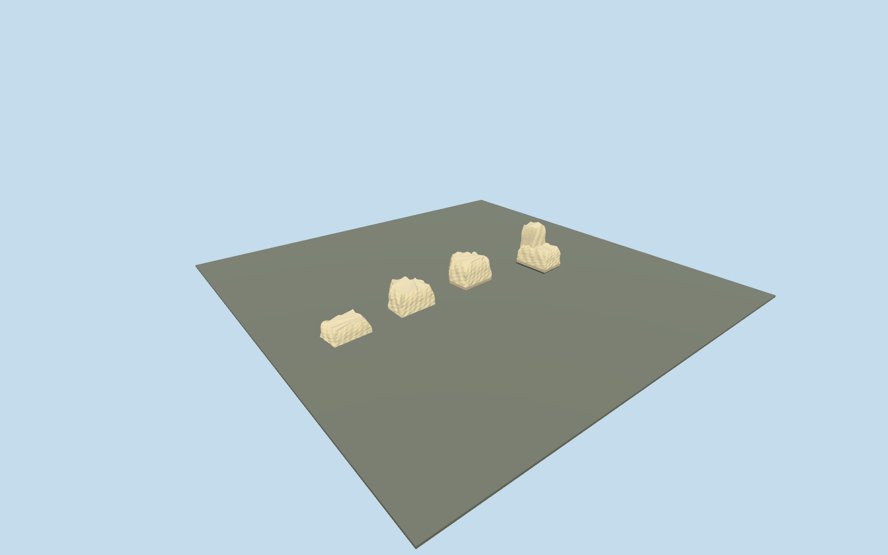

# Monumental entrance remains, Villa Romana del Casale

Four integral surviving monumental entrance piers only, placed on their four actual mapped footprints. Model low broad irregular rubble bodies, fractured tops and a taller narrow eastern wall remnant from the ordinary official entrance photograph. Three passages, lawn and paths remain open. No intact triumphal arches, reconstructed lintels, entrance roof or invented paved platform. Main villa/baths, Triclinium, Xystus and two latrines remain independent. Unmapped surrounding courtyard columns/walls, signage and site furniture remain context.

## Evidence and reconstruction

Published dimensions and reconstructed details are separated in spec.json. Primary references:

- [Reference](https://www.sslanzilotti.com/armerina-villa-del-casale)
- [Reference](https://www.villaromanadelcasale.it/portfolio_category/virtual-tour-aereo/)

Four integral surviving monumental entrance piers only, placed on their four actual mapped footprints. Model low broad irregular rubble bodies, fractured tops and a taller narrow eastern wall remnant from the ordinary official entrance photograph. Three passages, lawn and paths remain open. No intact triumphal arches, reconstructed lintels, entrance roof or invented paved platform. Main villa/baths, Triclinium, Xystus and two latrines remain independent. Unmapped surrounding courtyard columns/walls, signage and site furniture remain context.

## Model and axes

2,769 triangles; 8,307 vertices; 3 material groups; 334,812 bytes. Native bounds: -17.465, -0.800, -2.017 to 10.086, 4.808, 4.659. Source hash: `sha256:4b17fa12416b8b5c5b5ffdc997233bb3a503c7660184bbe8d89812cb2ba589d6`.

{"x":"east","y":"up","z":"south"}

The geographic proposal uses exact-QID OpenStreetMap evidence. Map-derived orientation and estimated architectural details require real-site visual review; preview eligibility is distinct from geographic/fidelity approval. Map attribution: © OpenStreetMap contributors, ODbL-1.0.

## Reproduce

Run `node packages/worldgen/scripts/generate-additional-landmarks.mjs --ids=N0765_ENTRY` (or add `--check`). The generator preserves manually edited masters by checking their baseline hashes. Import through the standard authored-model workflow with optimization disabled; then capture all QA cameras, including shared-surface views.

## Pending work

- Four integral surviving monumental entrance piers only, placed on their four actual mapped footprints. Model low broad irregular rubble bodies, fractured tops and a taller narrow eastern wall remnant from the ordinary official entrance photograph. Three passages, lawn and paths remain open. No intact triumphal arches, reconstructed lintels, entrance roof or invented paved platform. Main villa/baths, Triclinium, Xystus and two latrines remain independent. Unmapped surrounding courtyard columns/walls, signage and site furniture remain context.
- Shared site Q505617 identifies this ancient entrance within park way304804695. Four integral piers are independently mapped as ways304818582,304818577,304818576 and304818580/native35184676907414,35184676907409,35184676907408 and35184676907412. Anchor uses the inner eastern pier way304818576; the other three retain their exact offsets. Internal +X follows the outer-pier row east/slightly south and +Z points south/slightly west across the approach. Native east/up/south axes are baked with heading0. Only the four pier records are replaced; all three passages and every other mapped building remain.
- Photo-led medium-fi broken masonry exterior. No qualified mapped heights. Working low-body heights west-to-east1.75/2.15/2.30/1.90m, with a4.05m narrow remnant at the eastern pier, follow the ordinary entrance picture as approximate visual controls. Bases follow the original standard terrain; top erosion and rubble facets are original reconstructed geometry. Exact historic elevations, surviving fracture patterns, stone/block inventories and hidden faces are unverified. Do not infer intact arches or copied inscriptions from this model.
- Qualified approximate native exterior fit on original Protomaps20261020/Mapzen 201x201/6m ground. Open front provider[-4,7] supplies542.9866028097036m datum. Four-pier boundary grades -0.640..+0.678m relative; individual closed footings sit0.16m below their own boundary minima and rubble bases follow local center ground+0.06m. Current native views show supported broken piers with minor base exposure/burial, three clear passages and unchanged lawn/path approaches. Only the four occupied footprints are masked; all39 resident /40 wider independent buildings, original ground/roads and empty water layer remain. Exact archaeological heights, fractures, stone inventories, thresholds/paving and accessibility are unverified. No intact arch reconstruction, bespoke terrain or flattening.

This bundle follows the medium-fi standard. Medium-fi appearance and geographic fit are reviewed separately. Hash-bound visual acceptance is recorded separately after capture inspection.
