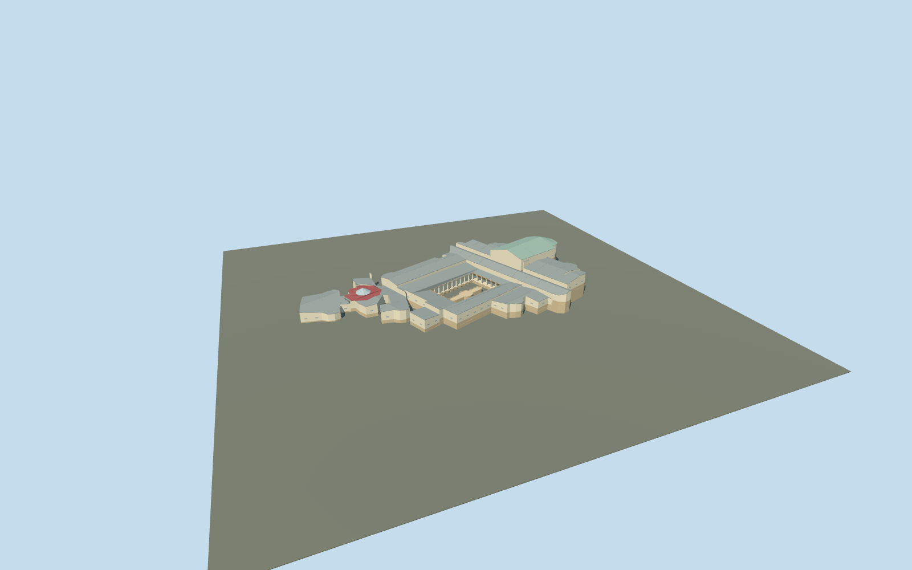

# Villa Romana del Casale, main villa and bath conservation complex

Main connected villa and baths conservation complex only: mapped apsidal room outline and open rectangular peristyle, 32 near-view columns, shallow dry courtyard fountain, pale infill above weathered stone ruins, grey standing-seam roofs, higher basilica/Great Hunt ranges, stepped western baths and red octagonal frigidarium roof with faceted skylight. Triclinium, Xystus rooms/court, entrance remains and two eastern latrines are separate required models. Figurative mosaics, temporary art, furniture, signage and surrounding archaeological park are not copied into this exterior model.

## Evidence and reconstruction

Published dimensions and reconstructed details are separated in spec.json. Primary references:

- [Reference](https://www.villaromanadelcasale.it/)
- [Reference](https://www.villaromanadelcasale.it/portfolio_category/virtual-tour-aereo/)
- [Reference](https://www.sslanzilotti.com/armerina-villa-del-casale)

Main connected villa and baths conservation complex only: mapped apsidal room outline and open rectangular peristyle, 32 near-view columns, shallow dry courtyard fountain, pale infill above weathered stone ruins, grey standing-seam roofs, higher basilica/Great Hunt ranges, stepped western baths and red octagonal frigidarium roof with faceted skylight. Triclinium, Xystus rooms/court, entrance remains and two eastern latrines are separate required models. Figurative mosaics, temporary art, furniture, signage and surrounding archaeological park are not copied into this exterior model.

## Model and axes

11,126 triangles; 23,970 vertices; 7 material groups; 1,000,844 bytes. Native bounds: -68.820, -1.480, -39.215 to 54.344, 15.897, 28.181. Source hash: `sha256:9438959e6e82b460a05bf7f43a3e06bcd8533b35f93fc7bc157eaec3d8a0f5a5`.

{"x":"east","y":"up","z":"south"}

The geographic proposal uses exact-QID OpenStreetMap evidence. Map-derived orientation and estimated architectural details require real-site visual review; preview eligibility is distinct from geographic/fidelity approval. Map attribution: © OpenStreetMap contributors, ODbL-1.0.

## Reproduce

Run `node packages/worldgen/scripts/generate-additional-landmarks.mjs --ids=N0765_MAIN` (or add `--check`). The generator preserves manually edited masters by checking their baseline hashes. Import through the standard authored-model workflow with optimization disabled; then capture all QA cameras, including shared-surface views.

## Pending work

- Main connected villa and baths conservation complex only: mapped apsidal room outline and open rectangular peristyle, 32 near-view columns, shallow dry courtyard fountain, pale infill above weathered stone ruins, grey standing-seam roofs, higher basilica/Great Hunt ranges, stepped western baths and red octagonal frigidarium roof with faceted skylight. Triclinium, Xystus rooms/court, entrance remains and two eastern latrines are separate required models. Figurative mosaics, temporary art, furniture, signage and surrounding archaeological park are not copied into this exterior model.
- Q505617 identifies the archaeological park way304804695; it is not a building footprint. This independent member uses the actual main covered building relation4063362/native52776562196610, including its four-point peristyle hole. Internal X follows the long court axis east-northeast toward the basilica; internal Z points south-southeast. Native east/up/south geometry is baked with heading0. Only the main covered footprint is replaced; all detached site buildings remain independent.
- Photo-led medium-fi conservation exterior. No qualified mapped heights. Working absolute floor terraces: western baths543.2m, frigidarium544.2m, peristyle545.5m, north rooms547.4m, Great Hunt548.0m, eastern rooms549.2m and basilica551.0m. These roughly follow the retained standard DEM and photographed stepped roofscape; they are reconstructed working levels, not measured ancient floors. Shelter eaves3.5–6m above their working floor and simple gables/faceted apses/skylight preserve roof forms. Wall and roof subdivisions, room inventories, exact glazing/beam spacing and unseen elevations are approximate. Shared geometric tile flooring is a generic tonal proxy, not a recreation of the villa mosaics.
- Qualified approximate native exterior fit on original Protomaps20261020/Mapzen 201x201/6m terrain. Outside-building provider internal[-20,24] supplies the 544.1027338337185m datum. Main boundary grades -1.330..10.799m require reconstructed working terraces (543.2–551.0m absolute), pale infill and closed foundations at -1.480m relative. Current native views show connected shelters, open peristyle/column bays, clear outside approaches and supported low baths; downhill foundation and partial uphill base burial remain visible. The dry courtyard basin is an approximate raised exterior proxy. Exact excavated floors, paving/stairs, water state, historic room levels and accessible transitions are unverified. Five occupied masks cover only the main building minus its courtyard plus the basin; original courtyard garden and approaches remain. Preserve all 42 resident / 43 wider independent buildings, original ground/roads and empty native water layer. No bespoke terrain or flattening.

This bundle follows the medium-fi standard. Medium-fi appearance and geographic fit are reviewed separately. Hash-bound visual acceptance is recorded separately after capture inspection.
