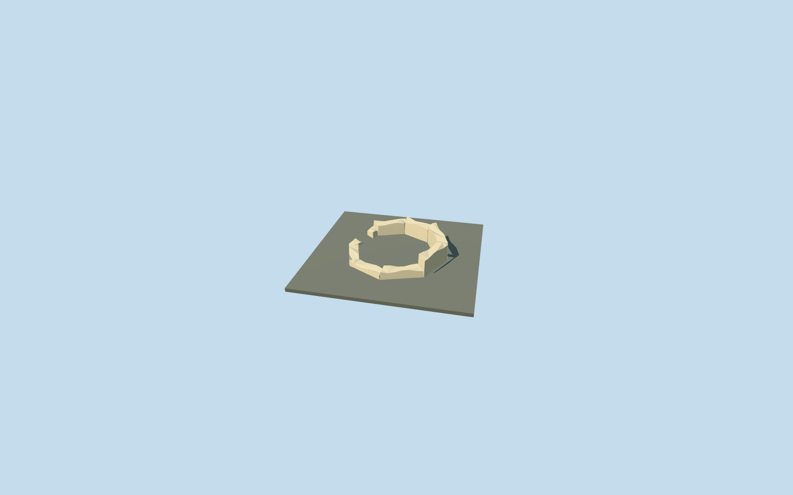

# Polygonal latrine remains, Villa Romana del Casale

Detached southern polygonal latrine remains, on its own exact eight-sided mapped footprint east of the southern apartments. Low broad rubble walls, irregular broken caps, a reconstructed west-facing entrance gap toward the main villa and a genuinely open center retain original ground. No speculative intact ancient roof, invented conservation canopy, mosaic copy, furnishings, benches or underground plumbing. Main villa, Triclinium, Xystus, entrance and the northern east-latrine draft remain independent.

## Evidence and reconstruction

Published dimensions and reconstructed details are separated in spec.json. Primary references:

- [Reference](https://www.villaromanadelcasale.it/)
- [Reference](https://www.sslanzilotti.com/armerina-villa-del-casale)

Detached southern polygonal latrine remains, on its own exact eight-sided mapped footprint east of the southern apartments. Low broad rubble walls, irregular broken caps, a reconstructed west-facing entrance gap toward the main villa and a genuinely open center retain original ground. No speculative intact ancient roof, invented conservation canopy, mosaic copy, furnishings, benches or underground plumbing. Main villa, Triclinium, Xystus, entrance and the northern east-latrine draft remain independent.

## Model and axes

1,924 triangles; 5,772 vertices; 3 material groups; 233,408 bytes. Native bounds: -2.849, -1.091, -2.849 to 2.848, 1.141, 2.848. Source hash: `sha256:500f508514321456df9211c4f6c33142eceb2753741f02efc6d14a239c451941`.

{"x":"east","y":"up","z":"south"}

The geographic proposal uses exact-QID OpenStreetMap evidence. Map-derived orientation and estimated architectural details require real-site visual review; preview eligibility is distinct from geographic/fidelity approval. Map attribution: © OpenStreetMap contributors, ODbL-1.0.

## Reproduce

Run `node packages/worldgen/scripts/generate-additional-landmarks.mjs --ids=N0765_POLYGONALLATRINE` (or add `--check`). The generator preserves manually edited masters by checking their baseline hashes. Import through the standard authored-model workflow with optimization disabled; then capture all QA cameras, including shared-surface views.

## Pending work

- Detached southern polygonal latrine remains, on its own exact eight-sided mapped footprint east of the southern apartments. Low broad rubble walls, irregular broken caps, a reconstructed west-facing entrance gap toward the main villa and a genuinely open center retain original ground. No speculative intact ancient roof, invented conservation canopy, mosaic copy, furnishings, benches or underground plumbing. Main villa, Triclinium, Xystus, entrance and the northern east-latrine draft remain independent.
- Shared park Q505617 identifies the site; independent way412339872/native35184784428704 identifies this separate southern polygonal latrine. Its eight mapped vertices set meter scale and offsets. Internal +X points east-southeast away from the villa and +Z follows the western side south-southwest. Native east/up/south axes are baked with heading 0. Only this one footprint is replaced; the northern eastern latrine and every other building remain independent.
- Photo-led medium-fi surviving masonry exterior. Existing ordinary aerial shows this southern detached polygon as an open dark center bounded by a low pale rim, beside the southern apartments and inside the path. No roof covers that visible center. Exact mapped outer polygon sets scale; inner face is a reconstructed 0.79 radial inset. Working wall tops vary 0.88–1.12m above local original terrain. Wall heights, west gap position/width, thickness, fracture pattern and unseen faces are unmeasured approximations. No qualified map height; exact excavated floor/paving, benches/drains and accessibility are unverified. No roof, mosaic copy, furnished interior or subterranean reconstruction.
- Qualified approximate native exterior fit on original Protomaps20261020/Mapzen 201x201 / 6m ground. Open eastern provider [4,0] supplies 554.4101060817029m datum. Boundary grades -0.941..+0.026m; each of nine closed masonry bases extends 0.15m below its own footprint minimum. Current native views show supported low walls with modest grade-related exposure/burial, a clear west gap and original open center/approaches. Only masonry strips mask terrain; all 42 resident / 43 wider independent buildings, original grid/roads and empty water layer remain. Exact archaeological floor/paving, thresholds, wall preservation and accessibility are unverified. No bespoke terrain or flattening.

This bundle follows the medium-fi standard. Medium-fi appearance and geographic fit are reviewed separately. Hash-bound visual acceptance is recorded separately after capture inspection.
