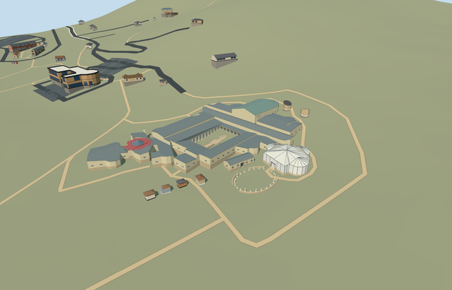

# N0765_XYSTUS — Casale Xystus rooms and open court

Reviewed 2026-10-23. **Completed medium-fi covered rooms/open-court remains; qualified approximate native fit. Collection N0765 is 3/6 complete.**

## Built and inspected

Xystus north conservation rooms and related open oval court remains: exact mapped north rectangle, pale infill/stone base, grey metal gabled roof and timber trim, small opaque window proxies and a genuine0.65m south door recess/soffit/threshold. Photo-led oval perimeter uses16 low wall strips and24 short column/base remains, each following original ground. No floor or roof covers the outdoor court. Ordinary aerials and standard PMTiles/Mapzen guided one continuous author/inspect pass. Changed the outside terrain reference from a lower western point to open southern ground while preserving absolute model heights. Main villa/baths and Triclinium load together with this member; gate and latrines remain unapproved procedural context.

## Shared materials and LODs

Seven roles use six existing256px graphs: plaster_lime, stone_limestone_raw (low masonry/column tint variants), metal_standing_seam, wood_plain, storefront and tile_mosaic. Canonical metric UVs, sRGB-to-linear tint and baked graph means for skyline; six textured draws/one skyline. No embedded image, private atlas or new graph. Separate vertex streams and equal CPU/GPU geometry bytes. All six graphs are already used by the completed main complex; the three-model scene still uses eight total graphs, each read once. Flat portable/shared/synthetic test grounds intersect some grade-specific bases and expose mask patches; native terrain captures supply the ground-fit evidence.

| Level | Triangles | Bytes | Draws |
| --- | ---: | ---: | ---: |
| skyline | 750 | 77644 | 1 |
| district | 1636 | 141320 | 6 |
| street | 2378 | 197768 | 6 |
| closeup | 3818 | 318728 | 6 |

Four authored LODs 750 / 1636 / 2378 / 3818 triangles; initial skyline+district geometry 218964 bytes, closeup 318728 bytes. Six GLBs zero Khronos errors/warnings; 457 actual mesh/contact probes; two actual intersecting PMTiles14/15 cases, one detailed owned rectangle. No level13 building intersects that mask in this extract. Generalized-area checks retain a1e-3m² area tolerance and skip point probes in sub1e-4m² micrometre-rounding fragments. Inspected49 current portable/shared/medium-fi/native frames including a three-model native overview. Individual LOD/failure/unload preserves42 resident /43 wider independent buildings, original201x201/6m terrain/roads/empty water layer, open oval ground and approaches. Failure keeps all43 originals. Combined loading preserves40 other resident buildings and eight shared graphs read once; both scenes restore ground/water and dispose all model geometry.

## Geographic fit

Shared site Q505617 and unique building way304818581/native35184676907413 identify the north Xystus conservation rooms. The mapped15.1m by5.7m rectangle sets scale and signed axes: internal +X east/slightly north, +Z south/slightly east toward the open oval court. Native +X east/+Y up/+Z south geometry is baked with heading0. Only this mapped rectangle is replaced. The unroofed oval remains and short column inventory are photo-led approximations within the surrounding open site, not claimed mapped building polygons. Qualified approximate native exterior fit on original Protomaps20261020/Mapzen 201x201/6m ground. South outside-building provider[0,28] supplies 545.1228036157049m datum. Covered north-room boundary grades -0.885..0.193m, working floor -0.183m and closed foundation -1.035m retain original heights. Minor downhill base exposure/uphill burial remain; the recessed south threshold stays exposed. Each low wall and short column pad follows bilinear samples of the retained grid, with no ground flattening. Forty-one occupied masks retain original terrain in the open oval and its approaches. All42 resident /43 wider independent buildings, roads and empty water layer remain. The approximate oval/column inventory does not overwrite any other mapped building. Exact archaeological layout, doorway/floor/paving levels, surviving wall heights and accessibility remain unverified. No bespoke terrain or survey research.

## Fidelity and limits

Photo-led medium-fi conservation exterior, with no qualified mapped heights. Working covered-room floor 544.940m absolute follows the south threshold sample+0.2m; eaves3.6m and ridge4.7m above floor are reconstructed. Approximate oval center internal[-1.5,15], radii11.5/9.4m;24 selected column stubs vary0.42–1.52m and surviving low wall tops follow the original standard ground+0.62m. Counts, surviving wall/gap extents, roof form, room inventories, door position and exact historic floor/paving/accessibility remain unverified. The outdoor court stays open with no copied mosaics or restored full-height colonnade. Qualified approximate native exterior fit on original Protomaps20261020/Mapzen 201x201/6m ground. South outside-building provider[0,28] supplies 545.1228036157049m datum. Covered north-room boundary grades -0.885..0.193m, working floor -0.183m and closed foundation -1.035m retain original heights. Minor downhill base exposure/uphill burial remain; the recessed south threshold stays exposed. Each low wall and short column pad follows bilinear samples of the retained grid, with no ground flattening. Forty-one occupied masks retain original terrain in the open oval and its approaches. All42 resident /43 wider independent buildings, roads and empty water layer remain. The approximate oval/column inventory does not overwrite any other mapped building. Exact archaeological layout, doorway/floor/paving levels, surviving wall heights and accessibility remain unverified. No bespoke terrain or survey research. Meets the current medium-fi exterior standard. Mapped north-room footprint is controlled; oval size, low-wall gaps/counts and surviving column inventory are approximate exterior interpretations, not a measured archaeological reconstruction. Windows/backed door are opaque proxies; no copied figurative mosaics or furnished rooms. Flat review terrain is not suitable for judging the native grade-specific low bases. Physical phone/laptop and dense-city timings remain pending.

## Targeted checks

Selected generation/import/placement, strict medium-fi, scene/sim30 pass. Sim30 sha256:533f537c3413290b9313363421c396d160212e0a8be6b2ec2b9f6a682ee1d2a5. Current pins: [qa.json](qa.json); [source controls](map-frame.json).

## Viewed references

- https://www.villaromanadelcasale.it/ — Site operator; individual photographer not specified; Photo date unspecified; No reuse license established; viewed only, no pixels copied. Viewed only; no copied pixels.

- https://www.sslanzilotti.com/armerina-villa-del-casale — Unknown; page labels this aerial an internet photo; Unspecified; No reuse license established; viewed only, no copied pixels. Viewed only; no copied pixels.

- https://www.openstreetmap.org/way/304818581 — independent north-room building rectangle; ©OpenStreetMap contributors, ODbL-1.0. Park way304804695 is collection identity, not a building footprint. Standard PMTiles/Mapzen only.

## Completion checklist

- [x] Rebuildable master/import, four authored LODs and shared materials.
- [x] Current exterior/context/native renders and geometry inspected.
- [x] Explicit independent-building identity/orientation and qualified native exterior fit.
- [x] Approaches/independent buildings/roads/terrain retained; failed loading/unload restoration checked.
- [ ] Entrance piers and two latrines remain three required independent models.
