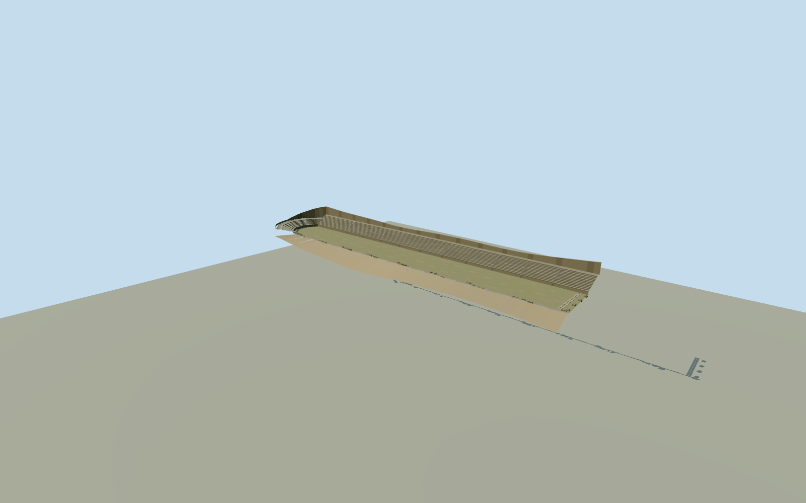

# Stadium of Delphi

The surviving stone banks of the Stadium of Delphi, sloped north seating, curved west end and eroded south wall around the open running surface.

Authoring state: **review-in-qa.json**. Current completion evidence is in [qa.json](qa.json) and the [completion ledger](../../../../qualla-structures/batches/qualla-003.PROGRESS.md).

- [Stadium of Delphi](https://qualla.com/stadium-of-delphi/)

The model represents the surviving remains in 2012. The exact Qualla photo and the archaeological account control the stepped north and west outline and ruined southern and eastern edges.

The source elevation field is preserved. It slopes across the excavated track by several metres. The modeled running surface and seat section use an approximate level inside a footprint-bounded terrain opening.

Individual stone positions, portions of the upper wall, and the heights and condition of eroded remains and entrance bases are approximate. The eastern arch has not been reconstructed.

Build: `node content/worldgen/source/places/sq/sqz/stadium_of_delphi/models/generate-stadium-of-delphi.mjs`. Add `--check` to verify exact regeneration. 3498 triangles; 3 materials; no embedded photographs.
