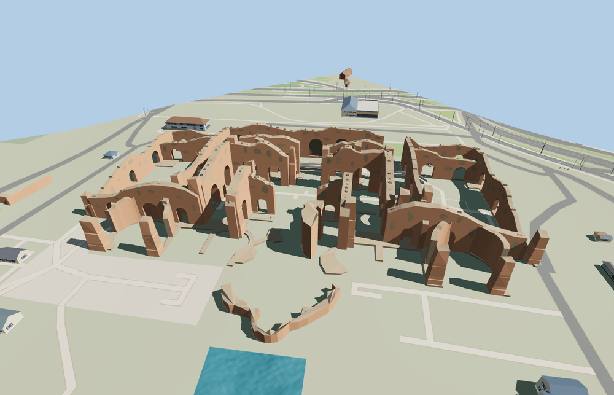

# Baths of Caracalla

The roofless Baths of Caracalla follow the mapped Roman bath block. The paired palaestrae surround a tall open frigidarium with deep brick arches and exposed piers. The dry natatio, curving rooms, detached caldarium fragments and surviving enclosure walls preserve the site’s uneven silhouette.

The 25,878-triangle source rebuilds byte for byte. Skyline, district, street and close-up use 913, 4,000, 11,742, 19,958 triangles. Skyline and district total 459,888 bytes. Six GLBs validated and 36 current views were inspected.

Six mapped room controls remain open to the sky and two frigidarium arch probes pass at every level. The skyline has ten checked pier contacts. Each nearer tier has 19. The ten authored ruin features replace their procedural building footprints while 48 unrelated buildings and all 203 mapped transportation records remain. Failed model loads retain all native buildings.

The visible ruins follow the mapped exterior rings and courtyards. Upper wall profiles, arch dimensions and surviving fabric are modeled from current photographs. The baths remain open to the sky. The source represents standing fabric and visible perimeter remnants, with underground rooms and lost roofs outside the scope. Footings meet the standard viewer terrain. Small excavated grade changes and individual masonry courses are approximated.

Rebuild with `node packages/worldgen/scripts/generate-caracalla-baths.mjs`. Append `--check` to compare exact bytes. Use `--ids=baths_of_caracalla` for targeted import, LOD, placement and readiness.
