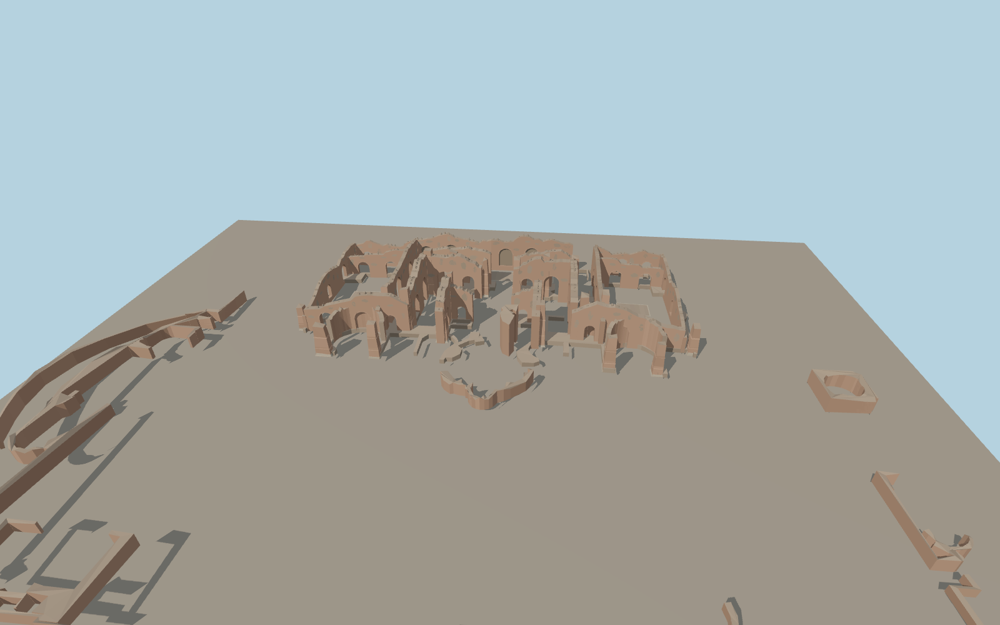

# Baths of Caracalla

The roofless Baths of Caracalla follow the mapped Roman bath block. The paired palaestrae surround a tall open frigidarium with deep brick arches and exposed piers. The dry natatio, curving rooms, detached caldarium fragments and surviving enclosure walls preserve the site’s uneven silhouette.

Run `node packages/worldgen/scripts/generate-caracalla-baths.mjs` to rebuild the source master. Append `--check` to compare the exact bytes. Use `--ids=baths_of_caracalla` for targeted import, LOD generation and placement.

The visible ruins follow the mapped exterior rings and courtyards. Upper wall profiles, arch dimensions and surviving fabric are modeled from current photographs.

The baths remain open to the sky. The source represents standing fabric and visible perimeter remnants, with underground rooms and lost roofs outside the scope.

Footings meet the standard viewer terrain. Small excavated grade changes and individual masonry courses are approximated.

Original geometry follows the repository license. Map data is © OpenStreetMap contributors under ODbL-1.0 via Protomaps. Terrain samples are described in terrain-grid.json. Ordinary pictures stay local and are not redistributed or used as textures. Current acceptance is recorded in qa.json.
