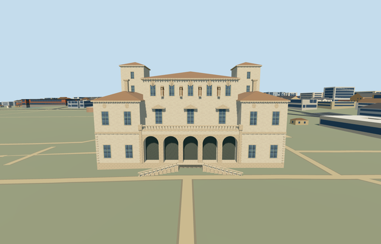

# galleria_borghese — Galleria Borghese

Reviewed 2026-10-23. **Completed medium-fi exterior; qualified approximate native fit.**

## Built

The mapped connected villa has five real round-arch loggia bays with recessed gates, a closed raised floor and curved soffits, paired descending entrance flights and continuous sloping rails. The recessed central block, lower front wings, broad rear range and twin square towers have separate terracotta hip roofs. Window hoods, niches, oval medallions and balustrades use simple original geometry. Nearby park buildings remain independent.

Six roles share six existing 256px graphs: stucco, limestone, ceramic tile, storefront, painted metal and plain wood. Metric UVs, linear tints, separate vertex streams and equal CPU/GPU geometry accounting. No embedded images, private atlas or new graph.

| LOD | Triangles | Bytes | Draws |
| --- | ---: | ---: | ---: |
| skyline | 778 | 70,972 | 1 |
| district | 1,892 | 174,952 | 5 |
| street | 4,560 | 422,852 | 6 |
| closeup | 6,078 | 564,376 | 6 |

Initial skyline + district geometry is **245,924 bytes**. Skyline retains the complete roof/tower envelope, five arch bays and coarse paired stair flights.

## Placement and limits

Q841506 and the named museum POI identify parent [way50842218](https://www.openstreetmap.org/way/50842218), native35184422931050. Its eight-vertex footprint controls scale and orientation. Anchor [12.49206930398941,41.914078240900324]; baked east/up/south axes, heading 0. Internal X follows the frontage east-southeast; Z points southwest toward the piazzale. Controls: [map-frame.json](map-frame.json).

Only occupied villa and stair footprints are ground-masked. **552 resident / 711 wider independent buildings**, original 201×201 / 6m terrain and roads, and **15,157.697 m² water** remain intact. Failure retains all 553 resident originals. Every LOD/failure/unload restores ground/water and releases model geometry; each used graph reads once.

The outside datum is 65.96779335564696m. Boundary grades −0.322..+0.356m, raised floor 1.4m and closed foundation −0.502m provide supported contact with modest low-side plinth exposure. Two reconstructed 10-tread flights connect toward local ground. Exact heights, roof subdivisions/chimneys, hidden side/rear windows, sculpture abstractions, stair inventory, thresholds and accessibility remain approximate. The photos were viewed only; no copied art, lettering, banners or furnished interiors.

Flat shared/synthetic planes partly bury the sloped stair bases and can expose small cutout patches. Some detail frames crop outer wings or the nearest tower; full turntables and native whole/front/rear views cover the envelope. Native unchanged ground establishes site fit. Physical phone/laptop and dense-city measurements remain pending.

## Checks and references

**Six GLBs: zero Khronos errors/warnings; 443 actual mesh/contact probes; 52 current inspected frames; three PMTiles13/14/15 cases.** Selected generation/import/placement, strict medium-fi, scene/sim30 and two-recipe lint pass. Sim30 sha256:f0f5a9f4364b39a0c564cf4f613849311e22cdc56b0046a1c88b2c54d86cc7cb. Current hash-bound evidence: [qa.json](qa.json).

- [Ordinary aerial](https://www.romaculta.com/leistungen/stadtfuehrungen-rom/galleria-borghese/): RomaCulta published photo; individual photographer/date unestablished. Actually inspected 750×750 view.
- [Front photograph](https://www.italymagazine.com/point-of-interest/borghese-gallery): Italy Magazine published photo; individual photographer/date unestablished. Actually inspected the 4378×2574 image fitted to the viewport.
- [Mapped parent](https://www.openstreetmap.org/way/50842218): ©OpenStreetMap contributors, ODbL-1.0. Standard pinned Protomaps20261020/Mapzen inputs only.

Ordinary pictures and standard map data guided one continuous author/inspect/fix pass. No bespoke terrain or survey research.
