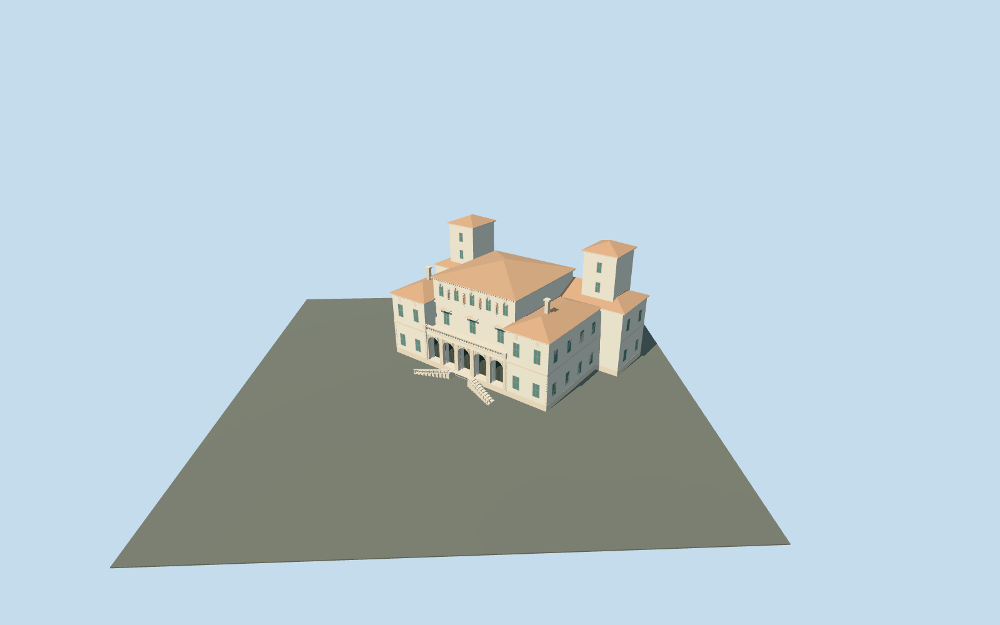

# Galleria Borghese

Galleria Borghese complete mapped connected villa exterior: pale plaster and limestone trim, five genuinely open round-arch loggia bays with recessed gates, raised terrace and paired outward-descending entrance flights, recessed central three-storey block, lower side wings, broad rear range and two tall square rear towers under terracotta hip roofs. Repeated tall windows, substantial cornices, simplified niches/medallions and balustrades convey the photographed identity. Neighboring park structures remain independent; no copied sculpture, inscriptions, art collections or interiors.

## Evidence and reconstruction

Published dimensions and reconstructed details are separated in spec.json. Primary references:

- [Reference](https://www.romaculta.com/leistungen/stadtfuehrungen-rom/galleria-borghese/)
- [Reference](https://www.italymagazine.com/point-of-interest/borghese-gallery)

Galleria Borghese complete mapped connected villa exterior: pale plaster and limestone trim, five genuinely open round-arch loggia bays with recessed gates, raised terrace and paired outward-descending entrance flights, recessed central three-storey block, lower side wings, broad rear range and two tall square rear towers under terracotta hip roofs. Repeated tall windows, substantial cornices, simplified niches/medallions and balustrades convey the photographed identity. Neighboring park structures remain independent; no copied sculpture, inscriptions, art collections or interiors.

## Model and axes

6,078 triangles; 17,570 vertices; 6 material groups; 709,304 bytes. Native bounds: -18.256, -0.502, -46.087 to 45.054, 30.300, 14.937. Source hash: `sha256:4c41f5b5a992493c9fbe827456d0c62a976a10d3b2ac5d906d9ff2d3fb78341f`.

{"x":"east","y":"up","z":"south"}

The geographic proposal uses exact-QID OpenStreetMap evidence. Map-derived orientation and estimated architectural details require real-site visual review; preview eligibility is distinct from geographic/fidelity approval. Map attribution: © OpenStreetMap contributors, ODbL-1.0.

## Reproduce

Run `node packages/worldgen/scripts/generate-additional-landmarks.mjs --ids=galleria_borghese` (or add `--check`). The generator preserves manually edited masters by checking their baseline hashes. Import through the standard authored-model workflow with optimization disabled; then capture all QA cameras, including shared-surface views.

## Pending work

- Galleria Borghese complete mapped connected villa exterior: pale plaster and limestone trim, five genuinely open round-arch loggia bays with recessed gates, raised terrace and paired outward-descending entrance flights, recessed central three-storey block, lower side wings, broad rear range and two tall square rear towers under terracotta hip roofs. Repeated tall windows, substantial cornices, simplified niches/medallions and balustrades convey the photographed identity. Neighboring park structures remain independent; no copied sculpture, inscriptions, art collections or interiors.
- Q841506 candidate reference and named Galleria Borghese PMTiles museum POI locate the complete parent way50842218/native35184422931050. Its actual eight-vertex outline supplies meter scale and stepped rear corners. Origin is the midpoint of the southwest front edge0→1. Internal X east-southeast along the front, Z southwest toward the piazzale; native east/up/south axes baked, heading0. Only this connected parent record is owned. Nearby northern/southeastern structures remain independent.
- Ordinary frontal and aerial pictures guide a medium-fi exterior. Working loggia floor1.4m, lower wings16.4m, central block21.8m and twin rear towers28.4m before tiled hips; highest roofs30.3m. Exact heights, roof subdivisions/chimneys, side/rear bay counts, stairs, balustrades and sculpture abstractions are approximate. No copied reliefs, sculpture, lettering, banners or furnished galleries. Exterior reflected glazing/gates are opaque proxies; loggia openings have real depth and closed floor/soffits.
- Qualified approximate native exterior fit on original Protomaps20261020/Mapzen201x201/6m ground. Open southwest piazzale provider[0,9] supplies65.96779335564696m datum. Boundary grades-.322..+.356m, raised loggia floor1.4m and closed foundation-.502m give a supported villa with modest low-side plinth exposure. Paired10-tread reconstructed flights connect the floor toward original local ground; exact riser inventory, paving and accessibility remain approximate. Occupied parent/stair masks preserve external approaches, all independent park buildings/roads and water. Native current views confirm supported envelope and recessed arcade. Flat review planes intersect grade-specific stair bases and the foundation. No bespoke terrain/survey or flattening.

This bundle follows the medium-fi standard. Medium-fi appearance and geographic fit are reviewed separately. Hash-bound visual acceptance is recorded separately after capture inspection.
