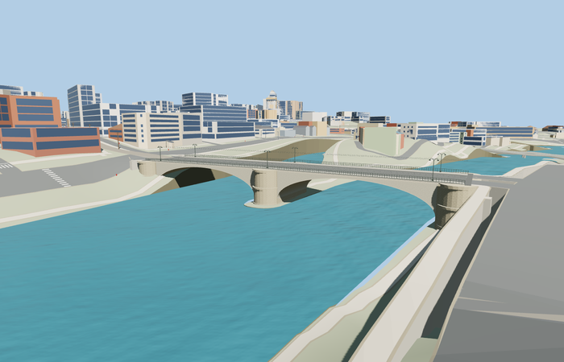

# Ponte Garibaldi, Rome

Reviewed 2026-10-27. **Scoped medium-fi exterior and approximate native placement complete.**

Inspected 62 current frames: 11 portable, 11 shared-material/geographic, 23 medium-fi and 17 native. Two complete shallow concrete vaults retain full-width outward soffits, pale fascia/cornice, rounded rusticated masonry pier/abutment heads, stepped plinths, open dark railings, raised walks, central tram rails and six tall paired curved lamps. Corrected helper argument conventions, outward head/cap winding, small pier-to-vault support gaps and raised coping crossing the landing pavement within this same authoring pass. Distinct neighboring bridges are retained context.

Three existing shared 256px graphs: concrete_plain, stone_limestone and metal_painted; four merged semantic groups near and one mean-tinted group at skyline. Metric UVs and linear vertex tints. No private/embedded images or copied photograph pixels. Each graph is fetched once in near native views; runtime GLBs use four separate GPU attribute streams.

| Level | Triangles | Bytes | Draws |
| --- | ---: | ---: | ---: |
| skyline | 600 | 47272 | 1 |
| district | 2592 | 212996 | 4 |
| street | 9776 | 757592 | 4 |
| closeup | 15064 | 1156828 | 4 |

Master: 22104 triangles / 2655384 bytes. Runtime levels: 600 / 2592 / 9776 / 15064 triangles, 47272 / 212996 / 757592 / 1156828 bytes and 1 / 4 / 4 / 4 draws. Initial skyline plus district 260268 bytes. Strict medium-fi budgets pass. Physical-device timings remain unmeasured.

Named standard PMTiles bridge carriageways 35184397841630, sidewalks 35184396656430 and tram tracks 35185557817320 establish the crossing alongside original Q2100416 and two ordinary pictures; no exact-QID footprint claimed. Anchor [12.474515587091446,41.89107316243978], heading 1.5001337686119638. +X north-northeast toward Regola / Lungotevere dei Vallati and De’ Cenci, -X south-southwest toward Trastevere / Piazza Belli; +Z east-southeast/downstream toward Tiber Island, -Z west-northwest/upstream toward Ponte Sisto. Mapped carriageway extent 123.916693m, unequal endpoints and paired transport lines are retained. The inferred 23.5m outer width covers both sidewalk lines. All 48 actual mapped width samples have model support and retained native paving at every LOD: 12 road samples differ by at most 0.022683182868149743m, 24 sidewalk samples by 0.011999130248796064m, and 12 tram-bed samples by 0.06242930874486774m. The tram difference is explicitly larger; no uniform sub-3cm fit is claimed. Source datum 7m and deck 21.6–21.95m are approximate standard-terrain visualization controls, not surveyed thresholds.

All 2,285 resident buildings and 1,828 independent road records remain. From 1,936 raw road records, deliberate replacement/clipping produces 1,931 output records when loaded; target failure retains all 1,936 map records. Ten cycleway records, 35 checked tunnel/cross-bank records and six other named crossing records retain their inputs with zero authored connections; lower cycleways receive zero grade raise. Raw roads, DEM, displayed ground and water stay unchanged. Connected bridge/landing paving is deliberately graded. No ground/building cutout is used; failure and full model/support disposal pass.

## Reconstruction limits

- Scoped present-day bridge exterior: two shallow concrete vaults, three rounded masonry pier/abutment stations, raised walks, open metal rails, six paired lamps and central tram tracks. The older iron bridge and separate Ponte Cestio / Tiber Island structures are not duplicated.
- Mapped carriageway extent 123.916693m and signed axis are retained. Width 23.5m follows the two mapped sidewalk lines and inferred outer paving edges. Opening widths 50.7/50.6m, arch rise, sections, rustication, lamp schedule and exact railing pattern are photo-led visual approximations, not surveyed engineering dimensions.
- Source datum 7m and deck 21.6–21.95m use approximate standard PMTiles/Mapzen visualization grades. The DEM smooths the riverbanks and road cuts; exact quay walls, stairs, abutment footings and river stage remain outside the asset. Raw native ground/water are retained unless a bounded documented cut proves necessary.
- Tram rails and two near-only contact wires retain the mapped central transit identity; exact track curvature, gauge, overhead fittings, operating status and signaling are not reconstructed. Fine lettering, plaques and graffiti are omitted. Distant LODs simplify rails, rustication and lamps.
- Existing shared 256px concrete_plain, stone_limestone and metal_painted graphs provide metric surfaces, with separate paving/concrete semantic groups and linear vertex tints. No private or embedded textures. Physical laptop and phone measurements remain pending.
- The native coarse banks, island tip and automatic retaining faces are preserved context, not an exact reconstruction of Rome’s quays, stairs or bank heights. The north abutment is partly embedded in the coarse bank. The current native water surface at sampled river points is approximately 10.12565m; this is renderer output, not an observed river stage.
- Tram-bed paving can differ from the landing cap by up to 0.06243m at the inspected width samples. The source preserves the transit corridor but does not claim surveyed track fit or navigable transit simulation.
