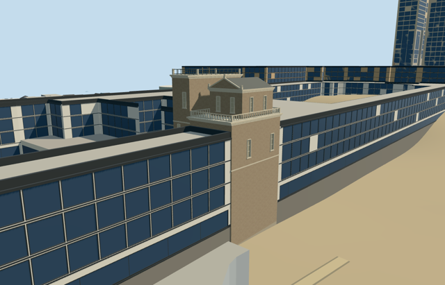

# gregorian_tower — Gregorian Tower

Reviewed 2026-10-20 in one continuous author/build/inspect/fix round.

## Appearance

Inspected47 final source/shared/context/native views during one continuous picture/map/build/fix round. The notched plan supports a lower west chamber/stone-balustraded terrace, taller east flat block/projecting cornice/iron roof rail, small pedimented roof house with closed pitched cap, sparse recessed closed light shutters, broad string courses/pilasters and bounded buried footing. Moved the east stone band above the small shutters before final capture. Two useful ordinary2011 courtyard/bird-eye pictures carried through construction; no copied fresco, coat of arms, inscription, image atlas, whole museum or Saint Peter dome.

## Shared materials and browser levels

Four reused256-square graphs (stucco, stone_limestone_raw, metal_painted and wood_vertical) supply five merged groups: stucco walls, limestone trim/foundation, painted metal and closed wooden shutters. Metric repeats/linear tints, zero embedded images, at most five runtime draws. Runtime LOD streams are separate and CPU/GPU byte counts agree. Skyline is one flat merged draw with graph means; graph reads occur once and eviction releases every model geometry. Source4514triangles/545096bytes.

| Level | Triangles | Bytes | Draws |
| --- | ---: | ---: | ---: |
| skyline | 742 | 77560 | 1 |
| district | 1634 | 153852 | 5 |
| street | 3506 | 322344 | 5 |
| closeup | 4514 | 415800 | 5 |

Inspected street/block/skyline at noon/late afternoon in Economy/High, texture-free silhouette, three close details, all four authored LODs and transitions. Levels742/1634/3506/4514triangles remain inside1000/4000/16000/64000 limits. Skyline+district total231412bytes, below3MB phones/6MB laptops. Fine frame bars, balusters and downpipes drop with distance; the stepped tower, roof house/pediment and terrace edges remain. Synthetic context tile edges are fixture boundaries; native captures prove the museum join. Physical-device/dense-city timing remains pending.

## Approximate map fit

Exact-QID retained OSMway176719116 supplies the notched16.997x14.984m tower polygon and undirected axis0.06657450338rad. The current PMTiles has no separate tower building/point at that ID; its footprint lies within palace52776558306308 and touches part35184483819981. Global heading0 and internal axes{"xAxis":[0.9977847361323613,-0.06652533608539087],"zAxis":[0.06652533608539087,0.9977847361323613]} preserve native east/south placement at12.454195746,41.905161124. West/east stepped mass assignment follows the two pictures and mapped notch; window schedule/directed facade interpretation retain20degree/2m approximation, not surveyed facing. Retain original6m standard terrain, paths/water and all museum geometry outside the exact tower polygon. Only subtract the overlapping tower area from palace52776558306308 and touching part35184483819981; retain their large remaining footprints and all other independent inputs. A bounded footing sits above the highest occupied rim with buried sides below the lowest. No ground/water cutout, precinct slab or full-palace replacement. Coarse DEM/contact levels and hidden lower walls are visualization estimates; adjoining roof joins must be inspected in native context. All four loaded levels retain both partially clipped museum input IDs: part35184483819981 retains1511.696513m2 of1512.958634m2, palace52776558306308 retains14735.711517m2 of14972.570030m2. Symmetric difference from the independently computed original-minus-tower shapes is below4e-9m2; residual tower overlap below6e-10m2. All1228 unrelated resident inputs remain byte-equivalent among1230 source records, and original6m terrain/paths/1538.154890m2 water geometry stay unchanged. Failed loading restores the exact original palace/part polygons and all1230 inputs; eviction restores terrain/water bindings and releases geometry. Host procedural museum facades remain generic approximations; their retained geometry is not an authored Vatican Museum reconstruction.

## Limits

Neither retained Wikidata nor tower map geometry supplies a qualified tower height. Picture-led nominal levels: west terrace22.8m, taller east deck30.2m, upper house22.8..27.9m with29.8m pediment/ridge, and roof rails/piers to31.4m above the attachment plane. Neighbor palace17m is a map attribute, not a tower height. Cornice, shutter, terrace, roof-house, ornament and lower hidden wall dimensions are visualization estimates; no73m height datum or modern repair accuracy is asserted. Retain original6m standard terrain, paths/water and all museum geometry outside the exact tower polygon. Only subtract the overlapping tower area from palace52776558306308 and touching part35184483819981; retain their large remaining footprints and all other independent inputs. A bounded footing sits above the highest occupied rim with buried sides below the lowest. No ground/water cutout, precinct slab or full-palace replacement. Coarse DEM/contact levels and hidden lower walls are visualization estimates; adjoining roof joins must be inspected in native context. Closed shutters, simplified roof-house pediment/acroteria, railing allocation and hidden lower walls are picture-led approximations. Lower walls stay plain where the selected photos are occluded by museum wings; no claim of surveyed or complete decorative inventory. Neither modern observatory fittings, roof wires, fresco/interior nor authentic heraldic sculpture/lettering is reconstructed. Source pictures were viewed only, not copied.

## Selected checks

Six Khronos files: zero errors/warnings.366 actual mesh/material/contact checks; 47 current inspected views. Scene validation/sim30 and strict selected medium-fi audit pass. Source/runtime/LOD hashes and material bindings verified.

Rebuild: node packages/worldgen/scripts/generate-additional-landmarks.mjs --ids=gregorian_tower; node packages/worldgen/scripts/import-structure-models.mjs --ids=gregorian_tower; node packages/tooling/scripts/generate-landmark-lods.mjs --ids=gregorian_tower --force.

Source: sha256:cb449e20445a676cfe6d3cd500089db1a431569cec487e14a2f7964431aac095

Runtime: sha256:9d7845fa87be44b14c6844987f63818e2c5089d647fbf6f78445df44ab90fd31

Input: sha256:e9a6c30721bb09f2b8b65f7b6817493a37f03d588cbc6f78cd8a74a16aec5264

## Viewed ordinary pictures

https://commons.wikimedia.org/wiki/File:Torre_dei_Venti_2011.jpg — Karelj; crop by Gugganij; PD-self. Viewed only; no pixels copied.

https://commons.wikimedia.org/wiki/File:0_Académie_des_Sciences_-_Casina_Pio_IV_-_Musées_du_Vatican.JPG — Jean-Pol GRANDMONT; CC-BY-SA-3.0. Viewed only; no pixels copied.
