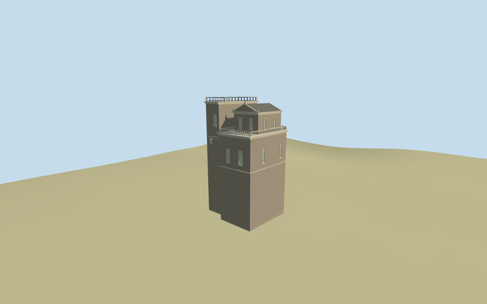

# Gregorian Tower

Specific standing Gregorian Tower exterior on its retained notched plan: low west chamber/stone balustraded terrace, taller east flat-roofed block/projecting cornice and iron roof rail, small pedimented upper house/pitched cap, sparse recessed closed light shutters, broad pilasters/string courses and bounded buried footings. Existing shared stucco, limestone, painted metal and wood graphs. No fresco/interior, copied coats of arms or inscriptions, photograph atlas, Saint Peter's dome or whole Vatican museum authored.

## Evidence and reconstruction

Published dimensions and reconstructed details are separated in spec.json. Primary references:

- [Reference](https://commons.wikimedia.org/wiki/File:Torre_dei_Venti_2011.jpg)
- [Reference](https://commons.wikimedia.org/wiki/File:0_Académie_des_Sciences_-_Casina_Pio_IV_-_Musées_du_Vatican.JPG)

Specific standing Gregorian Tower exterior on its retained notched plan: low west chamber/stone balustraded terrace, taller east flat-roofed block/projecting cornice and iron roof rail, small pedimented upper house/pitched cap, sparse recessed closed light shutters, broad pilasters/string courses and bounded buried footings. Existing shared stucco, limestone, painted metal and wood graphs. No fresco/interior, copied coats of arms or inscriptions, photograph atlas, Saint Peter's dome or whole Vatican museum authored.

## Model and axes

4,514 triangles; 13,542 vertices; 5 material groups; 545,096 bytes. Native bounds: -9.267, -0.910, -8.113 to 9.151, 31.837, 8.515. Source hash: `sha256:cb449e20445a676cfe6d3cd500089db1a431569cec487e14a2f7964431aac095`.

{"x":"east","y":"up","z":"south"}

The geographic proposal uses exact-QID OpenStreetMap evidence. Map-derived orientation and estimated architectural details require real-site visual review; preview eligibility is distinct from geographic/fidelity approval. Map attribution: © OpenStreetMap contributors, ODbL-1.0.

## Reproduce

Run `node packages/worldgen/scripts/generate-additional-landmarks.mjs --ids=gregorian_tower` (or add `--check`). The generator preserves manually edited masters by checking their baseline hashes. Import through the standard authored-model workflow with optimization disabled; then capture all QA cameras, including shared-surface views.

## Pending work

- Specific standing Gregorian Tower exterior on its retained notched plan: low west chamber/stone balustraded terrace, taller east flat-roofed block/projecting cornice and iron roof rail, small pedimented upper house/pitched cap, sparse recessed closed light shutters, broad pilasters/string courses and bounded buried footings. Existing shared stucco, limestone, painted metal and wood graphs. No fresco/interior, copied coats of arms or inscriptions, photograph atlas, Saint Peter's dome or whole Vatican museum authored.
- Exact-QID retained OSMway176719116 supplies the notched16.997x14.984m tower polygon and undirected axis0.06657450338rad. The current PMTiles has no separate tower building/point at that ID; its footprint lies within palace52776558306308 and touches part35184483819981. Global heading0 and internal axes{"xAxis":[0.9977847361323613,-0.06652533608539087],"zAxis":[0.06652533608539087,0.9977847361323613]} preserve native east/south placement at12.454195746,41.905161124. West/east stepped mass assignment follows the two pictures and mapped notch; window schedule/directed facade interpretation retain20degree/2m approximation, not surveyed facing.
- Neither retained Wikidata nor tower map geometry supplies a qualified tower height. Picture-led nominal levels: west terrace22.8m, taller east deck30.2m, upper house22.8..27.9m with29.8m pediment/ridge, and roof rails/piers to31.4m above the attachment plane. Neighbor palace17m is a map attribute, not a tower height. Cornice, shutter, terrace, roof-house, ornament and lower hidden wall dimensions are visualization estimates; no73m height datum or modern repair accuracy is asserted.
- Retain original6m standard terrain, paths/water and all museum geometry outside the exact tower polygon. Only subtract the overlapping tower area from palace52776558306308 and touching part35184483819981; retain their large remaining footprints and all other independent inputs. A bounded footing sits above the highest occupied rim with buried sides below the lowest. No ground/water cutout, precinct slab or full-palace replacement. Coarse DEM/contact levels and hidden lower walls are visualization estimates; adjoining roof joins must be inspected in native context.
- Two ordinary photographs carried through construction: whole skyline and close base. Fine glazing inventory, signed facade facing, rails and mast colors remain picture-led approximations. Preserve the adjacent Ma'mun Centre; no furnished restaurant or copied identity text.

This bundle follows the medium-fi standard. Medium-fi appearance and geographic fit are reviewed separately. Hash-bound visual acceptance is recorded separately after capture inspection.
