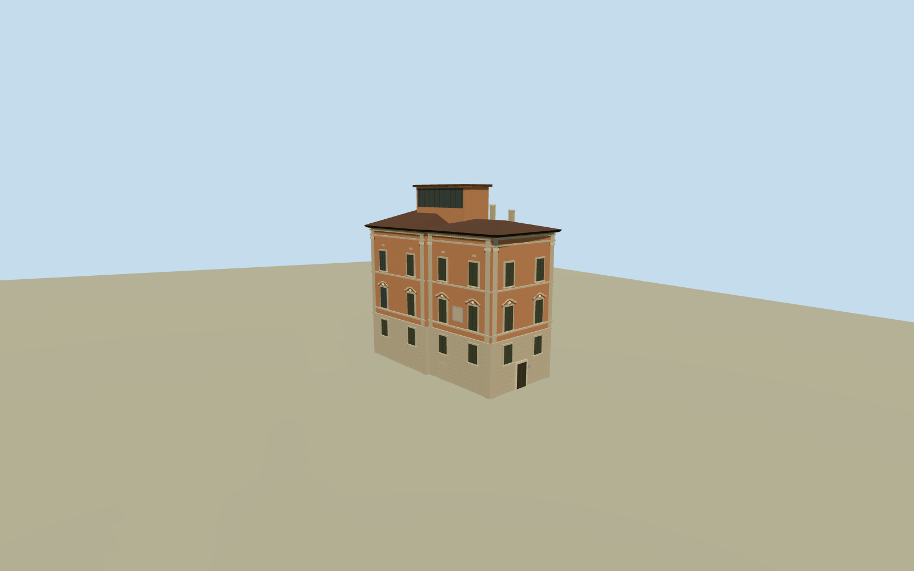

# Keats–Shelley Memorial House

The ochre palazzetto at Piazza di Spagna 26 with paired Baroque bays, travertine trim, dark shutters and a rooftop room.

Authoring state: **review-in-qa.json**. Current completion evidence is in [qa.json](qa.json) and the [completion ledger](../../../../qualla-structures/batches/qualla-004.PROGRESS.md).

- [Keats-Shelley Memorial House](https://qualla.com/keats-shelley-memorial-house/)

The model depicts the standing house at number 26. The Spanish Steps, the mirrored house across the staircase and other neighboring property remain outside the scope.

The photograph establishes both paired families of stair-facing windows. The plaza return, terrace depth, relief and individual opening dimensions are medium-fidelity estimates.

Build: `node content/worldgen/source/places/sr/sr2/keats_shelley_memorial_house/models/generate-keats-shelley-memorial-house.mjs`. Add `--check` to verify exact regeneration. 2646 triangles; 5 materials; no embedded photographs.
