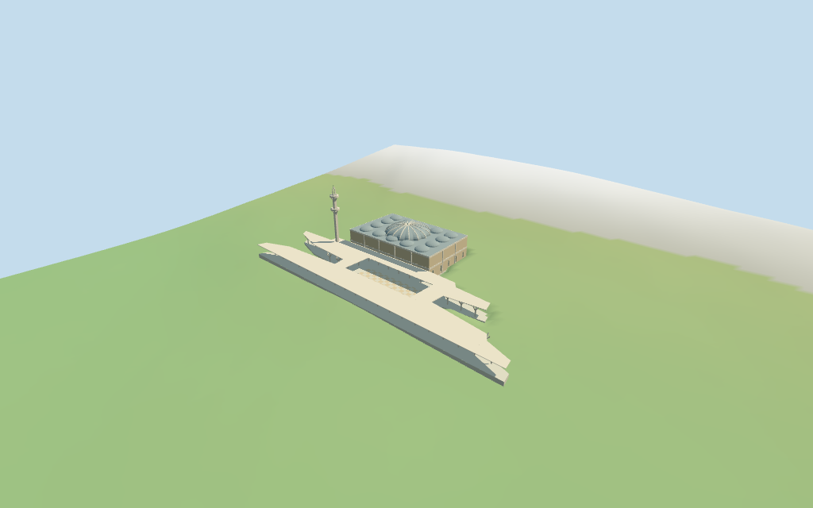

# Moschea di Roma

Individual Mosque of Rome: retained folded complex envelope,warm brick hall with pale horizontal bands,a shallow ribbed central roof dome and low surrounding roof vaults,open branching concrete colonnades,estimated atrium and geometric paving,one slender minaret with two open ring galleries and slotted pointed hood. Roofs,branching support rhythm and materials follow two inspected pictures. Detached buildings,landscaping,furnished interiors,inscriptions and engineering detail are excluded.

## Evidence and reconstruction

Published dimensions and reconstructed details are separated in spec.json. Primary references:

- [Reference](https://commons.wikimedia.org/wiki/File:Grande_Mosqu%C3%A9e_de_Rome.JPG)
- [Reference](https://commons.wikimedia.org/wiki/File:Moschea_-_cortile_00556.JPG)

Five existing shared256² brick,raw/coursed limestone,standing-seam metal and painted metal graphs;six merged roles including local opaque glazing. Metric UVs and linear tints,no embedded images,unique atlas,copied artwork or baked light.

## Model and axes

18,752 triangles; 56,256 vertices; 6 material groups; 2,254,028 bytes. Native bounds: -85.260, -4.513, -39.948 to 85.260, 39.997, 40.066. Source hash: `sha256:259ae11d1c94bfe0bcc243624e4b0abffba679b06f9faf223760da70ab5202c3`.

{"x":"long folded range axis","y":"up","z":"estimated hall atpositive Z"}

Standard Protomaps20261014 /Mapzen-USGS viewer extractN0477;datum 27.654888910252524 m. 808 footprint samples span -3.9580224838881257 to 1.9617079918508615 m. Floor -2.0030297495745017 m is the median of 210 edge samples plus0.25 m. Footings follow standard DEM grade;the exact retained envelope owns a paving slab beneath hall,colonnades and estimated atrium. Exact stairs,retaining levels,thresholds,planting and grade joins are unverified.

## Reproduce

Run `node packages/worldgen/scripts/generate-additional-landmarks.mjs --ids=moschea_di_roma` (or add `--check`). The generator preserves manually edited masters by checking their baseline hashes. Import through the standard authored-model workflow with optimization disabled; then capture all QA cameras, including shared-surface views.

## Pending work

- Retained Q1789776 /way30312316 identity,anchor,undirected axis and 24-vertex outer envelope remain unchanged. Current two-fragment main building has 28 vertices and closely matches that envelope;named mosque POI35184396038432 lies within the complex but has a separate id. Positive Z is assigned to the projecting prayer hall;the long folded negative-Z ranges become a low colonnaded canopy. The central open atrium is an architectural estimate absent from the retained no-hole map outline. Roof partitions,column grid,facing and dome/minaret positions are picture/map-guided estimates. Nearby buildings remain host content.
- No retained dimensional facts or current selected-building height tags exist. Estimated heights above the local floor: colonnade canopy6.6 m,hall15 m,shallow main dome20.1 m plus0.9 m finial,minaret42 m including tip. Small roof vaults rise1.65 m;branching columns,two open minaret galleries and its slotted hood are approximations. The selected photographs do not establish current complete condition.
- Standard Protomaps20261014 /Mapzen-USGS viewer extractN0477;datum 27.654888910252524 m. 808 footprint samples span -3.9580224838881257 to 1.9617079918508615 m. Floor -2.0030297495745017 m is the median of 210 edge samples plus0.25 m. Footings follow standard DEM grade;the exact retained envelope owns a paving slab beneath hall,colonnades and estimated atrium. Exact stairs,retaining levels,thresholds,planting and grade joins are unverified.
- The two inspected pictures guide roof,material and branching-support vocabulary. The canopy and atrium are approximate roof partitions inside the retained no-hole envelope. Fine screen perforations,roof coffering,inscriptions,interiors,engineering,exact current condition and physical-device/full-city performance remain unverified.

This bundle follows the medium-fi standard. Medium-fi appearance and geographic fit are reviewed separately. Hash-bound visual acceptance is recorded separately after capture inspection.

## Additional geographic data

©OpenStreetMap contributors;Protomaps;Mapzen/USGS terrain.
