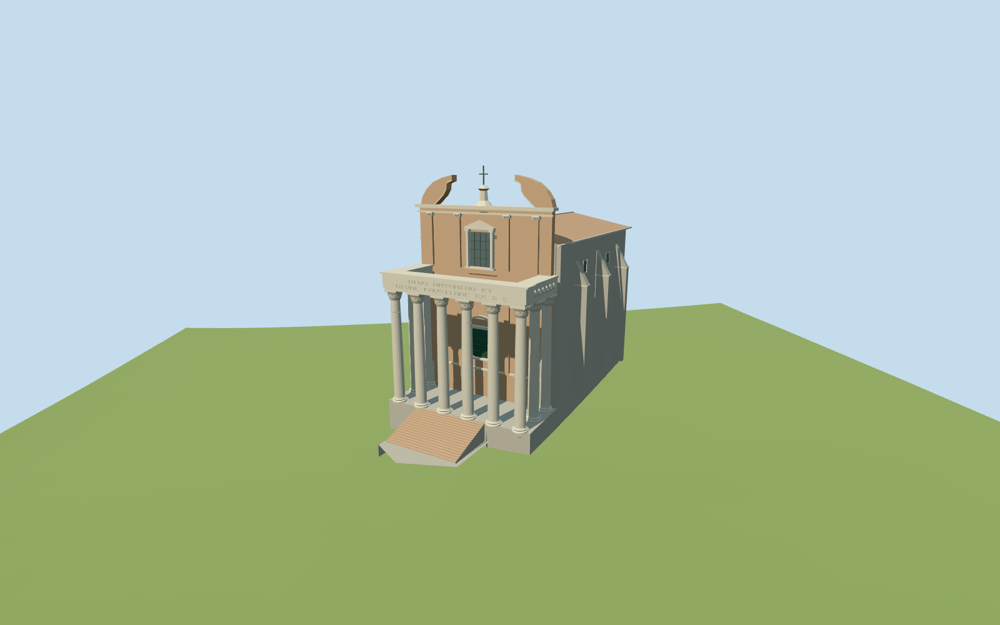

# Temple of Antoninus and Faustina

Present-day Temple of Antoninus and Faustina with San Lorenzo in Miranda: mapped church/cella body, southwest six-column porch with two returns behind each end, Corinthian capitals, inscribed open entablature, high podium/stair area, raised bronze doorway, side buttresses, tiled nave roof and later Baroque facade with split curved pediment and cross. Independent adjoining Forum monuments remain native; the missing ancient porch roof and complete antique pediment are not reconstructed.

## Evidence and reconstruction

Published dimensions and reconstructed details are separated in spec.json. Primary references:

- [Reference](https://commons.wikimedia.org/wiki/File:Temple_of_Antoninus_and_Faustina_(Roma).jpg)
- [Reference](https://commons.wikimedia.org/wiki/File:San_Lorenzo_in_Miranda_from_West,_Roman_Forum.jpg)

Two registered recipes rebuild the present temple porch and San Lorenzo in Miranda. Six common256-square material graphs, metric UVs and linear tints; no embedded images or unique atlas.

## Model and axes

12,412 triangles; 37,236 vertices; 6 material groups; 1,493,348 bytes. Native bounds: -8.839, -2.245, -37.766 to 29.298, 33.741, 8.052. Source hash: `sha256:6fd94a02c8f07e200f22baf8b7bf288e2f9b5a5bedd71a5c873751745ca9bd2a`.

{"x":"east","y":"up","z":"south"}

The geographic proposal uses exact-QID OpenStreetMap evidence. Map-derived orientation and estimated architectural details require real-site visual review; preview eligibility is distinct from geographic/fidelity approval. Map attribution: © OpenStreetMap contributors, ODbL-1.0.

## Reproduce

Run `node packages/worldgen/scripts/generate-additional-landmarks.mjs --ids=N0504` (or add `--check`). The generator preserves manually edited masters by checking their baseline hashes. Import through the standard authored-model workflow with optimization disabled; then capture all QA cameras, including shared-surface views.

## Pending work

- Present-day Temple of Antoninus and Faustina with San Lorenzo in Miranda: mapped church/cella body, southwest six-column porch with two returns behind each end, Corinthian capitals, inscribed open entablature, high podium/stair area, raised bronze doorway, side buttresses, tiled nave roof and later Baroque facade with split curved pediment and cross. Independent adjoining Forum monuments remain native; the missing ancient porch roof and complete antique pediment are not reconstructed.
- Q752555/relation1841090 identifies the temple porch. Four PMTiles component footprints also include the main32m church body, stair projection and surviving porch beam. Their raw east/south vertices remain intact. The southwest stair and front/west photographs establish the signed front. Ten column positions (six front plus two returns behind each end) are picture-guided within the mapped porch beam, not individually mapped or surveyed control points.
- The map supplies32m for the church body. Front/west pictures guide proportions: a3.2m modeled porch podium,17m shaft top,18.3m capital top and20.6m entablature above the lower local datum; the nave eaves/ridge are24.2/26.3m. The later facade rises through two orders to curved split wings around32.4m and a33.5m cross. The bronze door bottom is8.8m, deliberately above the3.2m porch floor. An ordinary article mentions17m columns and a roughly6m inaccessible entrance gap but gives a column count inconsistent with the pictured return arrangement; photos/map govern this approximate model. Heights, column allocation, stonework and opening dimensions are visualization estimates, not a survey.
- The original161-square/6m standard Mapzen/USGS grid is retained at the new anchor. A high occupied floor covers the church/porch and a separate low floor covers the mapped stair base. Both opaque floors clear the relevant original grid cells; their retaining sides continue below the lowest coarse grade. Treads descend to the low stair pocket. No terrain or water opening is proposed. Exact thresholds and archaeological ground levels remain approximate.
- Present-day exterior only. Columns, Corinthian leaf masses, dedication lettering, side carving, split pediment, roof pitch, buttresses and raised door are picture/map-guided medium-fi approximations. The ancient porch roof and full antique pediment remain absent. Complete interiors, exact masonry courses and neighboring structures are outside scope. Shared marble approximates cipollino; common window-grid and ceramic graphs stand in for glazing and roof tiles. Current acceptance is recorded in qa.json.

This bundle follows the medium-fi standard. Medium-fi appearance and geographic fit are reviewed separately. Hash-bound visual acceptance is recorded separately after capture inspection.

## Additional geographic data

©OpenStreetMap contributors; Protomaps; Mapzen/USGS terrain.
