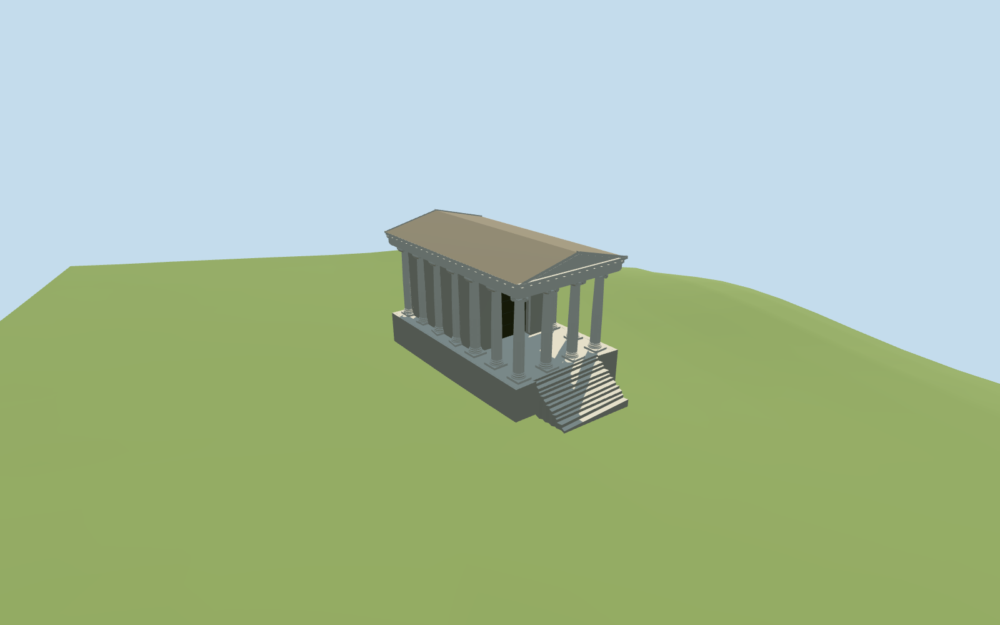

# Temple of Portunus

Specific present-day Temple of Portunus exterior: high mapped podium and eleven front stair parts, six free-standing Ionic portico columns, twelve engaged side/rear columns, roofed pronaos, closed recessed cella door, layered entablature, front/rear triangular pediments and complete shallow tiled gable roof. The neighboring Temple of Hercules Victor, church and modern street buildings remain independent.

## Evidence and reconstruction

Published dimensions and reconstructed details are separated in spec.json. Primary references:

- [Reference](https://commons.wikimedia.org/wiki/File:L06_709e_Tempel_des_Portunus.jpg)
- [Reference](https://commons.wikimedia.org/wiki/File:Rome.Temple_of_Portunus.backside.JPG)

Two registered recipes rebuild the complete Temple of Portunus exterior. Four common256-square material graphs, metric UVs and linear tints; no embedded images or unique atlas.

## Model and axes

26,740 triangles; 80,220 vertices; 4 material groups; 3,211,780 bytes. Native bounds: -8.169, -1.783, -12.325 to 9.103, 13.462, 13.116. Source hash: `sha256:7a35c69efa2b8b17483fed4c9bbdc5a2bf13b732500ad54f9111c06250dcabb3`.

{"x":"east","y":"up","z":"south"}

The geographic proposal uses exact-QID OpenStreetMap evidence. Map-derived orientation and estimated architectural details require real-site visual review; preview eligibility is distinct from geographic/fidelity approval. Map attribution: © OpenStreetMap contributors, ODbL-1.0.

## Reproduce

Run `node packages/worldgen/scripts/generate-additional-landmarks.mjs --ids=N0506` (or add `--check`). The generator preserves manually edited masters by checking their baseline hashes. Import through the standard authored-model workflow with optimization disabled; then capture all QA cameras, including shared-surface views.

## Pending work

- Specific present-day Temple of Portunus exterior: high mapped podium and eleven front stair parts, six free-standing Ionic portico columns, twelve engaged side/rear columns, roofed pronaos, closed recessed cella door, layered entablature, front/rear triangular pediments and complete shallow tiled gable roof. The neighboring Temple of Hercules Victor, church and modern street buildings remain independent.
- Q849241/way251331418 identifies the exact temple. Twenty-two PMTiles building components retain their original vertices: main outline, U-shaped cella wall, podium, eleven stair parts, column bases, all18 shafts and roof/entablature bands. The mapped stair projection and ordinary front picture fix the north-northwest front; the rear photograph confirms four engaged rear columns. Geometry retains raw east/south coordinates at heading0, with an internal162.695-degree architectural rotation so local+Z faces north-northwest.
- Standard-map parts provide podium3m, shaft interval3.2–10m, cella10m, cornice11–11.5m and roof envelope11.5–12.9m. The model follows these approximate heights above the declared lower datum, with fluted shafts ending9.65m and coarse Ionic capitals rising10.25m. Ordinary pictures guide cornice tiers, roof pitch, fluting, closed door and capitals; exact ornament, wall repairs and thresholds are not surveyed.
- The original161-square/6m standard Mapzen/USGS grid remains unchanged. The lower datum is the least offset that keeps every mapped stair top0.2m above the actual rendered terrain directly beneath its footprint. Each intersecting native triangle is clipped to the footprint and its linear height evaluated at every resulting corner. The3m upper podium and all higher treads cover their original coarse grade; retaining faces extend below the minimum local terrain. Numerical clipping scraps under0.1 square metres are omitted from the upper floor, removing false stair-side spikes; all original mapped controls remain intact. No ground or water cutout. Surrounding ground remains native; exact archaeological levels remain approximate.
- Specific present-day exterior. Six free and twelve engaged Ionic columns follow mapped positions; fluting, volutes, pediment/cornice profiles, closed entrance and stone repairs are medium-fi approximations. The complete gable roof is included. Fine carving, exact current stucco loss, interior frescoes and independent neighboring monuments are outside scope. Current acceptance is recorded in qa.json.

This bundle follows the medium-fi standard. Medium-fi appearance and geographic fit are reviewed separately. Hash-bound visual acceptance is recorded separately after capture inspection.

## Additional geographic data

©OpenStreetMap contributors; Protomaps; Mapzen/USGS terrain.
