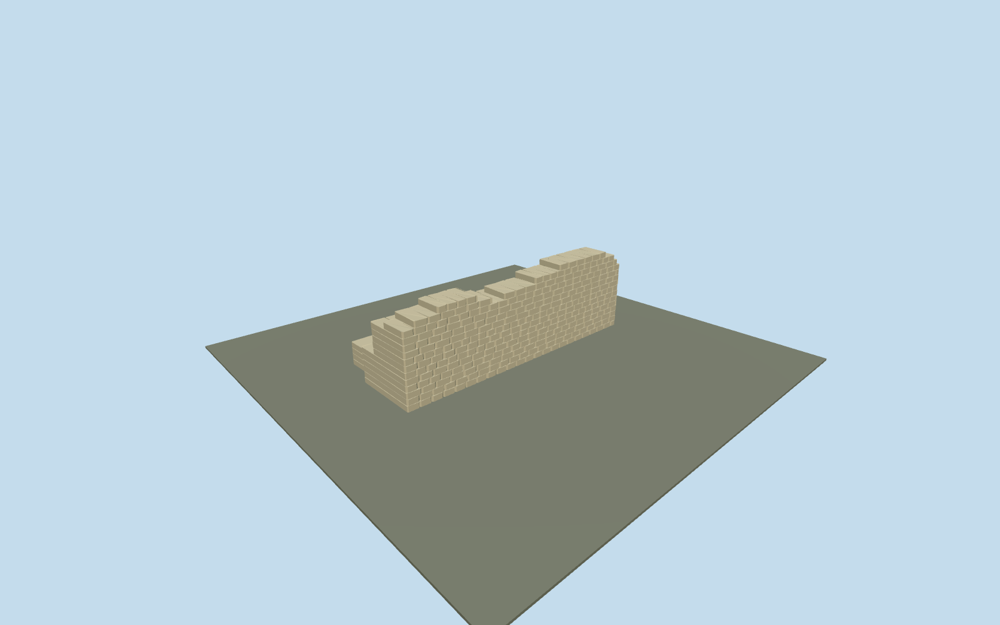

# Temple of Jupiter Optimus Maximus

Unfinished photographic draft of the exposed tufa foundation wall and adjoining low remnants of the Temple of Jupiter Optimus Maximus. It does not represent the complete buried temple footprint. No lost ancient roof, columns, cellae or statues are reconstructed, and no modern museum architecture is replaced.

## Evidence and reconstruction

Published dimensions and reconstructed details are separated in spec.json. Primary references:

- [Reference](https://commons.wikimedia.org/wiki/File:Temple_Jupiter_Optimus_Maximus.JPG)
- [Reference](https://commons.wikimedia.org/wiki/File:Temple_of_Jupiter_Optimus_Maximus.jpg)
- [Reference](https://commons.wikimedia.org/wiki/File:Ruins_of_the_Temple_of_Jupiter_(Capitoline_Hill)_-_2024-10-27_(2).jpg)

Two registered recipes rebuild the photographic foundation draft. One reused256-square raw stone graph, metric UVs and linear tints; no embedded images or unique atlas.

## Model and axes

9,156 triangles; 27,468 vertices; 1 material groups; 1,100,272 bytes. Native bounds: -13.491, 0.000, -7.900 to 13.491, 8.682, 2.800. Source hash: `sha256:4d6691ea5b1c402850d067da15483a12dd9fb0c70e7a6989bd07c189048f1705`.

{"x":"east-northeast along the inferred long wall","y":"up","z":"south-southeast toward the exposed face"}

The geographic proposal uses exact-QID OpenStreetMap evidence. Map-derived orientation and estimated architectural details require real-site visual review; preview eligibility is distinct from geographic/fidelity approval. Map attribution: © OpenStreetMap contributors, ODbL-1.0.

## Reproduce

Run `node packages/worldgen/scripts/generate-additional-landmarks.mjs --ids=N0507` (or add `--check`). The generator preserves manually edited masters by checking their baseline hashes. Import through the standard authored-model workflow with optimization disabled; then capture all QA cameras, including shared-surface views.

## Pending work

- Unfinished photographic draft of the exposed tufa foundation wall and adjoining low remnants of the Temple of Jupiter Optimus Maximus. It does not represent the complete buried temple footprint. No lost ancient roof, columns, cellae or statues are reconstructed, and no modern museum architecture is replaced.
- Q586468 identifies the surviving temple foundations. Photographs place the exposed tufa wall inside the Esedra/Capitoline museum complex. The PMTiles museum polygon and approximate photographic camera location constrain an explicitly estimated frame; they do not supply an ancient wall footprint.
- Draft photographic proportions: 0.58m nominal tufa courses, approximately 27m exposed face and up to 8.7m surviving wall height. These dimensions, block bonding and the relative positions of lower remnants are estimates requiring review; they are not map or survey measurements.
- Approximate current buried-foundation placement inside the mapped Esedra, not a reconstruction of the lost temple. The long wall follows the museum envelope axis; its exposed face points south-southeast toward the approximate2024 photographic camera location. Exact ancient wall coordinates and excavation levels are not mapped. The entire model envelope fits inside the retained museum part. The minimum native DEM vertex covering that envelope supplies a conservative overburden reference: modelY8.982m attaches there, leaving the highest modeled stone at least0.3m below the unchanged terrain. This preserves the modern surface and museum; it is an approximate burial envelope, not a measured excavation floor. SourceY0 is the displayed foundation base. No terrain/building/water removal. The normal above-ground world should not expose this basement wall; below-grade or isolated inspection is needed. Exact museum interior, excavation shape and buried masonry beyond the photographed visible remnants are not modeled.
- Unfinished photographic foundation draft. Entire surviving scope, exact block courses, underground depth, location and orientation remain unverified. No geographic or fidelity acceptance exists. The modern museum is independent and automatic placement stays disabled.

This bundle follows the medium-fi standard. Medium-fi appearance and geographic fit are reviewed separately. Hash-bound visual acceptance is recorded separately after capture inspection.

## Additional geographic data

©OpenStreetMap contributors; Protomaps; Mapzen/USGS terrain.
