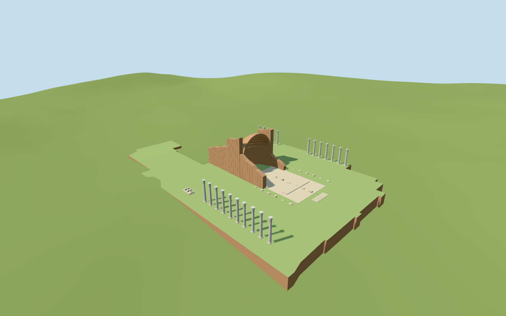

# Temple of Venus and Roma

Temple of Venus and Roma present-day medium-fi exposed exterior: broad surviving raised precinct, tall east-facing brick apse with a thick half-dome conch and diamond coffers, broken roofless cella walls, mapped surviving perimeter columns, low bases and scattered pale fragments. Keep the later Santa Francesca Romana church, bell tower, monastery and Antiquarium independent. No intact ancient temple roof, pediment or complete colonnade is reconstructed; the museum-covered western cella is not presented as a freely exposed interior.

## Evidence and reconstruction

Published dimensions and reconstructed details are separated in spec.json. Primary references:

- [Reference](https://commons.wikimedia.org/wiki/File:Rome_-_Temple_of_Venus_and_Rome_(5178790722).jpg)
- [Reference](https://commons.wikimedia.org/wiki/File:Tempio_di_Venere_e_Roma_-_abside_-_antmoose.jpg)

Two registered recipes build the exposed brick apse, precinct and mapped surviving shafts with shared 256² material graphs, metric UVs and linear tints. No embedded images or unique atlas.

## Model and axes

14,228 triangles; 42,684 vertices; 4 material groups; 1,710,304 bytes. Native bounds: -92.854, -12.000, -60.224 to 75.070, 27.399, 74.161. Source hash: `sha256:b15565fc8477201307451ba0e2710987abb300348d085d25e78c881dff0245b4`.

{"x":"east","y":"up","z":"south"}

The geographic proposal uses exact-QID OpenStreetMap evidence. Map-derived orientation and estimated architectural details require real-site visual review; preview eligibility is distinct from geographic/fidelity approval. Map attribution: © OpenStreetMap contributors, ODbL-1.0.

## Reproduce

Run `node packages/worldgen/scripts/generate-additional-landmarks.mjs --ids=N0514` (or add `--check`). The generator preserves manually edited masters by checking their baseline hashes. Import through the standard authored-model workflow with optimization disabled; then capture all QA cameras, including shared-surface views.

## Pending work

- Temple of Venus and Roma present-day medium-fi exposed exterior: broad surviving raised precinct, tall east-facing brick apse with a thick half-dome conch and diamond coffers, broken roofless cella walls, mapped surviving perimeter columns, low bases and scattered pale fragments. Keep the later Santa Francesca Romana church, bell tower, monastery and Antiquarium independent. No intact ancient temple roof, pediment or complete colonnade is reconstructed; the museum-covered western cella is not presented as a freely exposed interior.
- Q430792/relation1841091 identifies the precinct; the broad archaeological boundary is a platform extent rather than a solid temple shell. The pinned PMTiles cella35184503447863 and 22 individual perimeter columns plus the southern column-fragment cluster fix the exposed remains. Architecture+X points southeast toward the Colosseum, about20.58degrees from east in native east/south space. The ordinary east frontal photo resolves the open apse direction. Later church/museum footprints are excluded from the platform and replacement mask. The pinned main temple and Antiquarium polygons overlap by about0.032m². The replacement mask excludes the museum with a0.1mm numerical margin; a tiny native temple seam remains inside/along the museum wall. Preserve that shared seam rather than clip the independent museum. This is map-overlap handling, not an inferred archaeological wall boundary.
- Ordinary photos guide an approximately22.5m surviving brick conch above the precinct, about12m to its spring line, radius10m and irregular side-return walls. Perimeter shafts are about11.3–11.8m, with short exposed bases. These are visualization estimates, not surveyed architectural heights. Low fragment inventories, exact niches, coffers and damage are simplified.
- Reused pinned N0506 standard PMTiles/Mapzen extract. The broad precinct uses a flat visualization datum just above the sampled perimeter; retaining foundations extend below the unmodified native ground. Later independent building footprints are subtracted from the platform. No ground or water cutout; exact archaeological pavement elevation is not surveyed.
- The museum-covered western cella and later church/monastery remain independent. Exact niches, heights, damage, coffers and fragments are picture-led visualization estimates; no intact ancient roof or navigable interior is claimed.

This bundle follows the medium-fi standard. Medium-fi appearance and geographic fit are reviewed separately. Hash-bound visual acceptance is recorded separately after capture inspection.

## Additional geographic data

©OpenStreetMap contributors; Protomaps; Mapzen/USGS terrain.
