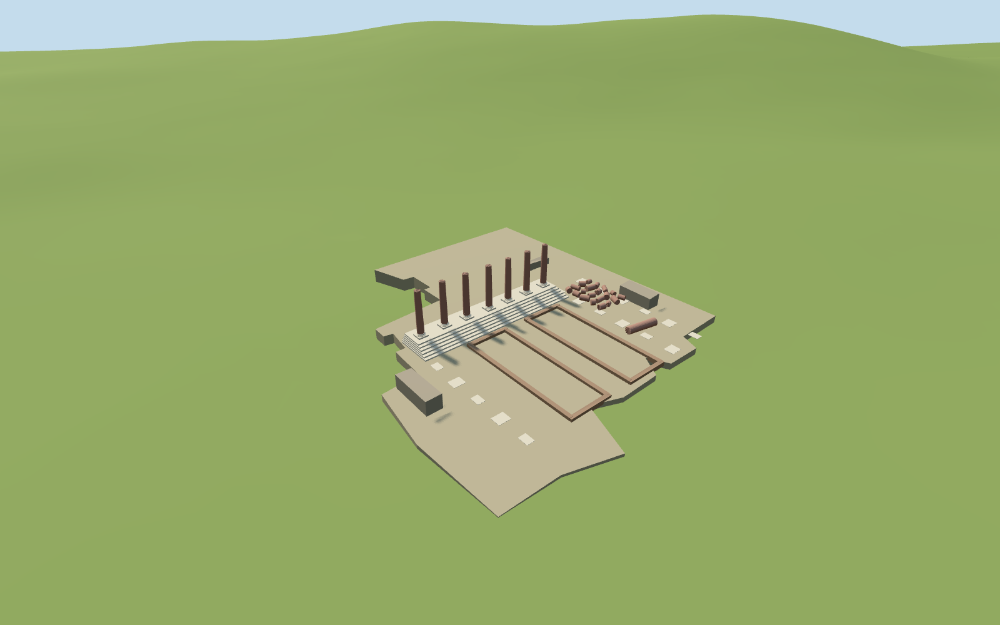

# N0517 — Temple of Peace

Reviewed 2026-10-19. Completed in one continuous authoring/inspection round for the visible exterior and approximate map fit.

## Visible architecture

Inspected current source, shared-material, medium-fi and retained-terrain site renders during the same authoring round. Seven individually mapped plain pink granite shafts, white moulded bases and broad steps, two low rectangular court traces, broken roofless wall cores, fallen drums and long shaft, pale paving fragments and eight small eastern mapped relics. Removed two unverified precinct pads after the first render; the intervening native terrain now remains intact. Skyline base profiles were simplified to stay within its triangle cap. No restored entablature or ancient temple roof is invented.

## Shared materials

Five reused 256² material graphs: granite, travertine, long-format brick, weathered limestone and gravel. Metric UVs and linear material tints; zero embedded images or unique atlas. Shared graphs load once, at most five model draws, separate GPU attribute streams and geometry disposal on eviction. Flat shared/context stages expose buried retaining foundations and are not proof of native grade.

## Browser levels

| Level | Triangles | Bytes | Draws |
| --- | ---: | ---: | ---: |
| skyline | 688 | 71080 | 1 |
| district | 1904 | 199400 | 5 |
| street | 3224 | 339916 | 5 |
| closeup | 5236 | 555680 | 5 |

Inspected 24 current medium-fi views: noon/late, Economy/High, street/block/skyline, untextured silhouette, three specific detail views, four authored levels and transitions. Levels 688 / 1,904 / 3,224 / 5,236 triangles. Initial geometry is 270,480 bytes. The seven-shaft row and stepped base remain legible at distance; mouldings, broken tops, drums and paving resolve nearer. Physical laptop/phone and dense-city timings remain pending.

## Map and terrain

Q1456939/relation1841167 identifies three separated archaeological areas, not a solid building. Seven individual pinned PMTiles column footprints determine the standing row. Its own measured map axis controls the internal architecture, rather than applying the broad precinct bounding-box axis to every shaft. Eight small eastern mapped remnants are low fragment treatments. Native+X east/+Z south and runtime heading0. Only the visible western court has an authored ground surface. Other archaeological boundary polygons do not imply invented building masses or paved platforms. Later neighboring footprints stay independent. Reused pinned N0506 standard Rome PMTiles/Mapzen extract. Only the photographed western court receives a shallow visualization pavement above its local coarse grid, with buried retaining foundations and stepped colonnade. Unverified intervening/southeastern precinct surfaces stay native; eight eastern mapped remnants sit locally on the original terrain. No ground or water opening. Exact excavated depths and street retaining levels remain approximate. All 1,866 independent in-tile buildings remain unchanged. Fifteen mapped authored records are replaced to boundary remnants below 1e-7m². The native ground and original water geometry remain unchanged. Failed loading restores all 1,881 original records; unloading frees the model geometry. Later church and neighboring Forum remains stay independent procedural context.

## Limits

Accepted as a medium-fi present-day exposed exterior and approximate standard-map fit. Seven mapped column centers control the row; shaft heights, mouldings, exact damage, low court rectangles, stone inventories and relative excavation levels are picture-led visualization estimates. Only the photographed western court receives a ground treatment; unverified intervening precinct areas stay native. The eight small eastern mapped remnants use simplified low geometry. No historical intact temple, exact archaeological reconstruction, detailed inscriptions or navigable interior is claimed.

## Selected checks

Two registered recipes rebuild the 631,728-byte source master. Six Khronos files: zero errors/warnings. 1,488 actual mesh probes pass. Inspected 48 current views (8 source, 8 shared, 24 medium-fi, 8 site/fallback). Scene validation/sim 30 and strict selected medium-fi audit pass. Full source rebuild, lock refresh and the prior N0512 renderer release gates remain at the planned batch milestone near 525 complete.

Rebuild: node packages/worldgen/scripts/generate-additional-landmarks.mjs --ids=N0517; node packages/worldgen/scripts/import-next-1000-models.mjs --ids=N0517; node packages/tooling/scripts/generate-landmark-lods.mjs --ids=N0517 --force.

Source: sha256:2e30d2bd3fac28cef8a9ef4169991dd892ee1734103141de532a31374edcae15

Runtime: sha256:dab320766607b1767f414ce4b8ce31a4958e9ba43bb832fdcd53ccf6b954bed0

Input: sha256:201192e0d66562c2c785f93ef7436265e0f98b58ad2792efd3c8783e3d6dec80

## Ordinary pictures

https://commons.wikimedia.org/wiki/File:2016_Temple_of_Peace_(Rome)_02.jpg — Jordiferrer; 2016-08-04; CC BY-SA4.0; viewed only. Viewed only; no pixels copied.

https://commons.wikimedia.org/wiki/File:2016_Temple_of_Peace_(Rome)_03.jpg — Jordiferrer; 2016-08-04; CC BY-SA4.0; viewed only. Viewed only; no pixels copied.
