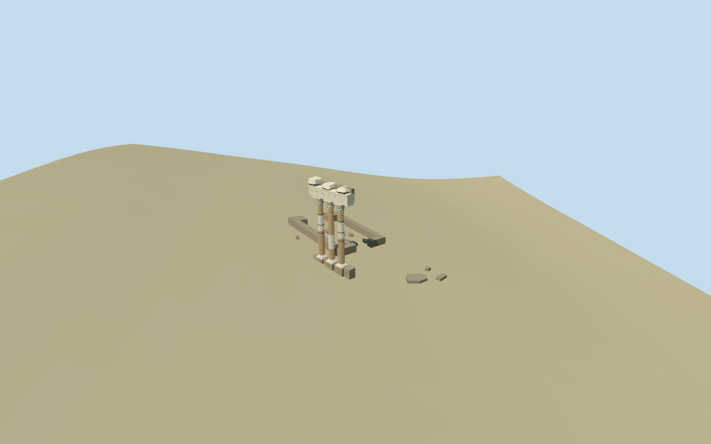

# N0532 — Temple of Venus Genetrix

Reviewed2026-10-19 in one continuous author/build/inspect/fix round.

## Appearance

Inspected48 final current source/shared/medium-fi/native-site/fallback views in one continuous author/build/inspect/fix round. Exactly three mapped standing fluted Corinthian columns in a straight row, layered round/square bases, two leafy capital rows/volutes, concave abaci, three-fascia architrave, original scrolling frieze, small bead/dentil rhythms and a broken three-mass upper cornice. Approximate warm/white shaft repairs, thin metal hoops on the outer shafts and fourteen mapped low fragments. Same-round images prompted tapered/chamfered eroded cornice pieces instead of square blocks, raised scroll relief instead of flat ribbons, and a closer capital/frieze camera. No whole ancient temple restoration.

## Shared materials and browser levels

Three existing256-square graphs: stone_marble for capitals/bases and warmer shaft tints, stone_limestone_weathered for exposed core/low remnants, metal_painted for repair hoops. Metric UVs and linear muted tints; each graph read once by the production resolver. Levels664/3348/8988/12204triangles; at most three draws, initial401376bytes. No embedded images or unique atlas, separate GPU streams and matching CPU/GPU accounting. All triangle/draw/download caps pass; eviction releases all model geometry.

| Level | Triangles | Bytes | Draws |
| --- | ---: | ---: | ---: |
| skyline | 664 | 71480 | 1 |
| district | 3348 | 329896 | 3 |
| street | 8988 | 893844 | 3 |
| closeup | 12204 | 1203240 | 3 |

Inspected noon/late, economy/high, source turntable, full silhouette, column/base, capital/frieze and low-remnant details, all four levels and transitions. Skyline keeps all three shafts, open gaps, the straight broken cornice silhouette and mapped low remains while omitting small carving/repair hoops. District retains flutes/capitals/hoops; street/close retain raised original scrolling relief. Flat shared stages can expose terrain-relative feet; source/native terrain carries contact judgment. Green fallback ground and generic neighboring facades are host context, not a reconstruction of the Roman excavation or surrounding architecture.

## Approximate map fit

Exact-QID Q2459870/relation1809171 fixes the36.626x30.348m archaeological site. Native column controls35184506694274/35184506694269/35184506694282 and beam52776571491074 fix the southwest-side straight row; fourteen other contained native remnants supply their own low outlines. Heading0, internal angle+0.850095289319rad. Replace only those18 exact controls with2cm numeric tolerance. All1801 independent in-tile building inputs remain byte-equivalent; original6m native terrain and water unchanged. The column strip has a local level top with buried bottom; low fragments follow grade and are buried. Cella/site ground remains open, without a tall full-precinct podium, flattening or ground/water cutout. Loaded levels retain1801 native records; failure1819 originals; unloading releases geometry.

## Limits

Accepted medium-fi current surviving-remains visualization from two retained useful ordinary full-height/capital pictures and the reused standard Rome PMTiles/Mapzen extract. Earlier cropped/end-on views did not establish the bases; the full-height picture resolved that concrete gap. Column height11.4m, exact proportions, cornice damage, repair/weathering distribution, low-remnant heights and scrolling/leaf motifs are picture-led approximations. No copied readable text, narrative sculpture, complete roof/pediment/colonnade or surveyed Roman floor is claimed. Coarse urban DEM does not resolve excavated floors/thresholds. A new reusable original Corinthian helper carries the existing design vocabulary; accepted Vespasian geometry/recipes remain unchanged. Physical-device/dense-city timings remain pending.

## Selected checks

Six Khronos files: zero errors/warnings.166 actual geometry/contact probes; 48 current inspected views. Scene validation/sim30 and strict selected medium-fi audit pass. Source and runtime hashes/material bindings/LOD caps verified.

Rebuild: node packages/worldgen/scripts/generate-additional-landmarks.mjs --ids=N0532; node packages/worldgen/scripts/import-next-1000-models.mjs --ids=N0532; node packages/tooling/scripts/generate-landmark-lods.mjs --ids=N0532 --force.

Source: sha256:f3087638265b74019bedf89e4f046a2c89f0147dc685f91b23aa36d8e04442c9

Runtime: sha256:53de8e293ef4170aeb3d15c138c0b423dff8569048c2f4f27109c576f2f08922

Input: sha256:96f7d3a7b3a68f881000d98b76a0781875b57d1955a38e101f6619b183111739

## Viewed ordinary pictures

https://commons.wikimedia.org/wiki/File:TVenereGenitriceForoCesareTrabeazione%26Capitelli.JPG — MM; CCBY3.0; viewed only. Viewed only; no pixels copied.

https://commons.wikimedia.org/wiki/File:Temple_of_Venus_Genetrix_in_Rome_(1).jpg — Tournasol7; CCBYSA4.0; viewed only. Viewed only; no pixels copied.

## Source binding maintenance — 550 checkpoint

Exact prior input reconstructed using prior recipe list and preserved helper text. Seven helper edits change only the first comment line, making existing source recipes explicit. All six approved model files are unchanged. Existing visual acceptance is retained through byte-equivalent rebuilding; this is not a new visual review.

Previous input: sha256:96f7d3a7b3a68f881000d98b76a0781875b57d1955a38e101f6619b183111739

Current input: sha256:17e1a27d01c3e5f86f13abe2bc09dfe4ca637eec42db0e4d9fc824d89aaa906d
