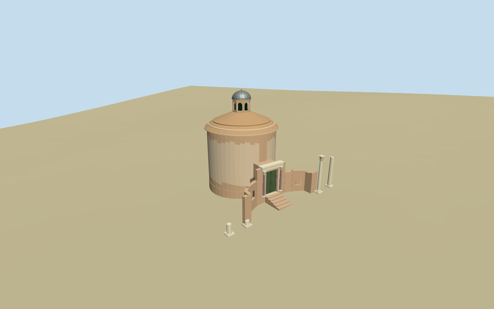

# Temple of Romulus

Specific standing Romulus exterior: round weathered brick/lime body, concentric shallow tiled roof rings, eight-sided arched-window lantern and gray metal dome; projecting pale portal with purple shafts/leafy capitals and static closed green bronze paired leaves/panels/studs. Concave lower entrance wings with recessed arched niches, two standing right-hand columns and broken left bases. Neighboring church and independent halls remain native. No hidden ritual interior, copied sculpture/text atlas or complete restoration of missing front colonnades.

## Evidence and reconstruction

Published dimensions and reconstructed details are separated in spec.json. Primary references:

- [Reference](https://commons.wikimedia.org/wiki/File:4309_-_Roma_-_Fori_-_Tempio_di_Romolo_-_Foto_Giovanni_Dall%27Orto_-_17-Mar-2008.jpg)
- [Reference](https://commons.wikimedia.org/wiki/File:Temple_of_Romulus_-_Ancient_doors.JPG)

Specific standing Romulus exterior: round weathered brick/lime body, concentric shallow tiled roof rings, eight-sided arched-window lantern and gray metal dome; projecting pale portal with purple shafts/leafy capitals and static closed green bronze paired leaves/panels/studs. Concave lower entrance wings with recessed arched niches, two standing right-hand columns and broken left bases. Neighboring church and independent halls remain native. No hidden ritual interior, copied sculpture/text atlas or complete restoration of missing front colonnades.

## Model and axes

11,088 triangles; 33,264 vertices; 6 material groups; 1,334,460 bytes. Native bounds: -16.623, -1.408, -9.453 to 8.491, 20.200, 16.868. Source hash: `sha256:77a6a56e216b285ccbbcefb76361bb8b7970b3f0fb9d0e68dd0273aad2f775f5`.

{"x":"east","y":"up","z":"south"}

The geographic proposal uses exact-QID OpenStreetMap evidence. Map-derived orientation and estimated architectural details require real-site visual review; preview eligibility is distinct from geographic/fidelity approval. Map attribution: © OpenStreetMap contributors, ODbL-1.0.

## Reproduce

Run `node packages/worldgen/scripts/generate-additional-landmarks.mjs --ids=N0548` (or add `--check`). The generator preserves manually edited masters by checking their baseline hashes. Import through the standard authored-model workflow with optimization disabled; then capture all QA cameras, including shared-surface views.

## Pending work

- Specific standing Romulus exterior: round weathered brick/lime body, concentric shallow tiled roof rings, eight-sided arched-window lantern and gray metal dome; projecting pale portal with purple shafts/leafy capitals and static closed green bronze paired leaves/panels/studs. Concave lower entrance wings with recessed arched niches, two standing right-hand columns and broken left bases. Neighboring church and independent halls remain native. No hidden ritual interior, copied sculpture/text atlas or complete restoration of missing front colonnades.
- Retained exact-QID relation1841089/Q338397 correlates standard PMTiles parent52776559974337 and its dome35184503447773/lantern35184503447753. Parent23.3x17.7m outline and two front holes establish the occupied envelope/curved entrance. Anchor12.487210858,41.891868949; heading0; internal cross-axis+.419392559901rad, portal faces southwest/local+z. Roof/lantern center aboutlocal[0,-1.9]; footprint controls extent, ordinary high-front and portal photographs establish facing/features. Church52776559959379 and other independent map inputs are preserved.
- Picture/map visualization estimates: body radius7.2m and eave11.4m above local floor, three shallow tiled roof steps ending14.6m; lantern radius1.85m/height2.5m, metal dome1.65m and finial0.25m, top about19m above floor. Nominal mapped dome height24m is retained as a source fact, not a surveyed threshold-relative height; profile follows photographed proportions against the27m mapped church. Portal opening2.85x4.8m, outer entablature5.3x6.2m, purple columns5.1m. Right columns about7.5/6.2m, left stumps0.8/1.7m; positions/inventory/capital/carving/repair details approximate. Closed door follows inspected2005 detail;2008 whole photo shows an open state.
- Original standard6m Mapzen Forum ground, native paths/water and independent buildings retained. Local temple floor1.2m above anchor DEM datum; occupied round footing, short vestibule/stair and narrow wing/column footings have buried bases. Open front holes remain native ground. No broad Forum/plaza slab, flattening or ground/water cutout. Coarse urban DEM cannot resolve excavated floor, threshold or individual steps; absolute levels remain approximate. Shared-edge protection preserves neighboring church/hall records.
- Approximate exterior only. Temple24m nominal mapped dome height is not a surveyed threshold-relative height; the authored profile follows two ordinary photographs. Static closed bronze door state, no ritual interior, hidden room reconstruction, copied text/photo atlas or complete restoration of missing front columns. Neighboring church/halls remain host context.

This bundle follows the medium-fi standard. Medium-fi appearance and geographic fit are reviewed separately. Hash-bound visual acceptance is recorded separately after capture inspection.

## Additional geographic data

©OpenStreetMap contributors; Protomaps; Mapzen/USGS terrain.
