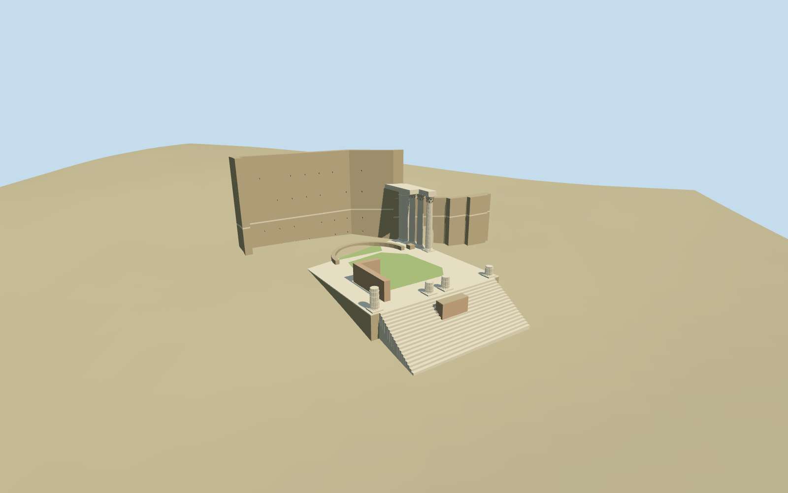

# N0550 — Temple of Mars Ultor

Reviewed 2026-10-19 in one continuous author/build/inspect/fix round.

## Appearance

Inspected48 current source/shared/medium-fi/native/fallback views in one construction round. Specific standing Mars Ultor: broad stair/central rough masonry remnant, four differently broken front fluted shafts, three tall mapped Corinthian columns with original simplified leafy capitals/volutes and short entablature, attached rear pilaster, low open cella/apse masonry, high rear firewall/pale stone band and lower return with genuine round-arched Pantani passage. First views prompted shallow beam-hole recesses and muted vegetated podium patches; actual tread probes caught inverted lowest steps whose bottoms exceeded a shared base. Corrected the base and approach height against retained terrain before final renders. No complete restored roof/pediment, full colonnade, cult statues or copied sculpture/photo atlas.

## Shared materials and browser levels

Three existing256-square graphs: stone_ashlar, stone_limestone_raw and brick. Four authored roles merge to three runtime draws: shared continuous limestone noise also carries a soft green vegetation tint on a few podium patches, not a new grass texture. Metric UVs, linear tints, each graph loaded once, zero embedded images. Master15,330triangles/1,842,056bytes. Runtime levels796/1966/11898/15330; initial254648bytes. Separate GPU streams and matching CPU/GPU accounting; eviction releases geometry.

| Level | Triangles | Bytes | Draws |
| --- | ---: | ---: | ---: |
| skyline | 796 | 84172 | 1 |
| district | 1966 | 170476 | 3 |
| street | 11898 | 1024892 | 3 |
| closeup | 15330 | 1340432 | 3 |

Inspected current noon/late/economy/high context, silhouette, all four LODs/transitions and three combined detail angles. The three-column group, broken front shafts, broad stair and high pierced rear wall remain in skyline; skyline reduces the stair to four broad treads and omits the pale band/fine wall holes. District has nine treads and denser shaft profiles; street/close-up have18treads, flutes/leafy capitals/volutes, dentils and actual blind beam holes. The palette holds across levels. Flat shared/synthetic stages can bury the low approach; terrain-bearing source/native views and actual mesh probes establish its contact. Native coarse terrain also partially hides low rear masonry; no broad excavation/flattening was invented to expose it. Synthetic modern neighbors are context, not authored Roman buildings.

## Approximate map fit

Named standard PMTiles Temple of Mars Ultor POI52776571486298 and archaeological POI17604119328229 correlate candidateQ679665; no exact-QID podium/building footprint claim. Thirteen selected surviving ruin/column/entablature/firewall controls fix position and facing. Front corner stumps establish cross-axis+.854930308005rad and front row, three southeastern column centers are used directly. Anchor12.486844,41.894283; heading0/native east-south axes, internal front-row origin[-8.749292612,6.904152395], front southwest/local+z. Picture-led34.4x38m occupied podium envelope fits these controls; cella/apse/arch dimensions remain approximate. Only thirteen corresponding shells replaced with2cm tolerance and independent envelopes+1mm protected. All1872 independent resident inputs retained unchanged. Rear-wall residual0.011335030802m2 is wholly within independent footprints+1.1mm; outside area0 and twelve other residuals0. Loaded1873 records including fragment, failed model load1885 full originals. Original6m ground, paths and3916.4174400192114m2 native water retained; no broad Forum slab, flattening or ground/water cutout. Unload restores surfaces and frees geometry.

## Limits

Accepted medium-fi from two inspected ordinary2009 front-panorama/2022 side pictures and the existing pinned standard Rome Protomaps/Mapzen extract, carried continuously through construction and fixes. Exact heights, stone/beam-hole/repair inventory, altar identification, hidden cella/apse layout, original ornament and absolute excavated levels are approximate. The unmodified coarse DEM slopes through archaeological levels: the authored floor is3.4m above anchor datum, giving a roughly7.5m DEM-driven approach rise; this is a visualization fit, not a surveyed podium height. Rear low masonry remains partly obscured. Pale stone/soft green patches approximate surface cover without literal paving/plant inventory; continuous shared limestone noise is reused for green patches. Independent historical/modern surroundings remain host context. No full roof/pediment, restored missing colonnade or statues. Physical-device/dense-city timings remain pending.

## Selected checks

Six Khronos files: zero errors/warnings.197 actual mesh/map-envelope probes; 48 current inspected views. Scene validation/sim30 and strict selected medium-fi audit pass. Source and runtime hashes/material bindings/LOD caps verified.

Rebuild: node packages/worldgen/scripts/generate-additional-landmarks.mjs --ids=N0550; node packages/worldgen/scripts/import-next-1000-models.mjs --ids=N0550; node packages/tooling/scripts/generate-landmark-lods.mjs --ids=N0550 --force.

Source: sha256:ecb76ddd38456c9b5a76ae6a5f9c7bad1e4bfecfd619eb2f8d6d5340bea689a4

Runtime: sha256:7a192f8a93c4fedf734f414192f8d8e1f2940f5511c362e7686ec664458d6b02

Input: sha256:4a1ef173c60d13a5ad3d1a65ffbede7acb112adff6874da8cdc3e9199ae7fd4b

## Viewed ordinary pictures

https://commons.wikimedia.org/wiki/File:Temple_of_Mars_Ultor_panorama.jpg — Alekjds; CC-BY-SA-3.0 / GFDL. Viewed only; no pixels copied.

https://commons.wikimedia.org/wiki/File:Tempio_di_Marte_Ultore_(Roma)_-_Laterale.jpg — NikonZ7II / Paris Orlando; CC-BY-SA-4.0. Viewed only; no pixels copied.
