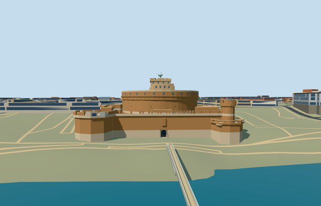

# N0758 — Castel Sant Angelo

Reviewed2026-10-22. **Completed medium-fi fortress exterior; qualified approximate native terrain fit.**

## Built and inspected

Complete connected mapped fortress exterior: circular brick keep, pale masonry base/courses, continuous projecting brick cornice with supporting corbels, gallery openings/portholes, upper rooms/terraces/courts, four corner bastions/curtain walls/mapped battlements. Genuine2.2m recessed arched south gate/closed soffit/threshold, working mapped stair treads and an original schematic faceted green winged roof figure/pedestal/sword. One author/inspect/fix pass using two ordinary photos and standard map. Fixed skyline courtyard filling from over-reduced rings, retained required vertices, reduced distant detail, stabilized boolean profiles at1mm, merged adjacent ground masks and refined brick scale/cornice. Bridge/Passetto and every independent neighbor remain context.

## Shared materials and browser LODs

Five existing256px graphs: brick_longformat warm brick keep/curtains/corbel course, with coarse0.75-per-metre UV tiling; stone_limestone_raw base/courses/gate/threshold and flat terrace paving; plaster_lime upper-room render; metal_painted schematic patinated roof figure/dark static gate/slits; storefront opaque gallery/window panes. Generic stone substitutes for historic marble/masonry/paving; opaque shared glazing/paint substitute for dark openings. No new graph/private atlas/embedded image. Six textured draws/one skyline draw; linear palette tints, separate POSITION/NORMAL streams/equal CPU-GPU bytes. Each native textured run reads every graph once; all LOD unloads release model geometry.

| Level | Triangles | Bytes | Draws |
| --- | ---: | ---: | ---: |
| skyline | 945 | 73088 | 1 |
| district | 3975 | 256564 | 6 |
| street | 11397 | 756952 | 6 |
| closeup | 11573 | 772084 | 6 |

Four authored LODs 945 / 3975 / 11397 / 11573 triangles within1k/4k/16k/64k caps. Initial skyline+district geometry 329652 bytes, shared cached material bakes separate. Six GLBs have zero Khronos errors/warnings;1187 actual mesh/contact probes and253 actual PMTiles13/14/15 cases (185 detailed owned parent/part records) pass. Inspected48 current portable/shared/medium-fi/native frames, all LODs, failure/loading lifecycle and Economy/High noon/late light. Physical device timings remain pending.

## Geographic placement

Q486382 plus named castle POI/parent way8035487/native35184380124319. Own185 integral parent/building-part records,180 with height tags, within the parent footprint. Existing map-axis anchor[12.466368146,41.9030693]; internalX east-northeast along south curtain/internalZ south-southeast toward entry/bridge; heading0/native axes baked in. Unchanged201x201/6m standard Mapzen grid, roads/Ponte Sant Angelo/Passetto context and235,254.276565m² river/water. Ground-level occupied union only cuts ground;90 triangulated occupied pieces merged to48 simple masks with unchanged area, preserving original open courts/approach. Preserve1,218 resident/1,783 wider independent buildings. Failure keeps1,403 originals; all LOD unloads restore ground/water and zero live geometry. Approximate native exterior fit reviewed: provider datum16.17376865079518m/floor0.35m, grades-2.253..+10.925m. South entry is clear; low-side foundation and substantial uphill/internal base burial remain in the coarse DEM. Exact moat, historic terrace levels, paving, thresholds and accessibility unverified; this does not certify surveyed grade accuracy.

## Fidelity and limits

Medium-fi connected castle exterior follows185 owned map records/180 unqualified height/min_height tags5..43m. Union height cross-sections/caps produce the actual exterior envelope instead of intersecting stacked prisms; boolean coordinates quantized to1mm. Base5m, core22/31m, outer curtain15m/merlons18m, upper rooms35.5/37/41/42m and crown43m are mapped. Gate5.4m/recess2.2m, cornice/corbel/window/porthole inventory and original faceted roof figure/pedestal/sword to49.1m are photo-led reconstructions. Skyline preserves outer open courts, simplifies the inner keep/roof figure and uses a flat arched portal; district rounds heights to3m and omits small cresting/upper windows; street/closeup retain mapped voids and real gate, with finer corbels/treads. Hidden elevations, exact historic sculpture likeness/court details are simplified. Original terrain causes uphill base burial; exact grading remains unverified. No furnished chambers/museum, copied inscriptions/coats of arms, crowds, flags, authored bridge or Passetto corridor. Physical device/dense-city timing pending.

## Targeted checks

Selected generation/import/placement, strict medium-fi, scene/sim30 and recipe lint pass. Sim30 sha256:1521d130aff95514408b54e0dc5aa8ba75d12ecc4af8628e461de0a7c9a31184. Pins: [qa.json](qa.json); [source controls](map-frame.json).

## Viewed references

- https://commons.wikimedia.org/wiki/File:Castel_Sant%27Angelo_(Rome)_-_Exterior.jpg — John Samuel (Jsamwrites); 2016-10-09; CC-BY-SA-4.0. Viewed only; no copied pixels.

- https://commons.wikimedia.org/wiki/File:Angyalvar036.jpg — Kiss Tamas (Kit36a); 2005-04-24; CC-BY-SA-3.0 migrated /GFDL. Viewed only; no copied pixels.

- https://www.openstreetmap.org/way/8035487 — original fortress parent, integral height-tagged parts and open courts, ©OpenStreetMap contributors ODbL-1.0. Standard PMTiles/Mapzen; no bespoke research.

## Completion checklist

- [x] Rebuildable source, import, four authored LODs and shared materials.
- [x] Current actual source/shared/native renders, geometry and lifecycle checks.
- [x] Unique mapped identity, signed orientation and approximate native exterior fit.
- [x] Open ground courts/approach, all independent buildings, bridge/Passetto context and original roads/terrain/water retained.
