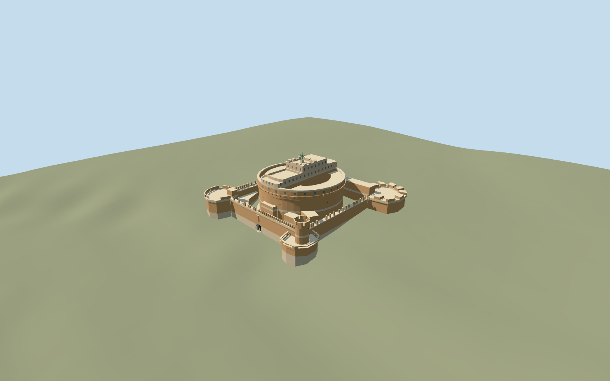

# Castel Sant Angelo, keep and connected fortifications

Connected Castel Sant Angelo exterior from the original map parent and180 height-tagged building parts: pale masonry base, large brick circular keep and upper galleries/terraces, four corner bastions/curtain walls/battlements, mapped upper rooms/courts, stepped ascent and a real arched south entrance recess/threshold. Original faceted winged roof figure and pedestal are a schematic silhouette. Preserve open ground courtyards, bridge, river and independent Passetto corridor/neighbors. No furnished museum/chambers, copied coats of arms/lettering, crowds, flags or bridge statuary.

## Evidence and reconstruction

Published dimensions and reconstructed details are separated in spec.json. Primary references:

- [Reference](https://commons.wikimedia.org/wiki/File:Castel_Sant%27Angelo_(Rome)_-_Exterior.jpg)
- [Reference](https://commons.wikimedia.org/wiki/File:Angyalvar036.jpg)

Connected Castel Sant Angelo exterior from the original map parent and180 height-tagged building parts: pale masonry base, large brick circular keep and upper galleries/terraces, four corner bastions/curtain walls/battlements, mapped upper rooms/courts, stepped ascent and a real arched south entrance recess/threshold. Original faceted winged roof figure and pedestal are a schematic silhouette. Preserve open ground courtyards, bridge, river and independent Passetto corridor/neighbors. No furnished museum/chambers, copied coats of arms/lettering, crowds, flags or bridge statuary.

## Model and axes

11,573 triangles; 26,323 vertices; 6 material groups; 1,090,436 bytes. Native bounds: -65.983, -2.403, -64.032 to 59.798, 49.450, 62.416. Source hash: `sha256:9b7406486ae2057654284e65a00a3dbddeb840c9f18bd5816408c1b972f1db32`.

{"x":"east","y":"up","z":"south"}

The geographic proposal uses exact-QID OpenStreetMap evidence. Map-derived orientation and estimated architectural details require real-site visual review; preview eligibility is distinct from geographic/fidelity approval. Map attribution: © OpenStreetMap contributors, ODbL-1.0.

## Reproduce

Run `node packages/worldgen/scripts/generate-additional-landmarks.mjs --ids=N0758` (or add `--check`). The generator preserves manually edited masters by checking their baseline hashes. Import through the standard authored-model workflow with optimization disabled; then capture all QA cameras, including shared-surface views.

## Pending work

- Connected Castel Sant Angelo exterior from the original map parent and180 height-tagged building parts: pale masonry base, large brick circular keep and upper galleries/terraces, four corner bastions/curtain walls/battlements, mapped upper rooms/courts, stepped ascent and a real arched south entrance recess/threshold. Original faceted winged roof figure and pedestal are a schematic silhouette. Preserve open ground courtyards, bridge, river and independent Passetto corridor/neighbors. No furnished museum/chambers, copied coats of arms/lettering, crowds, flags or bridge statuary.
- Q486382 and named castle POI on way8035487/native35184380124319 identify the complete connected fortification. Include the184 integral building-part records lying at least99percent within its parent:185 owned map records total,180 with height tags. Own the existing map-axis anchor[12.466368146,41.9030693]. InternalX east-northeast along the south curtain; internalZ south-southeast toward entrance/bridge. Heading0, signed axes baked into native east/south geometry. Passetto di Borgo extends outside this parent and Ponte Sant Angelo is a separate map feature; neither is replaced.
- Unqualified mapped height/min_height tags from5..43m guide the keep, terraces, outer walls, merlons, upper rooms and niches. Union occupied cross-sections at each tag boundary to eliminate intersecting prisms; preserve mapped elevated spans and voids. Low masonry5m, round core22/31m, outer curtain15m/merlons18m, upper rooms35.5/37/41/42m and crown43m are tagged. Working arched gate5.4m/2.2m recess and schematic figure/pedestal/sword rising about49m reconstructed from two ordinary photos; corbel/window inventories, hidden elevations and exact sculpture/court layout simplified. Profile boolean coordinates quantized to1mm. Skyline preserves outer courts, simplifies the keep/figure and uses a flat arched portal; district rounds heights to3m and omits small cresting/upper windows, while street/closeup retain mapped voids and real recessed gate. A broad brick corbel/cornice course is photo-led. Existing brick_longformat, stone_limestone_raw, plaster_lime, metal_painted and storefront graphs; no private atlas/embedded pixels.
- Standard Protomaps20261020 and original MapzenTerrarium201x201/6m grid. Uncovered south entrance approach fixes datum16.17376865079518m, working floor0.35m. Occupied ground-level part union only cuts ground; open courts and original roads/river/independent buildings remain. Ground variation is substantial around the internal keep and fortifications. Approximate native exterior fit inspected on original coarse terrain. Ground grades-2.253..+10.925m leave exposed low-side foundations and substantial uphill/internal base burial; the south entry remains clear. Exact moat, terrace levels, paving, thresholds and accessibility remain unverified. No bespoke terrain sources or custom flattening.

This bundle follows the medium-fi standard. Medium-fi appearance and geographic fit are reviewed separately. Hash-bound visual acceptance is recorded separately after capture inspection.
