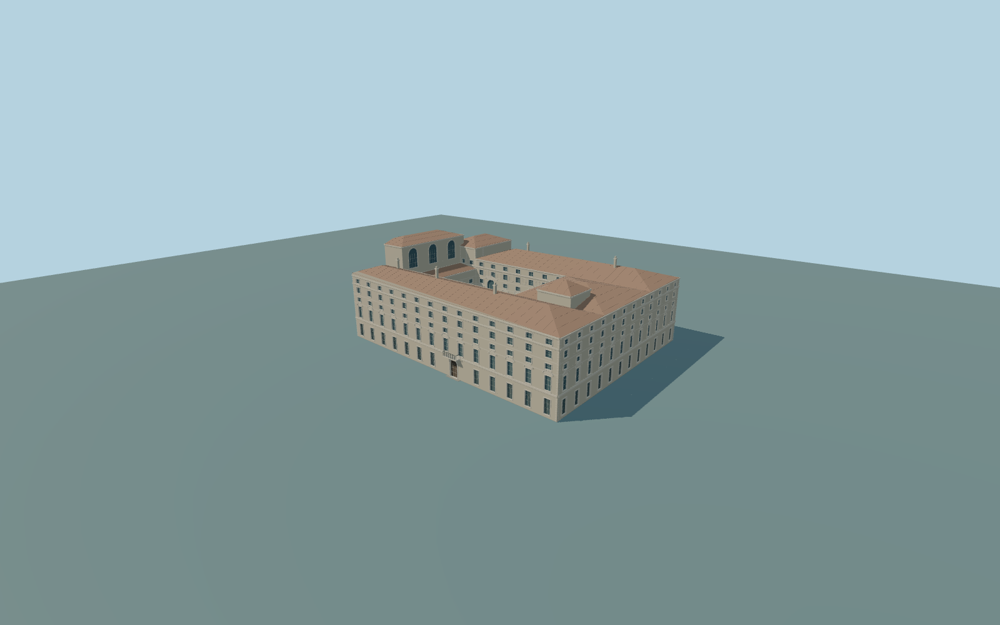

# Palazzo Chigi

Complete principal Palazzo Chigi exterior: all connected mapped ranges around the actual open court; pale five-row Piazza Colonna facade with original alternating pediments,rusticated corner bands,closed arched main entrance and balcony; terracotta hips/chimneys; tall western rooftop loggia,lower western court return and smaller eastern rooftop block. Ground-floor court arcades are genuinely open and deep, backed by closed simplified walls and doorways; the tall closed arched stair window, upper court windows and original plain plaster panels are included. Montecitorio,the column/Piazza Colonna,independent neighboring blocks and interiors remain outside scope. No copied heraldry,sculpture,inscriptions or artworks.

Rebuild: `node packages/worldgen/scripts/generate-palazzo-chigi.mjs`;append `--check` for exact source bytes. Select import/LOD/placement with `--ids=palazzo_chigi`. Detailed source and four browser tiers are separate ignored GLB outputs.

Complete principal Palazzo Chigi exterior: all connected mapped ranges around the actual open court; pale five-row Piazza Colonna facade with original alternating pediments,rusticated corner bands,closed arched main entrance and balcony; terracotta hips/chimneys; tall western rooftop loggia,lower western court return and smaller eastern rooftop block. Ground-floor court arcades are genuinely open and deep, backed by closed simplified walls and doorways; the tall closed arched stair window, upper court windows and original plain plaster panels are included. Montecitorio,the column/Piazza Colonna,independent neighboring blocks and interiors remain outside scope. No copied heraldry,sculpture,inscriptions or artworks.

Approximate37m standard global Terrarium datum and common exterior floor. Native17m principal parts,14m western court range,20m rooftop ranges and23m western loggia guide individual massing. Picture-guided shallow roof rises and five facade rows supplement incomplete tags. Four unchanged standard global tiles; only occupied palace and one bounded main-entry transition cut the field. Historic grades,heights and thresholds are approximate.

Three ordinary front,court and oblique aerial photographs were inspected. Night tricolor lighting was used only to identify the footprint,not as a material palette. Hidden rear/window inventories,arcade backing walls,roof transitions,original simplified ornament and historic grades remain medium-fi approximations. Native field slopes across the block; numeric LOD errors and physical-device timings remain unmeasured.

Seven existing shared256px plaster,limestone,granite,fired clay,painted metal,wood andwindow-grid graphs. Metric UVs/linear colors,zero private or embedded images andseven draws maximum. Skyline retains the whole plan,true court,reduced genuinely open arcade bays andboth rooftop blocks;district uses closed window proxies;street has closed recesses andopen court arcades;close-up adds original pediments,grilles,balcony bars,quoins androof seams. Detailed source retains finer framing/curves. Numeric LOD errors andphysical timings are unmeasured.

Original geometry:repository license. Map:© OpenStreetMap contributors,ODbL-1.0;Protomaps. Standard terrain:terrain-grid.json. Ordinary pictures stay local and are not redistributed or used as textures. Current acceptance:qa.json.
