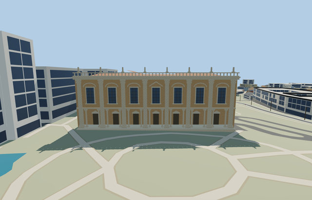

# Palazzo dei Conservatori / Caffarelli museum ranges

Reviewed2026-10-24. **Completed medium-fi connected exterior; approximate native fit. Capitoline Museums remains a three-member collection, with this one member complete.**

## Built and inspected

Complete connected Conservatori/Caffarelli museum building group on the standard mapped parent and eight integral parts. Seven-bay eastern piazza facade with giant stone pilasters, real recessed ground portico, paired Ionic column proxies, pedimented upper windows, deep cornice and balustrade; open mapped internal courtyard, irregular connected rear ranges, terracotta roofs and a modern curved hall roof proxy. Original simplified roof figures; no copied statues, art, text or furnished galleries.

Inspected all44 current frames:8 portable,8 shared-material,20 medium-fi,8 native, in six labeled contact sheets. Also inspected full-resolution native front/portico/courtyard/whole views during construction. Seven-bay front, eight giant pilasters, fourteen physical round portico supports, seven recessed doors, upper pediments, deep cornice/balustrade, connected irregular ranges, roofs and open court read coherently beside procedural buildings. Roof figures/capitals are original abstractions. One ordinary front photograph and standard PMTiles guided this continuous round.

## Shared materials and LODs

Five existing256px shared graphs, metric UVs and linear tints; five textured draws/one skyline. No embedded image, private atlas or new graph. Each used graph reads once and unload releases all geometry. Separate vertex streams and equal CPU/GPU accounting.

| Level | Triangles | Bytes | Draws |
| --- | ---: | ---: | ---: |
| skyline | 936 | 82684 | 1 |
| district | 3004 | 280060 | 5 |
| street | 4268 | 400876 | 5 |
| closeup | 4664 | 435004 | 5 |

LODs936/3004/4268/4664 triangles; initial skyline+district362744bytes; closeup435004bytes. Skyline omits nearby fenestration, small columns and balustrade detail while retaining the open portico envelope, giant pilasters, full massing and court. Synthetic contexts test style/LOD; they do not establish geographic fit.

## Location and limits

Named Palazzo dei Conservatori POI and actual main way123817455 identify the piazza front. Complete connected parent way1111783175 and eight mapped integral parts determine scale and ownership; courtyard remains open. X southeast along the front, Z northeast into Piazza del Campidoglio; axes baked east/up/south, heading0. Palazzo Nuovo and Palazzo Senatorio remain separate. Standard Protomaps20261020 and Mapzen ground retained. Outside piazza provider[0,10] supplies 46.33481771174452m datum. Main facade floor+.25m, boundary grades -3.411..0.862m. Rear ranges use local approximate floor levels and closed foundations following sampled lower grades. Original courtyard, piazza, roads/water and independent buildings retained. No bespoke terrain or ground flattening; historic thresholds/accessibility and rear basement levels approximate. Initial native views inspected: portico/treads supported, open mapped court and all independent structures retained; rear floor and basement levels remain approximate. All9 owned records are replaced while2504 resident independent buildings, original terrain/roads and127008.089m² water remain unchanged. Failure retains2513 originals; all LODs/failure/unload restore ground/water and release geometry.

Medium-fi exterior, not measured architectural reproduction. Main front and court follow standard map footprints; historic rear roofs/bays/floor levels, modern hall profile, column capitals, upper figures, thresholds and accessibility approximate. Main boundary -3.411..+.862m around floor+.25m yields low-side exposure and high-side burial. Rear grades vary by up to10.77m across a mapped part; per-range floor/closed foundation levels approximate the hill. Flat review planes bury some grade-specific bases; cropped detail frames cover local features, with whole/source/native views covering complete massing. Separate Senatorio/Tabularium and Nuovo remain procedural until their own models are finished. No copied sculpture/art/text or furnished galleries. Physical phone/laptop/dense-city timings pending.

## Rebuild and checks

Recipe, geometry and generator live in models/ and are inventoried by source.json. Run `node content/worldgen/source/places/sr/sr2/palazzo_dei_conservatori/models/generate-palazzo-dei-conservatori.mjs --check`. Selected import/placement, strict medium-fi, scene validation and sim30 passed; six GLBs had zero Khronos errors/warnings.88 actual geometry/contact probes and17 PMTiles13/14/15 cases passed, including all9 detailed owned records. Seven source-path ownership tests passed. Current pins and report hashes: [qa.json](qa.json). Sim30: `sha256:95eab0cddd5f752918324e5d58634911eca68bed1f782d11d60b18d70e03f355`.

## References

- [Ordinary exterior photograph](https://commons.wikimedia.org/wiki/File:2016_Musei_Capitolini.jpg), Jordiferrer,2016-08-04,CC BY-SA4.0; viewed only, no copied pixels.
- [Museum buildings](https://www.museicapitolini.org/it/gruppo-infopage/piazza-and-its-palazzi), official membership context.
- [Mapped parent](https://www.openstreetmap.org/way/1111783175), ©OpenStreetMap contributors,ODbL-1.0. Integral parts and signed axes: [map-frame.json](map-frame.json).
