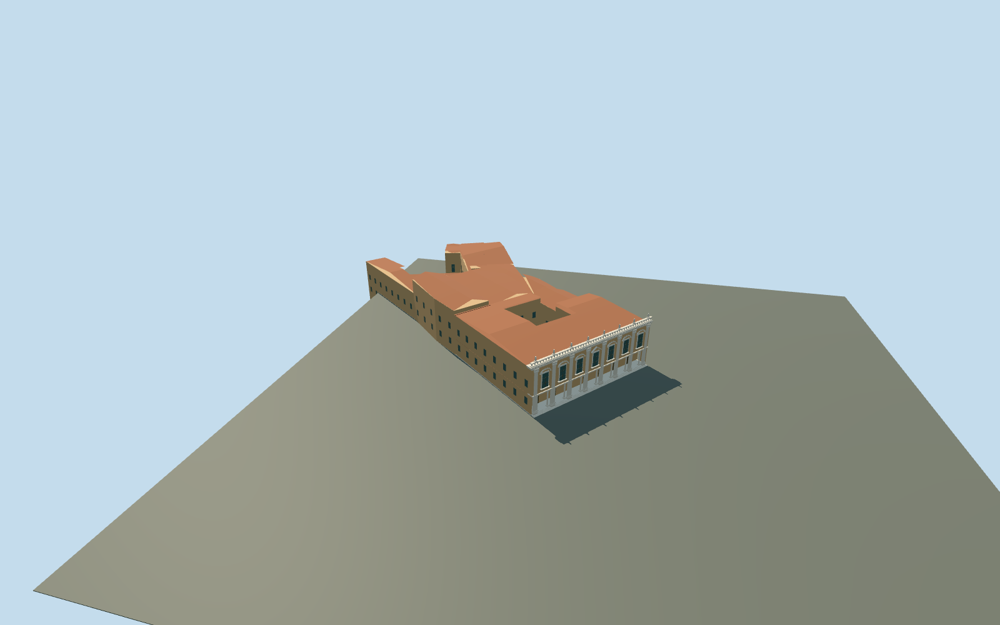

# Palazzo dei Conservatori and Caffarelli museum ranges

Complete connected Conservatori/Caffarelli museum building group on the standard mapped parent and eight integral parts. Seven-bay eastern piazza facade with giant stone pilasters, real recessed ground portico, paired Ionic column proxies, pedimented upper windows, deep cornice and balustrade; open mapped internal courtyard, irregular connected rear ranges, terracotta roofs and a modern curved hall roof proxy. Original simplified roof figures; no copied statues, art, text or furnished galleries.

## Evidence and reconstruction

Published dimensions and reconstructed details are separated in spec.json. Primary references:

- [Reference](https://commons.wikimedia.org/wiki/File:2016_Musei_Capitolini.jpg)

Complete connected Conservatori/Caffarelli museum building group on the standard mapped parent and eight integral parts. Seven-bay eastern piazza facade with giant stone pilasters, real recessed ground portico, paired Ionic column proxies, pedimented upper windows, deep cornice and balustrade; open mapped internal courtyard, irregular connected rear ranges, terracotta roofs and a modern curved hall roof proxy. Original simplified roof figures; no copied statues, art, text or furnished galleries.

## Model and axes

4,664 triangles; 13,570 vertices; 5 material groups; 547,904 bytes. Native bounds: -107.464, -10.594, -18.576 to 22.074, 21.423, 118.911. Source hash: `sha256:5947aa261f2bafdc3b2bec19534951f4cbaac4e43d72d350fb171b2527350f57`.

{"x":"east","y":"up","z":"south"}

The geographic proposal uses exact-QID OpenStreetMap evidence. Map-derived orientation and estimated architectural details require real-site visual review; preview eligibility is distinct from geographic/fidelity approval. Map attribution: © OpenStreetMap contributors, ODbL-1.0.

## Reproduce

Run `node content/worldgen/source/places/sr/sr2/palazzo_dei_conservatori/models/generate-palazzo-dei-conservatori.mjs --ids=palazzo_dei_conservatori` (or add `--check`). The generator preserves manually edited masters by checking their baseline hashes. Import through the standard authored-model workflow with optimization disabled; then capture all QA cameras, including shared-surface views.

## Pending work

- Complete connected Conservatori/Caffarelli museum building group on the standard mapped parent and eight integral parts. Seven-bay eastern piazza facade with giant stone pilasters, real recessed ground portico, paired Ionic column proxies, pedimented upper windows, deep cornice and balustrade; open mapped internal courtyard, irregular connected rear ranges, terracotta roofs and a modern curved hall roof proxy. Original simplified roof figures; no copied statues, art, text or furnished galleries.
- Named Palazzo dei Conservatori POI and actual main way123817455 identify the piazza front. Complete connected parent way1111783175 and eight mapped integral parts determine scale and ownership; courtyard remains open. X southeast along the front, Z northeast into Piazza del Campidoglio; axes baked east/up/south, heading0. Palazzo Nuovo and Palazzo Senatorio remain separate.
- Photo-led medium-fi heights: piazza body17m above+.25m floor, cornice/balustrade to19.3m and simplified figures to21.2m; connected rear wings18m plus2.6m tiled rises, modern hall14m plus1.8m. Mapped front8m is inconsistent with its photographed two monumental orders and is not treated as a measured overall height. Hidden roof subdivisions, rear windows/levels, column capitals and ornaments approximate.
- Standard Protomaps20261020 and Mapzen ground retained. Outside piazza provider[0,10] supplies 46.33481771174452m datum. Main facade floor+.25m, boundary grades -3.411..0.862m. Rear ranges use local approximate floor levels and closed foundations following sampled lower grades. Original courtyard, piazza, roads/water and independent buildings retained. No bespoke terrain or ground flattening; historic thresholds/accessibility and rear basement levels approximate.

This bundle follows the medium-fi standard. Medium-fi appearance and geographic fit are reviewed separately. Hash-bound visual acceptance is recorded separately after capture inspection.
