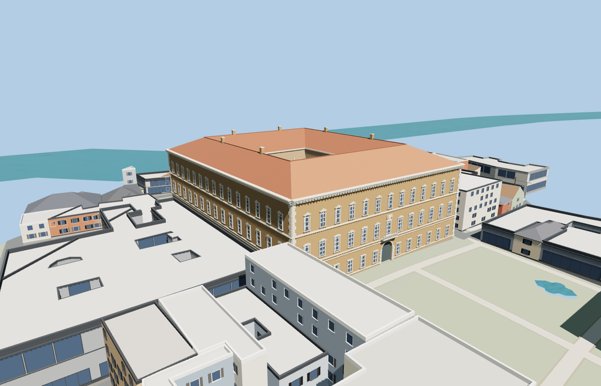

# Palazzo Farnese

Rome’s three-storey Renaissance palace with thirteen piazza-facing bays, an arched portal and balcony, alternating piano-nobile pediments, a projecting travertine cornice, an open arcaded court, and the Via Giulia garden loggia.

The 26,142-triangle source rebuilds byte for byte. Skyline, district, street and close-up use 985, 3,979, 12,312, 25,566 triangles. The first two tiers total 377,632 bytes. Six GLBs validated and 38 current views were inspected.

All four tiers pass ten foundation contacts, five open courtyard probes, four roof probes, and six rear portal probes. The viewer replaces the palace shell and preserves 53 neighboring buildings, 50 mapped road segments, the native terrain and water. Failed loading restores the palace shell.

Roof slopes, garden passage grades, and details are approximated from ordinary photos, PMTiles and standard Terrarium. Embassy interiors are outside the authored scope. Physical-device timings are unmeasured.

Rebuild with `node packages/worldgen/scripts/generate-palazzo-farnese.mjs`. Append `--check` to compare exact bytes. Use `--ids=palazzo_farnese` for targeted import, LOD, placement and readiness.
