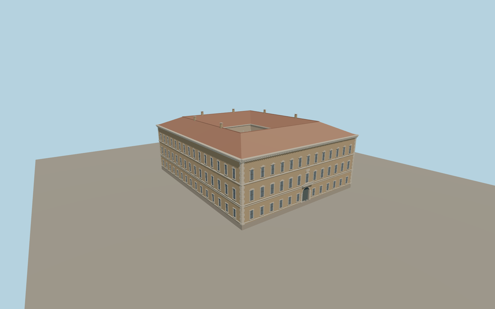

# Palazzo Farnese

Rome’s three-storey Renaissance palace with thirteen piazza-facing bays, an arched portal and balcony, alternating piano-nobile pediments, a projecting travertine cornice, an open arcaded court, and the Via Giulia garden loggia.

Run `node packages/worldgen/scripts/generate-palazzo-farnese.mjs` to rebuild the source master. Append `--check` to compare the exact bytes. Use `--ids=palazzo_farnese` for targeted import, LOD generation and placement.

Ordinary photographs and standard PMTiles determine the exterior and courtyard. Roof slopes, rear passage grades and decorative proportions are visual approximations.

The embassy interior and detached garden structures are outside the model. The front entrance is shown closed.

Original geometry:repository license. Map:© OpenStreetMap contributors,ODbL-1.0;Protomaps. Standard terrain:terrain-grid.json. Ordinary pictures stay local and are not redistributed or used as textures. Current acceptance:qa.json.
