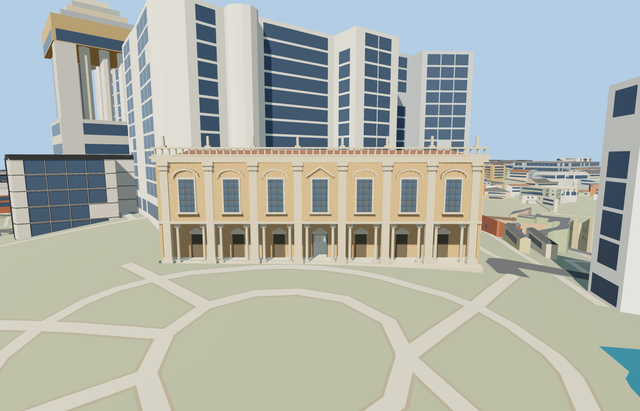

# Palazzo Nuovo — Capitoline Museums

Reviewed2026-10-24. **Complete medium-fi connected exterior with approximate native fit. Capitoline Museums still requires its separate Senatorio/Tabularium member.**

## Built and inspected

Complete connected Palazzo Nuovo exterior on its actual L-shaped mapped main footprint and attached rear courtyard range. Seven-bay southwest piazza facade with eight giant pilasters, fourteen physical round portico columns, deep open ground loggia, upper window pediments, cornice and open roof balustrade; separate tiled roofs, the original open Marforio courtyard and approximate rear-range walls. Central ground passage connects the portico to the court. Original abstract roof figures; no copied sculpture, inscriptions or furnished galleries.

Inspected all44 current portable/shared/medium-fi/native frames in six labeled contact sheets, plus full-resolution native front, portico, whole-site and overhead court views. The seven upper bays, eight giant pilasters, fourteen physical round ground supports, six curved and one triangular window hood, deep open loggia, central passage and open roof balustrade read coherently. Actual L-shaped main and attached rear range retain the open mapped Marforio court. Roof figures/capitals are original abstractions. Ordinary photographs and standard PMTiles guided one continuous author/inspect/fix round.

## Shared materials and LODs

Five existing256px material graphs: stucco, stone_limestone, tile_ceramic, storefront and wood_plain. Metric UVs and linear tints; five nearby draws/one skyline. No embedded image, private atlas or new graph. Each used graph reads once; unloading releases every model geometry. POSITION/NORMAL streams are separate and CPU/GPU accounting matches.

| Level | Triangles | Bytes | Draws |
| --- | ---: | ---: | ---: |
| skyline | 730 | 64208 | 1 |
| district | 2810 | 267220 | 5 |
| street | 3524 | 338948 | 5 |
| closeup | 3920 | 374104 | 5 |

Four authored LODs730/2810/3524/3920 triangles. Initial skyline+district331428bytes; closeup374104bytes. Skyline retains the main/rear envelope, real loggia aperture and central passage, and drops nearby fenestration, paired columns and balustrade ornament. Synthetic street/block contexts check coherence and rendering tiers, not geographic placement.

## Native location and limits

Actual way25958413 fixes the main museum envelope. Connected rear way123817538 wraps the open courtyard around the mapped Fontana di Marforio POI; the ordinary courtyard photo and museum courtyard description support that attachment. Santa Maria in Aracoeli way25640152, Palazzo Senatorio and Conservatori/Caffarelli remain independent. X west-northwest along the front, Z south-southwest into Piazza del Campidoglio; axes baked east/up/south, heading0. Retained standard Protomaps20261020 and Mapzen ground; outside piazza provider[0,10] gives 48.69647368253359m datum. Boundary grades -0.734..2.841m; closed foundation reaches -0.934m. Original court, piazza, independent buildings, roads and water remain. Coarse hill exposure/high-side burial and historical thresholds/accessibility approximate; no bespoke terrain or flattening. Initial native facade/loggia views inspected: treads and columns have supported contact, court remains open and independent structures remain unchanged. Rear grade burial and hidden levels remain approximate. Both owned mapped records are replaced. All2511 resident/2943 wider independent buildings, original court/piazza, terrain, roads and127008.089m² water remain. Failure keeps all2513 originals; all LOD/failure/unload cases restore terrain/water and release geometry.

Medium-fi recognizable exterior; historic heights and hidden rear roof/bay subdivisions, capitals, roof figures, thresholds and accessibility are approximate. Main floor+.3m and coarse boundary grades-.734..+1.952m leave modest low-side foundation exposure and up to1.65m high-side burial. Rear boundary reaches+2.841m, burying up to2.54m of the lower rear wall. The fountain sculpture, inscriptions, collection items and furnished galleries are not reproduced. Some detail/style frames crop edges; whole/source/native views cover the envelope. Flat synthetic ground can bury grade-specific foundations/treads. Native Aracoeli/Senatorio/Conservatori still use independent procedural shells in this isolated fixture; they occlude some rear context. Physical phone/laptop/dense-city timing remains pending.

## Rebuild and checks

Source-local recipes are inventoried in source.json and generator registered in asset-build.json. Run `node content/worldgen/source/places/sr/sr2/palazzo_nuovo_capitoline/models/generate-palazzo-nuovo-capitoline.mjs --check`. Selected import/placement checks, strict medium-fi, scene validation and sim30 passed. Six GLBs have zero Khronos errors/warnings;88 actual geometry/contact probes and8 map-level cases passed, covering both detailed owned footprints. Sim30 sha256:de7a0abceaf36400e4c58b01ea06d11a47303612c261469025720fc955dcb620. Exact pins and concise evidence: [qa.json](qa.json).

## References

- [Facade photograph](https://commons.wikimedia.org/wiki/File:Facade_Palazzo_Nuovo_Roma.jpg), Jastrow,2006-09-03, public domain; viewed only.
- [Courtyard photograph](https://commons.wikimedia.org/wiki/File:0_Marforio_-_Cortile_del_Palazzo_Nuovo_-_Musei_Capitolini_(MC0001).jpg), Jean-Pol GRANDMONT,2011-10-02,CC BY3.0; viewed only.
- [Museum courtyard](https://www.museicapitolini.org/en/collezioni/percorsi_per_sale/palazzo_nuovo/cortile), membership context.
- [Mapped main](https://www.openstreetmap.org/way/25958413) and [attached rear range](https://www.openstreetmap.org/way/123817538), ©OpenStreetMap contributors,ODbL-1.0. Controls and signed axes: [map-frame.json](map-frame.json).
