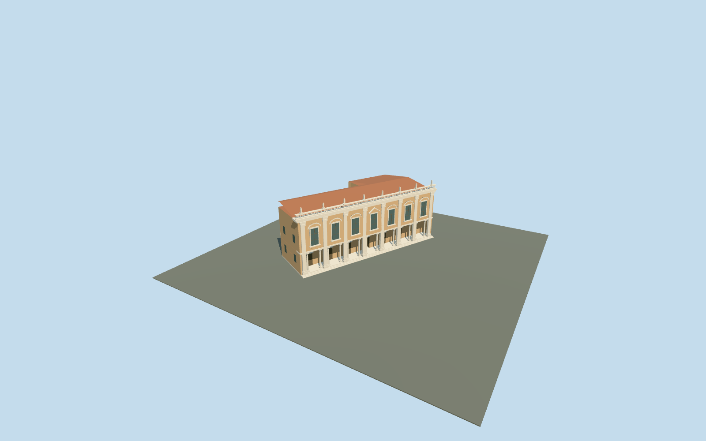

# Palazzo Nuovo — Capitoline Museums

Complete connected Palazzo Nuovo exterior on its actual L-shaped mapped main footprint and attached rear courtyard range. Seven-bay southwest piazza facade with eight giant pilasters, fourteen physical round portico columns, deep open ground loggia, upper window pediments, cornice and open roof balustrade; separate tiled roofs, the original open Marforio courtyard and approximate rear-range walls. Central ground passage connects the portico to the court. Original abstract roof figures; no copied sculpture, inscriptions or furnished galleries.

## Evidence and reconstruction

Published dimensions and reconstructed details are separated in spec.json. Primary references:

- [Reference](https://commons.wikimedia.org/wiki/File:Facade_Palazzo_Nuovo_Roma.jpg)
- [Reference](https://commons.wikimedia.org/wiki/File:0_Marforio_-_Cortile_del_Palazzo_Nuovo_-_Musei_Capitolini_(MC0001).jpg)

Complete connected Palazzo Nuovo exterior on its actual L-shaped mapped main footprint and attached rear courtyard range. Seven-bay southwest piazza facade with eight giant pilasters, fourteen physical round portico columns, deep open ground loggia, upper window pediments, cornice and open roof balustrade; separate tiled roofs, the original open Marforio courtyard and approximate rear-range walls. Central ground passage connects the portico to the court. Original abstract roof figures; no copied sculpture, inscriptions or furnished galleries.

## Model and axes

3,920 triangles; 11,412 vertices; 5 material groups; 461,268 bytes. Native bounds: -25.102, -0.964, -33.561 to 35.117, 21.380, 12.622. Source hash: `sha256:10bef5b7d590a136df839799bbb50d824ec0bee59a560bdcce3f0e4b2b14eecf`.

{"x":"east","y":"up","z":"south"}

The geographic proposal uses exact-QID OpenStreetMap evidence. Map-derived orientation and estimated architectural details require real-site visual review; preview eligibility is distinct from geographic/fidelity approval. Map attribution: © OpenStreetMap contributors, ODbL-1.0.

## Reproduce

Run `node content/worldgen/source/places/sr/sr2/palazzo_nuovo_capitoline/models/generate-palazzo-nuovo-capitoline.mjs --ids=palazzo_nuovo_capitoline` (or add `--check`). The generator preserves manually edited masters by checking their baseline hashes. Import through the standard authored-model workflow with optimization disabled; then capture all QA cameras, including shared-surface views.

## Pending work

- Complete connected Palazzo Nuovo exterior on its actual L-shaped mapped main footprint and attached rear courtyard range. Seven-bay southwest piazza facade with eight giant pilasters, fourteen physical round portico columns, deep open ground loggia, upper window pediments, cornice and open roof balustrade; separate tiled roofs, the original open Marforio courtyard and approximate rear-range walls. Central ground passage connects the portico to the court. Original abstract roof figures; no copied sculpture, inscriptions or furnished galleries.
- Actual way25958413 fixes the main museum envelope. Connected rear way123817538 wraps the open courtyard around the mapped Fontana di Marforio POI; the ordinary courtyard photo and museum courtyard description support that attachment. Santa Maria in Aracoeli way25640152, Palazzo Senatorio and Conservatori/Caffarelli remain independent. X west-northwest along the front, Z south-southwest into Piazza del Campidoglio; axes baked east/up/south, heading0.
- Photo-led approximate medium-fi dimensions: piazza body17m, cornice/balustrade19.3m and abstract roof figures21.2m above the+.3m floor, consistent with the mapped22m overall scale. Rear court range9m plus1.5m roof rise is an approximation; hidden roof subdivisions, bays, capitals, figures, floor levels and thresholds are not measured.
- Retained standard Protomaps20261020 and Mapzen ground; outside piazza provider[0,10] gives 48.69647368253359m datum. Boundary grades -0.734..2.841m; closed foundation reaches -0.934m. Original court, piazza, independent buildings, roads and water remain. Coarse hill exposure/high-side burial and historical thresholds/accessibility approximate; no bespoke terrain or flattening.

This bundle follows the medium-fi standard. Medium-fi appearance and geographic fit are reviewed separately. Hash-bound visual acceptance is recorded separately after capture inspection.
