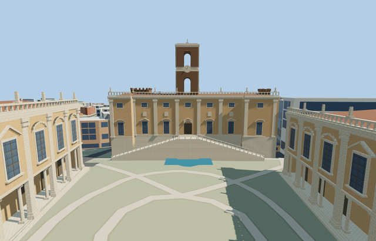

# Palazzo Senatorio / Tabularium

Reviewed2026-10-24. **Complete medium-fi connected exterior with approximate native fit. Final required Capitoline member.**

## Built and inspected

Complete connected Palazzo Senatorio / Tabularium exterior on the mapped parent with its narrow open court and three integral tower parts. Seven-bay ochre piazza facade with rusticated base, giant pilasters, upper windows, pedimented lower openings and a physically recessed central portal; two supported stair flights and central landing, roof balustrade, two open bell-tower stages, clock and finial. Forum side has three physical arched recesses, masonry basement, upper gallery windows, tiled roof and medieval corner tower silhouettes. Sculpture, heraldry and inscriptions use no copied artwork; small ornament is abstract.

Inspected all52 current portable/shared/medium-fi/native frames in nine labeled contact sheets, plus full-resolution native facade, stair, Forum, belfry and courtyard views. Seven-bay front, pale base, open stair rails/landing, recessed portal, three deep rear arch pockets, open two-stage belfry, clock/cornices, corner crenellations, tiled roofs and original narrow court read coherently. Ordinary pictures and standard PMTiles guided one continuous author/inspect/fix round; sculpture, heraldry and inscriptions are not copied.

## Shared materials and LODs

Seven existing256px material graphs: stucco, stone_limestone, tile_ceramic, storefront, wood_plain, brick and stone_ashlar. Seven nearby draws/one skyline, metric UVs, linear tints and separate POSITION/NORMAL streams. No embedded image, private atlas or new graph. Each used graph reads once; all model geometry is released at unload. CPU/GPU accounting matches.

| Level | Triangles | Bytes | Draws |
| --- | ---: | ---: | ---: |
| skyline | 997 | 89336 | 1 |
| district | 3821 | 364124 | 7 |
| street | 5933 | 569432 | 7 |
| closeup | 6497 | 615160 | 7 |

Four authored LODs997/3821/5933/6497 triangles. Initial skyline+district453460bytes; closeup615160bytes. Skyline keeps the complete main/corner/clock-tower silhouette, both physical open belfry stages, the rear arch pockets, court and coarse supported three-tread stair proxies. It omits small fenestration, nearby portal recess, pilasters, rails and clock-face detail. District uses12 treads per flight; street24; closeup28. Synthetic contexts test coherence/LOD/tier behavior, not native fit.

## Native location and limits

Relation1691910 fixes the connected Senatorio/Tabularium parent. Integral ways123817461,123817462 and123817559 locate the corner and central clock towers. X northeast along the long central piazza edge; Z northwest toward the piazza. Signed axes baked east/up/south, heading0. Conservatori/Caffarelli, Nuovo, Aracoeli, surrounding ruins and city buildings remain independent. Original standard Protomaps20261020 / Mapzen grid retained. Outside piazza provider[0,13] gives 46.75355052584945m datum. Parent boundary grades -9.159..-0.794m; closed foundation-9.409m. Rear levels approximate the steep Forum slope. Court and piazza ground, independent neighbors, roads and water retained; no bespoke terrain or flattening. Historical thresholds, exposed basements and accessibility approximate. Initial native terrain/ownership inspected: both stair feet and the central landing are supported, the narrow court remains open, all four owned map records are replaced and independent structures/roads/water remain. Coarse rear levels, basement exposure and historic thresholds remain approximate. All four owned map records are replaced;2509 resident and2941 wider independent buildings, original narrow courtyard/piazza, terrain, roads and127008.089m² water remain. Failure keeps all2513 originals; all LOD/failure/unload cases restore ground/water and release geometry.

Recognizable medium-fi exterior with approximate architectural levels and hidden roof/bay inventory. Original coarse ground falls-.794..-9.159m around the mapped parent relative to the outside piazza datum. Front floor+.25m gives about1m of low-side plinth exposure; foundation-9.409m supports the Forum edge. Rear arches/levels approximate the sampled slope, not surveyed archaeology. Small capitals, roof figures, medieval crenellations, clock markings, thresholds and accessibility are simplified. No copied sculpture/inscriptions/heraldry, furnished galleries or reconstructed ancient interior. Some detail views crop far edges or tower top; whole/turntable views cover the envelope. Flat synthetic planes bury lower basement arches and grade-specific foundations. Native procedural ruins/neighbors can occlude lower Forum details; they stay independent. Physical phone/laptop and dense-city timings remain pending.

## Rebuild and checks

Source-local recipes/generator are inventoried in source.json and asset-build.json. Run `node content/worldgen/source/places/sr/sr2/palazzo_senatorio_tabularium/models/generate-palazzo-senatorio-tabularium.mjs --check`. Selected generation/import/placement, strict medium-fi, scene validation and sim30 pass. Six GLBs have zero Khronos errors/warnings;161 actual mesh/contact probes and7 map-level cases cover all4 owned detailed footprints. Sim30 sha256:8913206131d04f1bb99ea887706cc38c8d240b1c1cd5926e2aeac34982c2c2be. Exact pins and concise evidence: [qa.json](qa.json).

## References

Ordinary pictures viewed only; no copied pixels or artwork. Provenance and inspection notes: [reference-metadata.json](reference-metadata.json). [Mapped parent](https://www.openstreetmap.org/relation/1691910) and integral parts: ©OpenStreetMap contributors,ODbL-1.0. Controls and signed axes: [map-frame.json](map-frame.json).

## Combined Capitoline viewer check

Inspected three current combined district/closeup frames. All three named palace models load independently at their native anchors; all15 owned records are replaced while2498 resident independent buildings, all3 courts and original terrain/roads/water remain. Seven used shared graphs read once each across all3 assets; unload releases all geometry and restores ground/water. Initial combined skyline+district geometry1147632bytes; closeup1424268bytes. Surrounding Aracoeli and city/ruins remain procedural. Historic thresholds and rear levels remain approximate; physical-device timings pending.
