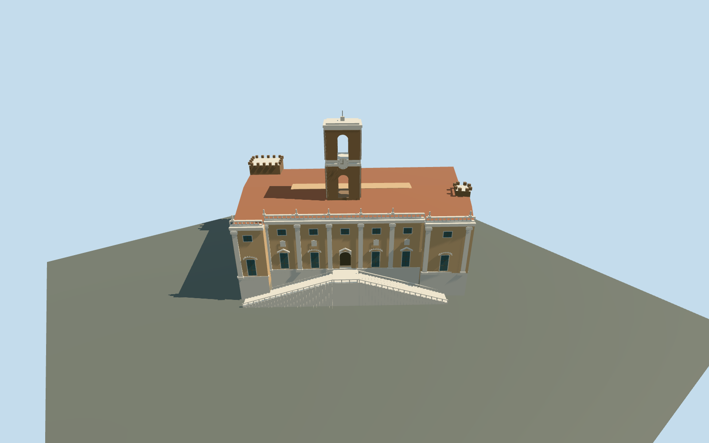

# Palazzo Senatorio / Tabularium

Complete connected Palazzo Senatorio / Tabularium exterior on the mapped parent with its narrow open court and three integral tower parts. Seven-bay ochre piazza facade with rusticated base, giant pilasters, upper windows, pedimented lower openings and a physically recessed central portal; two supported stair flights and central landing, roof balustrade, two open bell-tower stages, clock and finial. Forum side has three physical arched recesses, masonry basement, upper gallery windows, tiled roof and medieval corner tower silhouettes. Sculpture, heraldry and inscriptions use no copied artwork; small ornament is abstract.

## Evidence and reconstruction

Published dimensions and reconstructed details are separated in spec.json. Primary references:

- [Reference](https://commons.wikimedia.org/wiki/File:Palazzo_senatorio_Rome_2011_2.jpg)
- [Reference](https://commons.wikimedia.org/wiki/File:Palazzo_Senatorio_2.jpg)
- [Reference](https://commons.wikimedia.org/wiki/File:Palazzo_dei_Senatori_in_the_Piazza_del_Campidoglio.jpg)
- [Reference](https://commons.wikimedia.org/wiki/File:Senatorenpalast_vom_Forum_aus.jpg)

Complete connected Palazzo Senatorio / Tabularium exterior on the mapped parent with its narrow open court and three integral tower parts. Seven-bay ochre piazza facade with rusticated base, giant pilasters, upper windows, pedimented lower openings and a physically recessed central portal; two supported stair flights and central landing, roof balustrade, two open bell-tower stages, clock and finial. Forum side has three physical arched recesses, masonry basement, upper gallery windows, tiled roof and medieval corner tower silhouettes. Sculpture, heraldry and inscriptions use no copied artwork; small ornament is abstract.

## Model and axes

6,497 triangles; 18,929 vertices; 7 material groups; 763,696 bytes. Native bounds: -20.790, -9.409, -25.961 to 55.566, 46.500, 58.789. Source hash: `sha256:a9c105ef3dd362b62a98a75d110adddf8a7c271099140967ea5de5d1e0f757d6`.

{"x":"east","y":"up","z":"south"}

The geographic proposal uses exact-QID OpenStreetMap evidence. Map-derived orientation and estimated architectural details require real-site visual review; preview eligibility is distinct from geographic/fidelity approval. Map attribution: © OpenStreetMap contributors, ODbL-1.0.

## Reproduce

Run `node content/worldgen/source/places/sr/sr2/palazzo_senatorio_tabularium/models/generate-palazzo-senatorio-tabularium.mjs --ids=palazzo_senatorio_tabularium` (or add `--check`). The generator preserves manually edited masters by checking their baseline hashes. Import through the standard authored-model workflow with optimization disabled; then capture all QA cameras, including shared-surface views.

## Pending work

- Complete connected Palazzo Senatorio / Tabularium exterior on the mapped parent with its narrow open court and three integral tower parts. Seven-bay ochre piazza facade with rusticated base, giant pilasters, upper windows, pedimented lower openings and a physically recessed central portal; two supported stair flights and central landing, roof balustrade, two open bell-tower stages, clock and finial. Forum side has three physical arched recesses, masonry basement, upper gallery windows, tiled roof and medieval corner tower silhouettes. Sculpture, heraldry and inscriptions use no copied artwork; small ornament is abstract.
- Relation1691910 fixes the connected Senatorio/Tabularium parent. Integral ways123817461,123817462 and123817559 locate the corner and central clock towers. X northeast along the long central piazza edge; Z northwest toward the piazza. Signed axes baked east/up/south, heading0. Conservatori/Caffarelli, Nuovo, Aracoeli, surrounding ruins and city buildings remain independent.
- Approximate photo-led medium-fi levels above piazza datum: front floor+.25m, central stair landing7.25m, main body21.25m, roof/balustrade23.5m; lower Forum arches from-7.75m to+2.05m, plus upper windows. Central tower has two open stages above the main roof, cornice43.25m and finial46.5m; mapped tower45m is a scale cue, not a surveyed datum. Corner towers24/25m. Rear roof subdivisions, historical floor levels, arch gallery interiors and ornament remain approximate.
- Original standard Protomaps20261020 / Mapzen grid retained. Outside piazza provider[0,13] gives 46.75355052584945m datum. Parent boundary grades -9.159..-0.794m; closed foundation-9.409m. Rear levels approximate the steep Forum slope. Court and piazza ground, independent neighbors, roads and water retained; no bespoke terrain or flattening. Historical thresholds, exposed basements and accessibility approximate.

This bundle follows the medium-fi standard. Medium-fi appearance and geographic fit are reviewed separately. Hash-bound visual acceptance is recorded separately after capture inspection.
