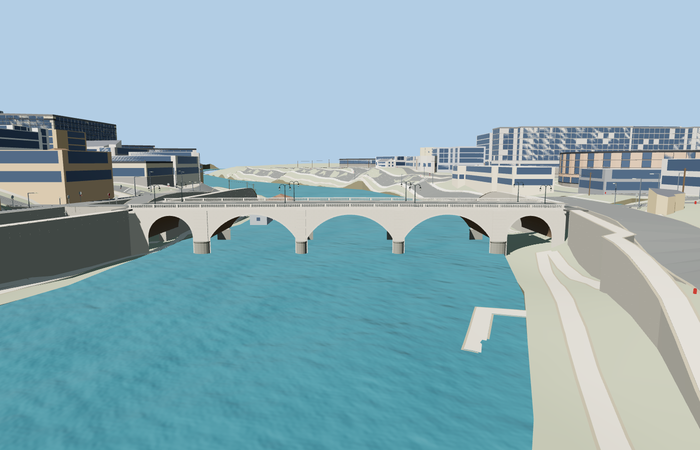

# Ponte Cavour

Reviewed 2026-10-27. **Scoped medium-fi exterior and approximate native placement complete.**

Inspected67 current frames:11 portable,11 shared-material/geographic,27 medium-fi and18 native views. All five real openings, round-ended piers, brick vaults, travertine cornices, open turned balustrades and eight paired-lantern posts remain distinct. The original52872-triangle body and every original grouped vertex attribute remain exact. Added288 source triangles for thin upper-bank paving around the retained asymmetric wings; the skyline/district use simpler paving. The full arch silhouette remains visible at intended distances, while baluster profiles, stone joints and lantern curvature enter nearer levels.

Six existing shared256px graphs: stone_travertine, stone_limestone_raw, brick, stone_granite, concrete_plain and metal_painted. Metric UVs and linear vertex tints provide variation; lantern glass is a local physical translucent material. No embedded/private images, copied photograph pixels or downloaded meshes. Each graph is read once and runtime geometry/support resources dispose on unload.

| Level | Triangles | Bytes | Draws |
| --- | ---: | ---: | ---: |
| skyline | 685 | 56116 | 1 |
| district | 3888 | 343392 | 6 |
| street | 15552 | 1577340 | 7 |
| closeup | 39396 | 4069356 | 7 |

Detailed source master: 53160 triangles / 6383380 bytes. Browser levels: 685 / 3888 / 15552 / 39396 triangles and 56116 / 343392 / 1577340 / 4069356 bytes. Initial skyline plus district is 399508 bytes, below phone/laptop download targets. Physical-device timing remains unmeasured.

Exact-QID OSM way/381471896 and ordinary photos establish the retained irregular112.529m by22.735m mapped outline; the modeled main body is20.5m wide. Named bridge-tagged roads cover106.249m inside those wings, not a separately surveyed overall length. Anchor[12.4742725,41.9049771], heading-0.104179996174: +X east/southeast toward Campo Marzio, -X west/northwest toward Prati, +Z south/southwest downstream. Corrected earlier compass wording without changing the numeric frame. Source origin9.5m and native water about10.700m are standard-Mapzen/photo visualization controls. Thin approximate upper-bank slabs meet actual mapped lanes/footways within0.011003m across all four levels. Four independent cycleway records have unchanged inputs, no authored connections and zero added grade; low rays through the west opening remain clear.

Six clean GLBs,308 mesh probes, actual lane/footway samples at every level and native failed-load/unload checks pass. Compass labels and review-note formatting were corrected with numeric geometry, scenes, model bytes and captured frame bytes unchanged; no new images are claimed for that metadata reconciliation. Bulk evidence stays local.

## Reconstruction limits

- Photo-based arch rises, pier profiles, height datum and lamp placement are approximate.
- Baluster spacing and lamp intervals are regularized; no exact element count or as-built claim.
- A<=7.5cm mapped facade sliver is snapped to the20.5m body plane to preserve the west arch opening.
- Landmark LODs intentionally remove turned profiles and small fittings; skyline uses an opaque mean-color parapet band.
- Surrounding quays, nearby architecture, boats, traffic and graffiti are outside this model.
- Upper-bank paving around the irregular wings is approximate visualization support, not surveyed quay geometry. Thin slabs sit 1cm below map paving and leave lower riverside routes below; all surrounding coarse terrain remains approximate.
- Coarse riverbanks, automatic retaining faces, nearby architecture, floating map objects and power lines remain context, not a reconstruction of the historic quays. Input preservation does not assert unchanged elevations on every connected street; bounded approach grades intentionally change connected upper paving.
