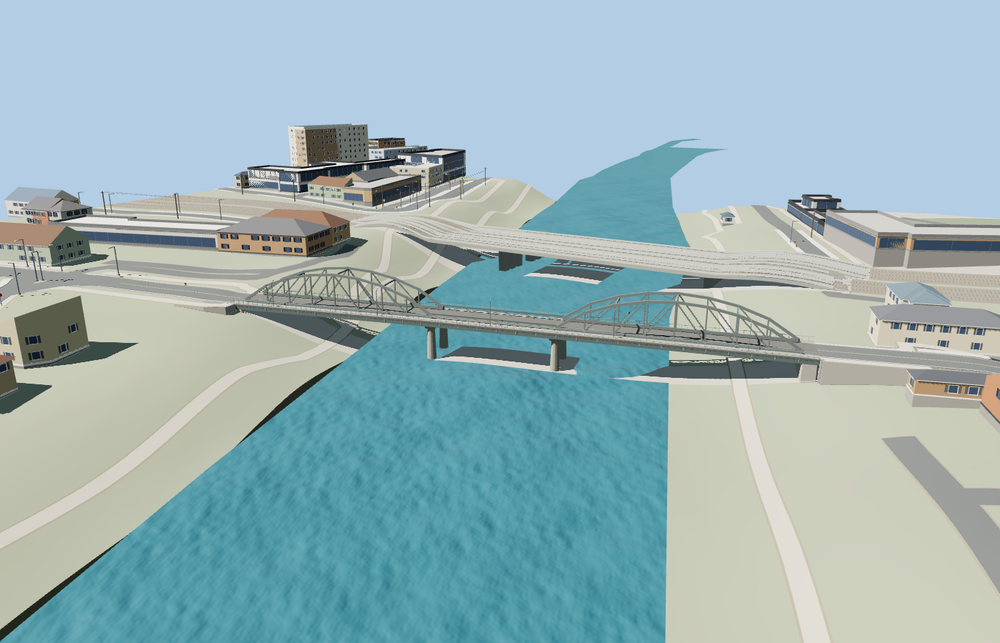

# Ponte dell'Industria

Two dark restored iron trusses straddle the road with a low central span between them. The three-part deck includes a separate cycling and pedestrian edge, riveted steel chord details and a pair of concrete pier bents.

The exact OpenStreetMap bridge outline and named PMTiles deck and sidewalk traces locate the crossing from Portuense to Ostiense. Eighteen street and path seam samples pass at each detail level with a maximum height difference of 3.8 cm. The original crossing returns when the model fails to load. Native terrain, water, the adjacent rail crossing and independent streets remain.

The 20,908-triangle source rebuilds byte for byte. The first two runtime tiers total 297,824 bytes. Six GLBs validated and 36 current views were inspected.

The mapped bridge outline and sidewalk traces set the exterior length, width, and bearing direction. Deck grades and truss sections are exterior-photo approximations. The model covers the bridge and its paths; the adjacent rail crossing and bank paths remain separate. The standard terrain shows a shallow exposed patch beneath the center span at the sample water level.

Rebuild with `node packages/worldgen/scripts/generate-ponte-dellindustria.mjs`. Append `--check` to compare exact bytes. Use `--ids=ponte_dellindustria` for targeted import, LOD, placement and readiness.
