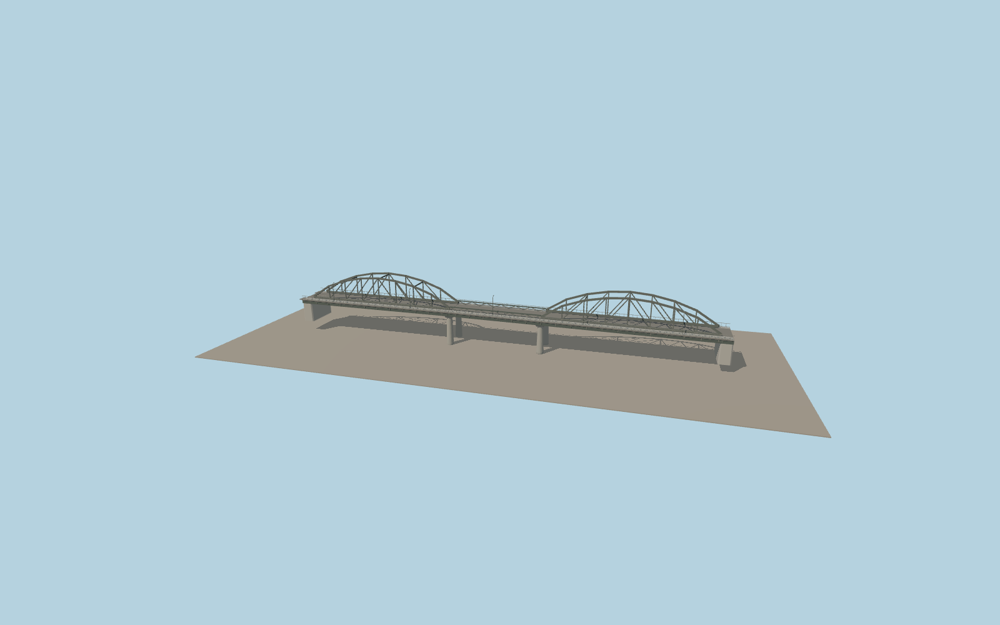

# Ponte Industria

Two dark restored iron trusses straddle the road with a low central span between them. The three-part deck includes a separate cycling and pedestrian edge, riveted steel chord details and a pair of concrete pier bents.

Run `node packages/worldgen/scripts/generate-ponte-dellindustria.mjs` to rebuild the source master. Append `--check` to compare the exact bytes. Use `--ids=ponte_dellindustria` for targeted import, LOD generation and placement.

The mapped bridge outline and sidewalk traces set the exterior length, width, and bearing direction.

Deck grades and truss sections are exterior-photo approximations. The model covers the bridge and its paths; the adjacent rail crossing and bank paths remain separate.

Original geometry follows the repository license. Map data is © OpenStreetMap contributors under ODbL-1.0 via Protomaps. Terrain samples are described in terrain-grid.json. Ordinary pictures stay local and are not redistributed or used as textures. Current acceptance is recorded in qa.json.
