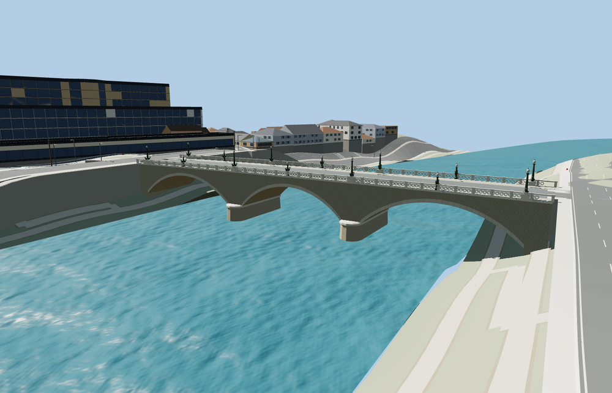

# Ponte Giuseppe Mazzini

**Viewer readiness passed for the current Route91 crossing.**

Source: 33,482 triangles. Skyline / district / street / close-up: 824 / 2,512 / 15,554 / 33,194 triangles. Initial skyline plus district: 256,952 bytes; close-up: 2,250,116 bytes. Four existing shared material graphs, four merged bindings, metric UVs and zero embedded images. Six clean GLBs; 34 current inspected images: 10 portable plus 24 native. Seventeen native context frames cover silhouette, three distances, noon/late lights, reduced-resolution shadowless Economy/High and four fixed-camera LOD transitions.

Ordinary river-side and lamp photographs guide the open segmental arches, rounded waterline piers, pierced parapets and simplified green bronze lamps. The current carriageway direction corrects the retained minimum-area rectangle by 0.8298 degrees; paired sidewalk traces refine its center by less than 1 m. The 108.4 m source includes short sidewalk-bearing ends around the 106.558 m retained crossing. The original polygon world coordinates are preserved explicitly. Roadside walks and the parapet base share a 12 cm curb datum.

All four tiers pass 45 carriageway/sidewalk join-width probes, 12 approach probes and six lower-route clearance probes. The independent lower cycleway and riverbank path remain unchanged, unprofiled and unobstructed. Minimum sampled headroom is 2.817 m across all tiers and 3.104 m close-up. Original terrain and four water features, including three river ribbons, remain unchanged. All tiers unload model/support geometry; failed loads retain the native fallback.

The rounded pier noses and lamp shafts now use outward-facing walls. A targeted radial-normal check confirms both surfaces. All current source/native frames were rendered again with the corrected geometry in an isolated Molen project while the earlier batch remained frozen. Exact source, runtime, LOD, scene and placement hashes match the canonical outputs.

Rebuild: `node packages/worldgen/scripts/generate-ponte-giuseppe-mazzini.mjs` (append `--check` for exact source bytes). Import/LOD/placement/readiness selection: `--ids=ponte_giuseppe_mazzini`. No engine CI, audit, Git mutation or upload in this model pass.

Complete Ponte Giuseppe Mazzini: three open segmental stone arches, two rounded river piers with waterline bases and projecting springing caps, ashlar spandrels, pale travertine arch rings and cornice, broad road with raised verge walks, pierced circular stone parapets and green-patinated ornamental lamps with small rostral scroll forms. Preserve the complete mapped crossing and both independent riverside routes beneath the outer spans.

Original ordinary-picture medium-fi approximation, not a surveyed engineering or conservation model. ColdShine’s2007 lower-lungotevere photograph controls the three open arches, rounded piers and pierced parapet. Lubin23’s lamp close-up controls the patinated shaft, globe and small rostral scroll silhouette. Heraldic relief, inscriptions and individual carved figures are simplified rather than copied as photo textures. Retained106.558m by17.866m envelope identifies the bridge; current carriageway and paired sidewalk traces refine its axis by0.8298 degrees and center by less than1m. The108.4m source includes short mapped sidewalk-bearing ends. Original footprint world coordinates remain in map-frame.json; they are not used as a literal deck rectangle. Hidden construction, masonry blocks, lamp count, road markings, arch profile and absolute elevations remain approximate. No custom terrain/water flattening, private textures, copied meshes or vehicles. Physical-device timing remains unmeasured. Actual native standard terrain and polygon/river-ribbon water remain unchanged. The paired bridge sidewalk traces refine the retained rectangle axis by0.8298 degrees and its center by less than1m; the108.4m source includes short mapped sidewalk-bearing ends. Original retained footprint world coordinates remain explicit in map-frame.json. Native45 width-distributed carriageway/sidewalk joins and12 approach probes pass on every tier. The two lower riverside routes remain unchanged and unprofiled. Six path-width clearance probes per LOD are unobstructed; minimum sampled headroom2.817m across LODs and3.104m close-up. These are visualization fit checks, not engineering clearance certification. Bronze rostral sculpture and heraldic relief are simplified. Physical-device performance remains unmeasured.
