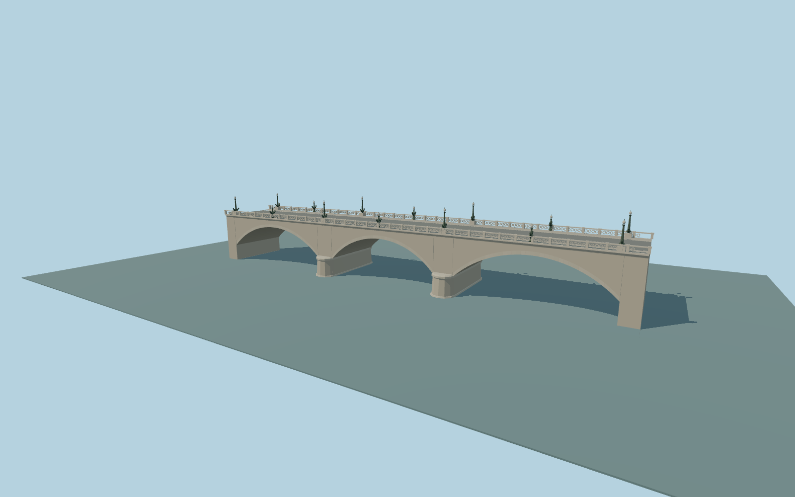

# Ponte Giuseppe Mazzini

Complete Ponte Giuseppe Mazzini: three open segmental stone arches, two rounded river piers with waterline bases and projecting springing caps, ashlar spandrels, pale travertine arch rings and cornice, broad road with raised verge walks, pierced circular stone parapets and green-patinated ornamental lamps with small rostral scroll forms. Preserve the complete mapped crossing and both independent riverside routes beneath the outer spans.

Rebuild: `node packages/worldgen/scripts/generate-ponte-giuseppe-mazzini.mjs`;append `--check` for exact source bytes. Select import/LOD/placement with `--ids=ponte_giuseppe_mazzini`. Detailed source and four browser tiers are separate ignored GLB outputs.

Original ordinary-picture medium-fi approximation, not a surveyed engineering or conservation model. ColdShine’s2007 lower-lungotevere photograph controls the three open arches, rounded piers and pierced parapet. Lubin23’s lamp close-up controls the patinated shaft, globe and small rostral scroll silhouette. Heraldic relief, inscriptions and individual carved figures are simplified rather than copied as photo textures.

Retained106.558m by17.866m envelope identifies the bridge; current carriageway and paired sidewalk traces refine its axis by0.8298 degrees and center by less than1m. The108.4m source includes short mapped sidewalk-bearing ends. Original footprint world coordinates remain in map-frame.json; they are not used as a literal deck rectangle. Hidden construction, masonry blocks, lamp count, road markings, arch profile and absolute elevations remain approximate. No custom terrain/water flattening, private textures, copied meshes or vehicles. Physical-device timing remains unmeasured.

Original geometry:repository license. Map:© OpenStreetMap contributors,ODbL-1.0;Protomaps. Standard terrain:terrain-grid.json. Ordinary pictures stay local and are not redistributed or used as textures. Current acceptance:qa.json.
