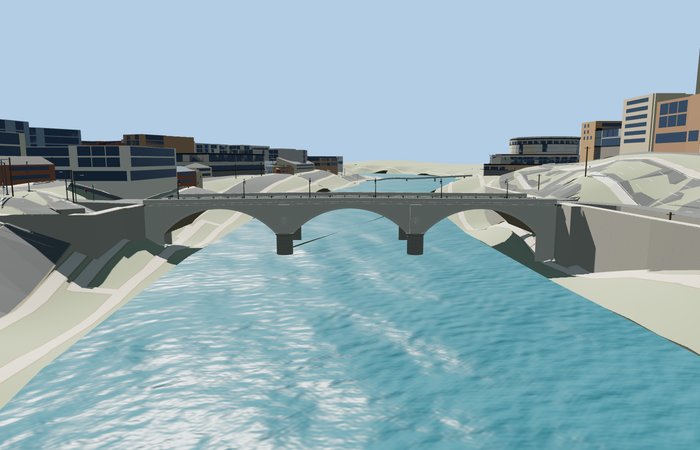

# Ponte Umberto I

Reviewed 2026-10-27. **Scoped medium-fi exterior and approximate native placement complete.**

Inspected 61 current frames: 10 portable, 10 shared-material/geographic, 26 medium-fi and 15 native views. Three genuine segmental arches, two round-ended pier heads, cornices, solid parapets/coping, simplified shields/laurel, asymmetric walks, raised median, six curved lamps and chain fencing remain recognizable. The four runtime models retain the full arch silhouette at their intended distances; small relief, chains and lantern curvature enter nearer levels. The original 20188-triangle body and every original grouped vertex attribute remain exact; ten small paving prisms add 120 triangles for the bank landings.

Five existing shared 256px graphs: stone_travertine, stone_limestone_raw, stone_granite, concrete_plain and metal_painted. Metric UVs and linear vertex tints provide variation; local lantern glass is a physical translucent material. No embedded or private images, copied photograph pixels or downloaded meshes. Each shared graph is read once and all model/support resources dispose on unload.

| Level | Triangles | Bytes | Draws |
| --- | ---: | ---: | ---: |
| skyline | 956 | 80088 | 1 |
| district | 1596 | 137572 | 5 |
| street | 7532 | 730300 | 6 |
| closeup | 14580 | 1422484 | 6 |

Detailed source master: 20308 triangles / 2440740 bytes. Browser levels: 956 / 1596 / 7532 / 14580 triangles and 80088 / 137572 / 730300 / 1422484 bytes. Initial skyline plus district is 217660 bytes, below the phone/laptop download targets. Physical-device timing is still unmeasured.

Exact-QID OSM relation/5679034 and ordinary photos establish the retained 105.108m bridge body. Anchor [12.471329317,41.902655954], heading -1.170051815347: +X southeast toward old Rome, -X northwest toward the Palace of Justice, +Z southwest/downstream. The raw mapped outline is retained separately from the widened replacement mask. Source origin 9.3m and native water about 11.265m are standard-Mapzen/photo visualization controls. Approximate 2m flared bank aprons overlap skewed map ends, 1cm below native paving. Actual mapped lane/footway width samples meet within 0.010001m at all four levels. Restored the generalized southeast footway T-junction and kept the turning sidewalks connected; stairs and nearby disconnected paths remain separate.

Six clean GLBs, 184 geometric probes, actual mapped join samples across all four levels, shared material bindings and native failure/unload checks pass. Bulk evidence remains local.

## Reconstruction limits

- Arch rises, pier dimensions and absolute elevation are approximate picture-based reconstructions.
- Six lamps and regular spacing are a simplified photo-based arrangement, not a verified as-built schedule.
- Shield/cross/laurel is a simplified visual motif, not exact heraldry.
- The 2m flared bank aprons are approximate visualization transitions for generalized PMTiles footways, not surveyed paving. They sit 1cm below map paving to avoid coplanar overlap. Coarse surrounding riverbank terrain and independent lower paths are retained.
- Surrounding coarse riverbanks, lower quay paths, independent transport slivers and automatic retaining faces are context, not a reconstruction of the historic embankments. No claim is made that every connected street elevation is unchanged; bounded approach grade metadata intentionally changes connected paving while raw map polylines, DEM and water are retained.
