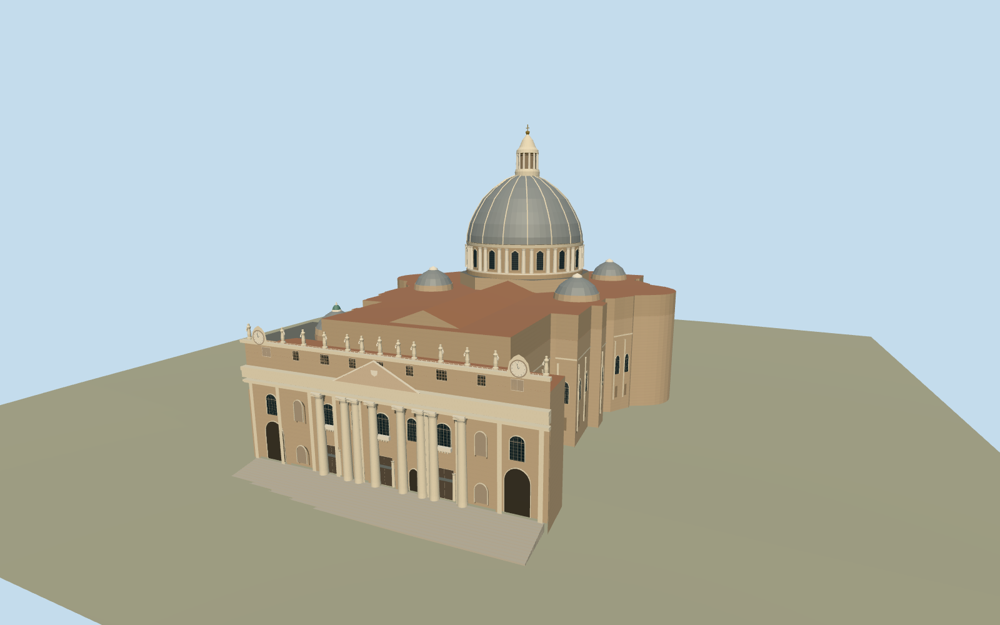

# St. Peter's Basilica

St. Peter’s Basilica and attached sacristy, including Maderno’s facade, the main ribbed dome and the smaller roof cupolas.

Authoring state: **review-in-qa.json**. Current completion evidence is in [qa.json](qa.json) and the [completion ledger](../../../../qualla-structures/batches/qualla-003.PROGRESS.md).

- [St. Peter's Basilica](https://qualla.com/st-peter-s-basilica/)

The facade rhythm, two clocks, thirteen roof statues, dome ribs and lantern are modeled. Sculptures, inscriptions, lettering and fine decoration are represented at landmark scale.

Local rooftop fittings, stair risers, subsidiary dome profiles and some outer window details are approximate. St Peter’s Square, the separate colonnades, the Apostolic Palace and basilica interiors are outside the selected extent.

Build: `node content/worldgen/source/places/sr/sr2/st_peter_s_basilica/models/generate-st-peter-s-basilica.mjs`. Add `--check` to verify exact regeneration. 28838 triangles; 8 materials; no embedded photographs.
