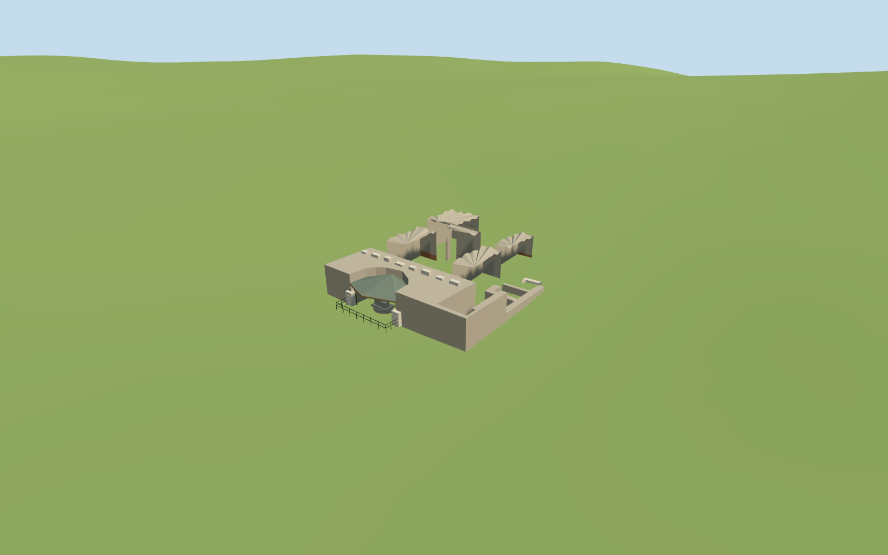

# Temple of Caesar

Temple of Caesar present-day medium-fi exterior: surviving concrete/brick podium and isolated eroded cores, low return/foundation traces, curved altar recess, broad protective canopy with timber understructure, rough altar blocks, a few fallen marble fragments and low visitor rail. No intact ancient colonnade or temple roof is reconstructed. Adjacent Arch of Augustus, Regia, Vesta, Antoninus and Faustina and the wider Forum remain independent.

## Evidence and reconstruction

Published dimensions and reconstructed details are separated in spec.json. Primary references:

- [Reference](https://commons.wikimedia.org/wiki/File:Temple_of_Caesar.jpg)
- [Reference](https://commons.wikimedia.org/wiki/File:RomaForoRomanoTempioDivoGiulio.JPG)

Two registered recipes build the specific surviving ruins and modern shelter with shared 256² material graphs, metric UVs and linear tints. No embedded images or unique atlas.

## Model and axes

2,835 triangles; 8,505 vertices; 5 material groups; 343,628 bytes. Native bounds: -10.442, -0.741, -13.670 to 21.564, 6.158, 14.335. Source hash: `sha256:276ee0ca3eaac4103a20d201bb49d2979b9af668bd3765335d5f23b8da0ddd32`.

{"x":"east","y":"up","z":"south"}

The geographic proposal uses exact-QID OpenStreetMap evidence. Map-derived orientation and estimated architectural details require real-site visual review; preview eligibility is distinct from geographic/fidelity approval. Map attribution: © OpenStreetMap contributors, ODbL-1.0.

## Reproduce

Run `node packages/worldgen/scripts/generate-additional-landmarks.mjs --ids=temple_of_caesar` (or add `--check`). The generator preserves manually edited masters by checking their baseline hashes. Import through the standard authored-model workflow with optimization disabled; then capture all QA cameras, including shared-surface views.

## Pending work

- Temple of Caesar present-day medium-fi exterior: surviving concrete/brick podium and isolated eroded cores, low return/foundation traces, curved altar recess, broad protective canopy with timber understructure, rough altar blocks, a few fallen marble fragments and low visitor rail. No intact ancient colonnade or temple roof is reconstructed. Adjacent Arch of Augustus, Regia, Vesta, Antoninus and Faustina and the wider Forum remain independent.
- Q1133288/way131451819 identifies the archaeological site. Seven pinned standard PMTiles components control the surviving podium, shelter, four concrete cores and short southern foundation trace. The broad historic site boundary is context, not a solid building to extrude. The curved shelter/recess and ordinary northwest frontal picture establish the altar front toward northwest, with an internal architectural rotation of about 124 degrees. Raw +X remains east and +Z south at runtime heading 0. Neighboring Arch of Augustus components east of the temple are explicitly excluded.
- Ordinary frontal and Palatine photographs guide the current form: main podium about 3.25m, irregular free-standing concrete cores about 3.25–4.65m, shelter eaves about 2.95m and ridge 4.10m. Individual erosion profiles, timber members and altar blocks are visualization estimates rather than surveyed inventories. The mapped small shapes govern horizontal placement; there are no mapped exact heights.
- The retained standard Mapzen grid is unchanged. Each surviving core has a buried retaining foundation and a locally seated datum; the altar floor and modern canopy remain near the northwest local grade. Ground and water stay native with no cutout. Archaeological excavation floors and current damage are not surveyed.
- Mapped components retain their footprints. Erosion, altar blocks, canopy joinery and relative archaeological grade are picture-led estimates. The modern protective canopy is included; no ancient temple superstructure or navigable interior is claimed.

This bundle follows the medium-fi standard. Medium-fi appearance and geographic fit are reviewed separately. Hash-bound visual acceptance is recorded separately after capture inspection.

## Additional geographic data

©OpenStreetMap contributors; Protomaps; Mapzen/USGS terrain.
