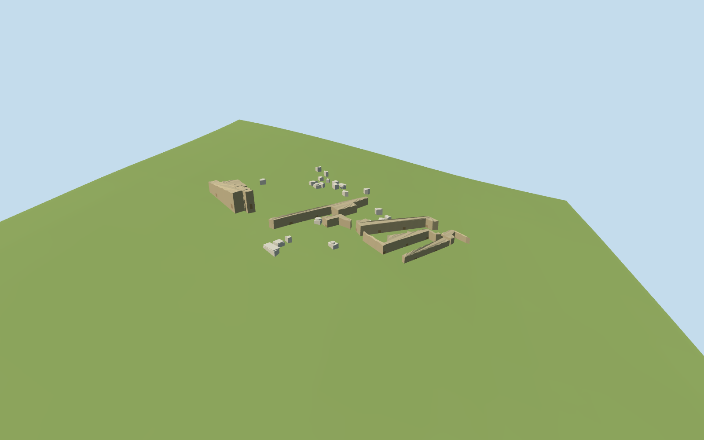

# temple_of_concord — Temple of Concord

Reviewed 2026-10-19. Completed in one continuous authoring/inspection round for the visible exterior and approximate map fit.

## Visible architecture

Inspected current source, shared-material, medium-fi and retained-terrain site renders during this same authoring round. Thirty individually mapped remnants: eight low roofless wall/podium strips and twenty-two separated pale stone/marble fragments, eroded mixed concrete/masonry, a western retaining block with shallow arched/flat-lintel recesses and one grille, and selected simplified moulded slabs/cornice/drum pieces. The first site render exposed a blocked southwest recess view; openings were turned toward the exposed court and their approximate positions adjusted consistently with the ordinary photo. The flat-lintel/grille and open arch are distinguished. Native ground remains visible between remnants; no lost intact temple is invented.

## Shared materials

Four reused 256² graphs: weathered limestone, marble, long-format brick and standing-seam metal. Metric UVs, linear warm rough-core/pale fragment tints, no embedded images or unique atlas. Graphs load once, at most four model draws, separate GPU attribute streams, geometry disposal on eviction. Flat shared/context stages expose buried bases and are not evidence of native grade; the retained-terrain fixture supplies that check.

## Browser levels

| Level | Triangles | Bytes | Draws |
| --- | ---: | ---: | ---: |
| skyline | 640 | 68240 | 1 |
| district | 1084 | 121596 | 3 |
| street | 1588 | 176732 | 4 |
| closeup | 2836 | 315596 | 4 |

Inspected 24 current medium-fi views: noon/late, Economy/High, street/block/skyline, untextured silhouette, three details, four explicit levels and transitions. Levels 640 / 1,084 / 1,588 / 2,836 triangles. Initial geometry is 189,836 bytes. The mapped low strip layout and separated fragments remain at distance; erosion, pale mouldings, actual recess depth and grille resolve nearer. Physical laptop/phone and dense-city timing measurements remain pending.

## Map and terrain

Q828143/relation1767601 identifies the archaeological precinct. Thirty standard PMTiles records lying within its boundary supply eight wall strips/cores and twenty-two isolated fragments; the boundary itself is not extruded. Geometry retains raw east/south coordinates at heading0, with internal map-axis rotation32.14degrees. Two ordinary pictures guide eroded concrete/masonry, shallow gated recesses and pale carved remnants. Recess dimensions/position on the exposed western foundation are approximate visualizations, not surveyed entrance controls. The neighboring three-column Vespasian temple and later buildings are excluded. Reused pinned temple_of_portunus Rome PMTiles/Mapzen grid, sampled at this anchor. The long low remnants follow the native grade, with buried retaining bases. The shallow recesses have closed floors just above the sampled grade and opaque backs; they do not expose an underground interior. Preserve all native ground and water with no cutout. Exact archaeological pavement and hillside retaining levels are not surveyed. All 1,904 independent in-tile buildings remain unchanged, including Tabularium, Vespasian, the church and neighboring Forum structures. Thirty authored map records are replaced to boundary remnants below 1e-7m². Native ground and original Tiber/water geometry remain unchanged. Failed loading restores all 1,934 original records; eviction releases geometry. The source photographs identify the exposed foundation forms; exact gate/recess locations and relative archaeological levels remain approximate.

## Limits

Accepted as a medium-fi present-day exposed ruin exterior and approximate standard-map fit. Exact mapped remnant footprints control the scattered arrangement. Wall heights, erosion, mixed masonry, stone inventory, moulded pieces and shallow arched/flat-lintel recess positions are picture-led visualization estimates. Native ground stays visible in the gaps and across the unbuilt precinct. Recesses have opaque backs and closed floors and do not expose an underground interior. Independent neighboring monuments are procedural context, with some retained occlusion/shadows. No lost roof, colonnade, tall cella, exact carving inventory, reconstructed ancient temple or navigable interior is claimed. The ordinary pictures date from 2018, so exact current vegetation and surface damage are not certified.

## Selected checks

Two registered recipes rebuild the 343,284-byte source master. Six Khronos files: zero errors/warnings. 4,614 actual mesh probes pass. Inspected 48 current views (8 source, 8 shared, 24 medium-fi, 8 site/fallback). Scene validation/sim 30 and strict selected medium-fi audit pass. Full source rebuild, lock refresh and the prior templo_mayor renderer release gates remain at the planned batch milestone near 525 complete.

Rebuild: node packages/worldgen/scripts/generate-additional-landmarks.mjs --ids=temple_of_concord; node packages/worldgen/scripts/import-structure-models.mjs --ids=temple_of_concord; node packages/tooling/scripts/generate-landmark-lods.mjs --ids=temple_of_concord --force.

Source: sha256:acfd8090d015c0605ad7f0162b88b296615895bd6b48504960c120a3fdfd0375

Runtime: sha256:5bb0d3e21224ba8d46940d0c13e2c2a46b8f566ce7eeaedb768a9446fbbb9b3a

Input: sha256:73084f51849fc5453fff7ca9be405f96f95b6c2fca6be01055a6f4c3373282c8

## Ordinary pictures

https://commons.wikimedia.org/wiki/File:Temple_of_Concord_in_Rome_(1).jpg — Tournasol7; 2018-11-13; CC BY-SA4.0; viewed only. Viewed only; no pixels copied.

https://commons.wikimedia.org/wiki/File:Temple_of_Concord_in_Rome_(2).jpg — Tournasol7; 2018-11-13; CC BY-SA4.0; viewed only. Viewed only; no pixels copied.
