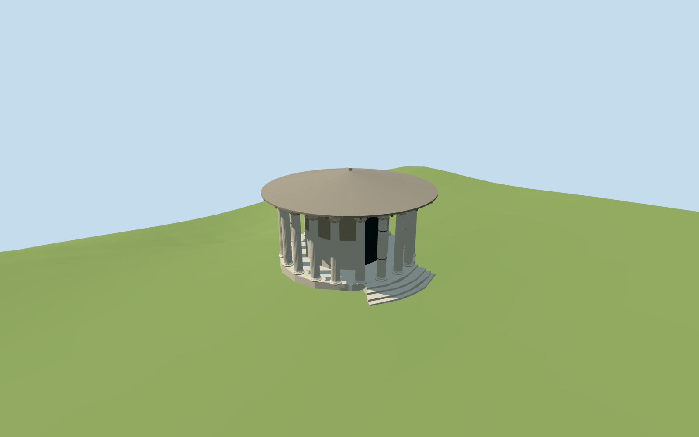

# Temple of Hercules Victor

Temple of Hercules Victor present-day medium-fi exterior: nineteen individually mapped fluted Corinthian shafts and the isolated surviving twentieth base, low circular stepped podium and east entrance steps, round brick/marble cella with a closed recessed arched door, broad shallow tiled conical roof with visible timber underside and small summit cap. Include simplified capital leaf/corner silhouettes and selected protective shaft bands. No lost ancient entablature or original roof is reconstructed. Neighboring Portunus, churches, modern streets and gardens stay independent.

## Evidence and reconstruction

Published dimensions and reconstructed details are separated in spec.json. Primary references:

- [Reference](https://commons.wikimedia.org/wiki/File:L06_725_Tempel_des_Hercules_Victor.jpg)
- [Reference](https://commons.wikimedia.org/wiki/File:Temple_Hercule_(Rome)_-_Chapiteaux.JPG)

Two registered recipes build the mapped circular colonnade, cella and present tiled roof with shared 256² material graphs, metric UVs and linear tints. No embedded images or unique atlas.

## Model and axes

19,764 triangles; 59,292 vertices; 5 material groups; 2,375,120 bytes. Native bounds: -7.946, -4.627, -10.480 to 11.146, 10.476, 7.920. Source hash: `sha256:db356c324a6aba533ddf443839aed5b8558aa65f1374c7483a6c26f411b9ee5c`.

{"x":"east","y":"up","z":"south"}

The geographic proposal uses exact-QID OpenStreetMap evidence. Map-derived orientation and estimated architectural details require real-site visual review; preview eligibility is distinct from geographic/fidelity approval. Map attribution: © OpenStreetMap contributors, ODbL-1.0.

## Reproduce

Run `node packages/worldgen/scripts/generate-additional-landmarks.mjs --ids=temple_of_hercules_victor` (or add `--check`). The generator preserves manually edited masters by checking their baseline hashes. Import through the standard authored-model workflow with optimization disabled; then capture all QA cameras, including shared-surface views.

## Pending work

- Temple of Hercules Victor present-day medium-fi exterior: nineteen individually mapped fluted Corinthian shafts and the isolated surviving twentieth base, low circular stepped podium and east entrance steps, round brick/marble cella with a closed recessed arched door, broad shallow tiled conical roof with visible timber underside and small summit cap. Include simplified capital leaf/corner silhouettes and selected protective shaft bands. No lost ancient entablature or original roof is reconstructed. Neighboring Portunus, churches, modern streets and gardens stay independent.
- Q576929/way251342364 fixes the circular temple. Eleven pinned standard PMTiles records supply the main footprint, podium, nineteen separate standing shaft polygons in one feature, isolated base, C-shaped cella, roof, roof cap and four east stair parts. The open east sector of the mapped cella and stair projection resolve the entrance facing east, independently of the circle bounding-box axis. Raw+X east/+Z south at runtime heading0; each mapped shaft keeps its individual center.
- Standard-map parts give podium0.8m, nineteen shaft tops8m, cella8.5m, roof8–10m and cap10.5m above the lower datum. The model follows this approximate envelope: fluted shaft1.0–7.0m, Corinthian crown7.0–8.0m, timber support8.0–8.25m and shallow roof8.25–10.15m. Ordinary frontal and capital pictures guide the present roof, leaf masses, flute/drum/band treatment, brick upper cella and pale lower panels. Exact carvings, repairs, tie bands, door joinery and surveyed heights are not claimed.
- Reused pinned temple_of_portunus standard Rome PMTiles/Mapzen extract. The lower datum clears the actual standard-grid triangles beneath each mapped entrance tread and podium, using retained footprint intersections. Foundations extend below the minimum local grade. Native ground and water stay unchanged with no cutout. Exact archaeological floor and modern fence/garden levels remain approximate.
- Mapped column centers, cella and entrance treads control placement. Capitals, flute profiles, repairs, tie bands, roof construction and exact levels are simplified. The twentieth shaft is absent and only its surviving base remains; no lost ancient entablature or navigable interior is claimed.

This bundle follows the medium-fi standard. Medium-fi appearance and geographic fit are reviewed separately. Hash-bound visual acceptance is recorded separately after capture inspection.

## Additional geographic data

©OpenStreetMap contributors; Protomaps; Mapzen/USGS terrain.
