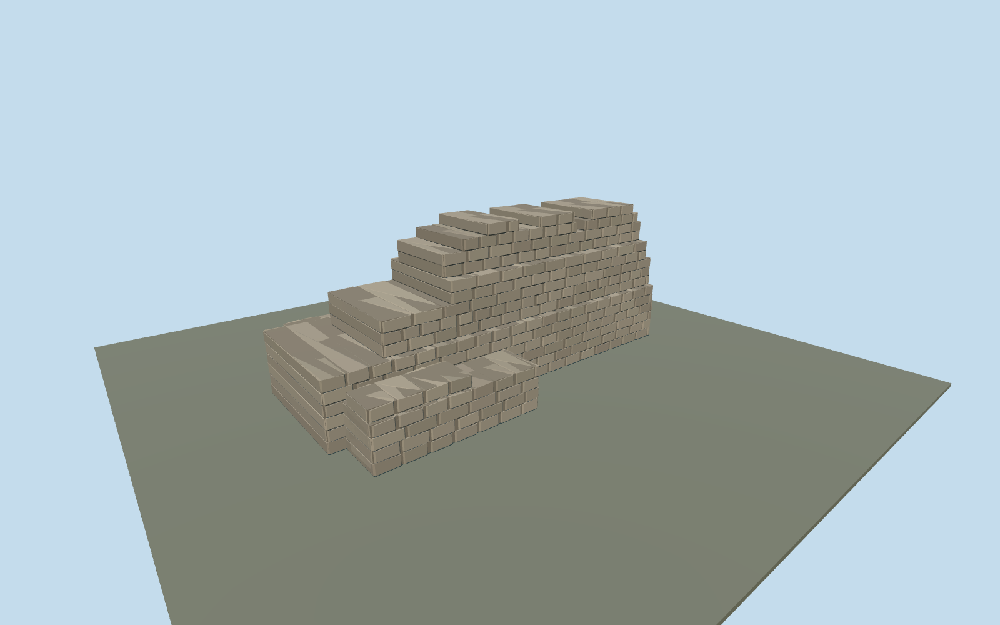

# Temple of Jupiter Optimus Maximus

> Superseded by the gallery review. [Current review](QA-REVIEW.md)

The current source depicts the exposed eastern wall and stepped podium masonry. Darker joints, chipped edges, unequal upper courses and the lower masonry follow the museum photographs. The original sculptural displays and the lost temple above the podium lie outside this model.

The first-floor visitor plan aligns to the four mapped courtyard corners, with individual residuals under 1.1 m. The curved Esedra provides an independent check within 2.2 m. Rooms 17 and 18 supply the approximately 20 m wall trace. The reported floor height remains a provisional offset from the standard terrain. [Placement controls](museum-placement.json)

The source master rebuilds exactly with 9,380 triangles. Six GLBs pass Khronos validation. The skyline and district models total 52,764 bytes and share the raw-stone graph with the other levels.

The first-floor visitor plan shifts the proposed wall into rooms 17–18 and signs its exposed face toward the photographed viewpoint. The host Palazzo dei Conservatori mesh and the foundation both load. All three indoor sightlines hit the modeled seam between the two mapped modern building parts before reaching the tufa wall. The shared room and effective floor levels require integration.

[Foundation photographs](https://www.museicapitolini.org/it/percorsi/percorsi_per_sale/museo_del_palazzo_dei_conservatori/area_del_tempio_di_giove_capitolino/fondazioni_del_tempio_di_giove_capitolino) · [Native review](placement-report.json)
