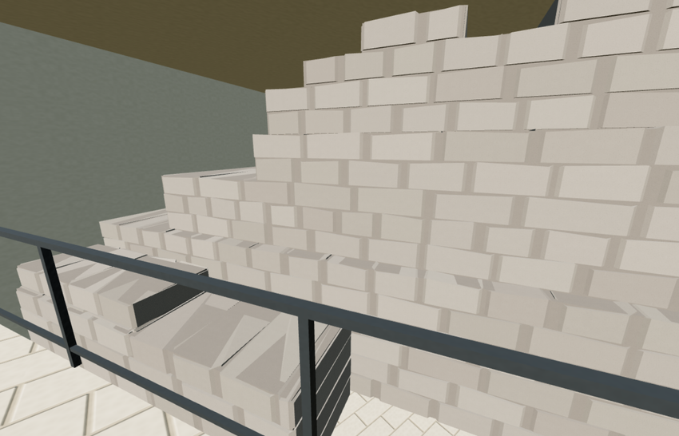

# Temple of Jupiter Optimus Maximus

The surviving eastern foundation and its stepped tufa blocks follow the photographs of the rooms beside the Esedra. The visitor plan and PMTiles establish the signed horizontal position. The guest model and palace share a terrain reference. The display floor and unseen parts of the stonework remain approximate.

The model rebuilds byte for byte. Six GLBs pass Khronos validation. The skyline and district files total 52,764 bytes and use a shared stone material.

All four detail levels passed the three interior sightline checks. The original terrain and native map data recover on unload. The museum stays intact when the masonry fails to load.

[Museum visitor plan](museum-placement.json) · [Native placement review](placement-report.json)
